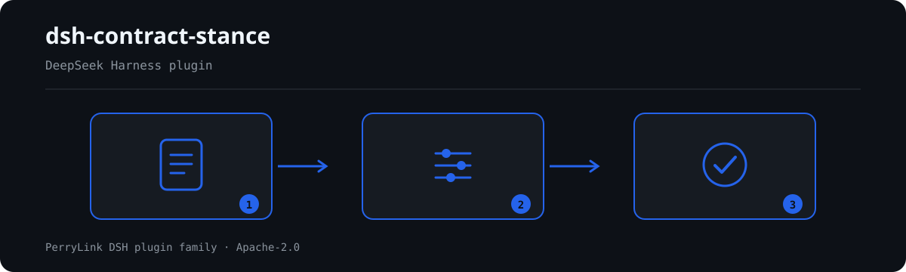

# dsh-contract-stance — 合同条款立场台账核对

[English](README.md) · [简体中文](README-zh.md) · [Español](README-es.md) · [Português](README-pt.md) · [हिन्दी](README-hi.md)

[](https://dsh.market/)

`dsh-contract-stance` 读取一份合同条款立场台账——合同表头加每条条款一行——核对这份台账自身的齐备与自洽：条款是否摘录原文、本方立场是否使用本机构口径的取值、风险等级是否同样在册、必保条款是否同时写明退让底线与责任人、条款号是否唯一、台账是否声明合同与本方主体、条款原文是否残留未替换的占位符。

## Install

```sh
dsh plugin --profile <name> add dsh-contract-stance
dsh --profile <name> --dump-config | grep 'dsh-contract-stance'
```

## 实际输出长什么样



*工作流概览：调用 → 插件 → 结果。下面的示例使用实际命令面。*


本插件对自己 `CS-001` 测试夹具的**真实输出**，不是示意图。规则库不伪造引文：每条发现都会写明所引条款，以及该条 excerpt 是逐字引文还是原则性推论。

## 它回答什么问题

### 示例

下表是示例集：第一行是详细走查，其余行是简短案例。

| 你会问 | 它怎么答 |
|---|---|
| 某行只填了条款主题，条款原文栏是空的，会被报出吗？ | 会。`CS-001` 要求每行都填写 `text` 栏：没有原文，就无法核对立场是针对什么措辞作出的。本条只核对原文栏是否填写，不判断该条款是否应当接受、是否存在法律风险。 |
| 立场栏与风险等级栏都填了，为什么每行都报 `skipped`？ | 因为两份取值清单出厂都是空的。`CS-002` 只接受为本机构配置的清单里的 `stance` 取值，`CS-003` 对 `riskLevel` 同理；未配置清单时两条规则都无法执行，于是各自报告 `skipped`，而不是静默通过。`CS-002` 只核对所填值是否在册，不判断该立场是否恰当；`CS-003` 只核对是否在册，不判断该条款的实际风险有多高。 |
| 某条标了「必保」，但没有写可以让到哪里、由谁决策。 | `CS-004` 读取台账自己的「是否必保」栏：该栏取值为 `是`、`Y`、`yes`、`true`、`必保` 或 `√`（由 `conditionValues` 配置）时，要求 `fallback` 与 `owner` 两栏都填写。它只核对这两栏是否填写，不判断该退让底线是否合理；哪些条款属于必保条款完全取决于本项目，本条不作判定。 |
| 同一个条款号在两行各出现一次，一行对应一个谈判稿版本，算问题吗？ | `CS-005` 会报出重复的条款号，比较时忽略空白字符。条款号重复会让人无法准确指认是哪一条；同一条款在多个谈判稿版本中各有一行是正常情形，请在版本栏加以区分，而不是重复使用条款号。没有任何条文规定条款号不得重复，唯一性只是台账可指认性的需要。 |
| 表头没有写明这是哪份合同、本方是哪个主体。 | `CS-006` 要求材料顶层写明 `contractName`（合同名称）与 `party`（本方名称）：不写明这两项，立场就无法追溯到具体的交易与主体。若本机构表式另有版本栏，把该栏加进本条的 `fields` 即可。本条只核对表头是否声明了这两项。 |
| 条款原文是从示范文本直接抄来的，里面还留着【】或 TBD。 | `CS-007` 会报出 `text` 栏仍含占位符术语的行，术语清单为 `【`、`】`、`{{`、`}}`、`XXX`、`xxx`、`待填`、`待补充`、`TBD`、`todo`、`示例`，可按本机构模板调整。参照示范文本订立合同是允许的，但照抄模板留下的占位符会让人误以为已经审阅了实际条款。本条只核对原文栏是否残留这些术语，不判断条款本身。 |

## 依据的标准

| 文件 | 文号 | 引用它的规则 |
|---|---|---|
| 《中华人民共和国民法典》 | 现行版本与条号本次未核实 | CS-001, CS-002, CS-003, CS-004, CS-005, CS-006, CS-007 |

**边界（中文译文，以英文原文为准）：** 本插件核对一份**合同条款立场台账**，范围限于登记表可以据以要求的事项——每一条款的原文是否记录，你的立场是否取自你配置的取值口径，风险等级是否同样取自该口径，必保条款是否同时记录可以让步到的底线与责任人，条款号是否唯一，台账是否写明合同与本方，以及是否残留占位符。它**不**判定某条款是否应当接受、某项风险是否可承受、是否应当签署，也不判定谈判策略是否妥当。**这些取决于交易本身、对方的议价能力与你自己的风险偏好。**

> ### ⚠️ 引文依据什么——以及一件绝不能交给本插件的东西（以英文原文为准）
>
> **《中华人民共和国民法典》已取得并逐字阅读**，`rules/evidence/clause-verification.md` 记录了所引
> 内容：第465条（依法成立的合同受法律保护）、第470条（合同内容**一般包括**当事人、标的、数量、
> 质量、价款、履行条款与违约责任）、第509条、第577条（违约的后果）与第584条（损害赔偿包括预期
> 利润，但以**可预见性**为限）。
>
> **合同部分并不规范谈判台账。** 它规范合同的成立、效力、履行与责任；台账的列来自你自己的企业
> 合同管理制度。因此 `excerpt` 字段仍写着“本次未取得”，每条规则也仍为 `warn` 或 `info`：
> **“这一栏是空的”不得被读作“这违反了《民法典》。** 另请注意，第470条写的是**一般包括**，
> 而不是应当包括——这也是 `CS-001` 不主张直接义务的又一理由。
>
> ⚠️ **不要向本插件添加诉讼时效规则。** 《民法典》*确实*规定了具体数字——第188条规定三年诉讼
> 时效（最长二十年），第203条规定期间的最后一日为法定休假日的，顺延至休假日结束的次日——这让
> “直接比较日期”看起来很有吸引力。但在这里行不通：该期间从**债权人知道或者应当知道**损害与
> 债务人之日起算，而这是台账并不记录的事实认定；该期间还适用中止（第194条）与中断（第195条），
> 第196条则列出根本不适用诉讼时效的请求权。日期算术规则会把事实认定包装成计算，而这恰恰是本
> 插件族要避免的过度主张。
>
> **本插件任何地方都不对条款的实质作出判断。** 它读取你自己的列，只核对这些列是否填写、是否
> 取自你的词汇表。有两份词汇表出厂为**空**——立场清单（`CS-002`）与风险等级（`CS-003`）——因此
> 在未配置任何内容时，这些规则会在 `skipped` 中自行报告，而不是静默通过。

## Compatibility

| 项目 | 状态 |
|---|---|
| Harness | 对等版本范围 `>=0.1.2-rc.1 <0.2.0 \|\| >=0.2.0-0 <0.3.0` —— 已实测同时接受 `0.2.0-rc.2` 与 `0.2.1-rc.2`。**已声明 `engines.dsh`**：0.2.1 起由宿主单独裁决，范围为 `>=0.2.1-0 <0.3.0` |
| Node | `^22.19.0 || >=24.0.0` |
| 平台 | 全平台（纯 ESM；无原生代码、无联网、不调用模型） |
| 工具模式 | `native` / `ptc` 均可；批量校验整个目录时建议 `ptc`，schema 成本只付一次 |

## What it does

规则表、字段说明与行为细节见 [README.md](README.md#what-it-does)（英文主版本）。本插件只列出材料与所引条款之间的字面差异，并对无法执行的检查在 `skipped` 中逐项说明。

## Configuration

全部可调参数都在 `src/config.ts` 的 Schemastery schema 中，只改 `cordis.yml` 即可生效，无需改代码；逐条阈值在 `rules/` 下的规则库文件里。

| 键 | 类型 | 默认值 | 说明 |
|---|---|---|---|
| `rulesFile` | string | `rules/contract-stance.yaml` | 规则库文件路径，相对插件包根目录 |
| `disabledRules` | string[] | `[]` | 要停用的规则 id 列表；每条都会出现在 `skipped` 中 |
| `onlyRules` | string[] | `[]` | 只执行这些规则 id；留空表示执行全部规则 |
| `skipNotes` | string | `""` | 附加到每条 `skipped` 说明后的备注 |
| `timeoutMs` | number | `120000` | 工具协作式超时预算（毫秒） |

## Material format

支持 JSON 与 YAML。完整字段示例见 [README.md](README.md#material-format)（英文主版本）。字段在读取层是可选的，由检查引擎校验，因此部分导出的材料会产生"缺项"类差异，而不是让程序崩溃。

## Rule sources

规则数据与代码分离，每条规则都带文件名、文号、按原文自身编号体系的条款号、逐字摘录与来源地址。加载期强制：摘录必须是真实引文且不少于八个字符；依据仅为原则性条款（`kind: derived-from-principle`，严重级上限 `warn`）或本机构配置（`kind: institutional-configuration`，上限 `info`）的检查不得标为 `error`。夸大依据的规则库会在加载期失败，而不会产出一份看起来很有底气的报告。

核验中确认的边界与"刻意没有作出的结论"见 [README.md](README.md#rule-sources)（英文主版本）与随包的 `rules/evidence/` 目录。

## Troubleshooting

- **插件装上了但工具不出现**：确认 `main` 指向 `lib/index.mjs` 且 `pnpm run build` 已生成该文件；`main` 写错会让加载器静默跳过该条目。
- **`dsh plugin add` 报版本不兼容**：peer 范围覆盖 `0.1.x` 与 `0.2.x`；若运行时在其之外，可显式豁免：`dsh plugin --profile <name> allow-version <包名@版本> --dsh-version <runtime> --accept-risk`
- **某条规则没有执行**：查看 `skipped` 数组，其中写明了规则 id 与原因。
- **`check` 报 `manifest-peers` 失败**：静态检查器比对的是一份早于 0.2 世代的硬编码 peer 范围；安装期的 peer 校验以运行时为准。这是 `dsh-plugin-dev` 的已知上游问题。
- **时间看起来偏移**：全部计算都是对输入字符串做墙上时钟运算，不做时区换算。

## Development

```sh
pnpm install
pnpm run typecheck
pnpm test
pnpm run build
node ../scripts/sync-shared.mjs dsh-contract-stance
```

第 4 项把 `../_shared` 的共享件同步进 `src/shared/`；每次改动共享件后都要重跑。

## PerryLink DSH Plugin Family

本项目是 [PerryLink](https://github.com/PerryLink) 维护的 DeepSeek Harness 插件家族成员。完整名单默认折叠，避免每个 README 的首屏被长表淹没；点击展开可查看每一行及其状态。

<details>
<summary>展开全部插件</summary>

| 插件 | 状态 |
|---|---|
| **[dsh-aqua-input-check](https://github.com/PerryLink/dsh-aqua-input-check)** |  |
| **[dsh-archive-check](https://github.com/PerryLink/dsh-archive-check)** |  |
| **[dsh-auto-review](https://github.com/PerryLink/dsh-auto-review)** |  |
| **[dsh-autotier](https://github.com/PerryLink/dsh-autotier)** |  |
| **[dsh-bid-ca-precheck](https://github.com/PerryLink/dsh-bid-ca-precheck)** |  |
| **[dsh-bid-qual-check](https://github.com/PerryLink/dsh-bid-qual-check)** |  |
| **[dsh-cert-mcp](https://github.com/PerryLink/dsh-cert-mcp)** |  |
| **[dsh-checkpoint-rewind](https://github.com/PerryLink/dsh-checkpoint-rewind)** |  |
| **[dsh-click](https://github.com/PerryLink/dsh-click)** |  |
| **[dsh-composer-history](https://github.com/PerryLink/dsh-composer-history)** |  |
| **[dsh-contract-stance](https://github.com/PerryLink/dsh-contract-stance)** |  |
| **[dsh-customs-doc-check](https://github.com/PerryLink/dsh-customs-doc-check)** |  |
| **[dsh-data-quality](https://github.com/PerryLink/dsh-data-quality)** |  |
| **[dsh-demurrage-ledger](https://github.com/PerryLink/dsh-demurrage-ledger)** |  |
| **[dsh-doublecheck](https://github.com/PerryLink/dsh-doublecheck)** |  |
| **[dsh-drill-script-check](https://github.com/PerryLink/dsh-drill-script-check)** |  |
| **[dsh-eia-guide-check](https://github.com/PerryLink/dsh-eia-guide-check)** |  |
| **[dsh-emergency-plan](https://github.com/PerryLink/dsh-emergency-plan)** |  |
| **[dsh-essay-rubric-check](https://github.com/PerryLink/dsh-essay-rubric-check)** |  |
| **[dsh-evidence-check](https://github.com/PerryLink/dsh-evidence-check)** |  |
| **[dsh-export-ctl-check](https://github.com/PerryLink/dsh-export-ctl-check)** |  |
| **[dsh-fast](https://github.com/PerryLink/dsh-fast)** |  |
| **[dsh-fmea-table-check](https://github.com/PerryLink/dsh-fmea-table-check)** |  |
| **[dsh-forecast-penalty](https://github.com/PerryLink/dsh-forecast-penalty)** |  |
| **[dsh-fund-research](https://github.com/PerryLink/dsh-fund-research)** |  |
| **[dsh-github](https://github.com/PerryLink/dsh-github)** |  |
| **[dsh-gongwen-flow-check](https://github.com/PerryLink/dsh-gongwen-flow-check)** |  |
| **[dsh-gongwen-word-check](https://github.com/PerryLink/dsh-gongwen-word-check)** |  |
| **[dsh-guard-plan-qc](https://github.com/PerryLink/dsh-guard-plan-qc)** |  |
| **[dsh-hazchem-check](https://github.com/PerryLink/dsh-hazchem-check)** |  |
| **[dsh-hazplan-check](https://github.com/PerryLink/dsh-hazplan-check)** |  |
| **[dsh-hidden-risk-map](https://github.com/PerryLink/dsh-hidden-risk-map)** |  |
| **[dsh-hs-classify](https://github.com/PerryLink/dsh-hs-classify)** |  |
| **[dsh-icd-rule-check](https://github.com/PerryLink/dsh-icd-rule-check)** |  |
| **[dsh-industry-research](https://github.com/PerryLink/dsh-industry-research)** |  |
| **[dsh-lawcite-adapter](https://github.com/PerryLink/dsh-lawcite-adapter)** |  |
| **[dsh-laya](https://github.com/PerryLink/dsh-laya)** |  |
| **[dsh-lc-doc-check](https://github.com/PerryLink/dsh-lc-doc-check)** |  |
| **[dsh-learning-gap-check](https://github.com/PerryLink/dsh-learning-gap-check)** |  |
| **[dsh-library](https://github.com/PerryLink/dsh-library)** |  |
| **[dsh-local-ai](https://github.com/PerryLink/dsh-local-ai)** |  |
| **[dsh-lsp-actions](https://github.com/PerryLink/dsh-lsp-actions)** |  |
| **[dsh-mask](https://github.com/PerryLink/dsh-mask)** |  |
| **[dsh-mcp-panel](https://github.com/PerryLink/dsh-mcp-panel)** |  |
| **[dsh-medrec-qc](https://github.com/PerryLink/dsh-medrec-qc)** |  |
| **[dsh-memento](https://github.com/PerryLink/dsh-memento)** |  |
| **[dsh-nsfc-form-check](https://github.com/PerryLink/dsh-nsfc-form-check)** |  |
| **[dsh-nurse-record-check](https://github.com/PerryLink/dsh-nurse-record-check)** |  |
| **[dsh-observe](https://github.com/PerryLink/dsh-observe)** |  |
| **[dsh-origin-rvc-check](https://github.com/PerryLink/dsh-origin-rvc-check)** |  |
| **[dsh-ota-review-check](https://github.com/PerryLink/dsh-ota-review-check)** |  |
| **[dsh-output-styles](https://github.com/PerryLink/dsh-output-styles)** |  |
| **[dsh-paper-doc-adapter](https://github.com/PerryLink/dsh-paper-doc-adapter)** |  |
| **[dsh-permission-rules](https://github.com/PerryLink/dsh-permission-rules)** |  |
| **[dsh-permit-report-check](https://github.com/PerryLink/dsh-permit-report-check)** |  |
| **[dsh-pipeline-check](https://github.com/PerryLink/dsh-pipeline-check)** |  |
| **[dsh-pleading-draft](https://github.com/PerryLink/dsh-pleading-draft)** |  |
| **[dsh-plugin-doctor](https://github.com/PerryLink/dsh-plugin-doctor)** |  |
| **[dsh-plugin-guide](https://github.com/PerryLink/dsh-plugin-guide)** |  |
| **[dsh-plugin-kit](https://github.com/PerryLink/dsh-plugin-kit)** |  |
| **[dsh-plugin-upgrade](https://github.com/PerryLink/dsh-plugin-upgrade)** |  |
| **[dsh-policy-brief-draft](https://github.com/PerryLink/dsh-policy-brief-draft)** |  |
| **[dsh-power-loss-split](https://github.com/PerryLink/dsh-power-loss-split)** |  |
| **[dsh-power-ticket-check](https://github.com/PerryLink/dsh-power-ticket-check)** |  |
| **[dsh-ppap-check](https://github.com/PerryLink/dsh-ppap-check)** |  |
| **[dsh-protest-deadline](https://github.com/PerryLink/dsh-protest-deadline)** |  |
| **[dsh-railway-window](https://github.com/PerryLink/dsh-railway-window)** |  |
| **[dsh-repair-order-qc](https://github.com/PerryLink/dsh-repair-order-qc)** |  |
| **[dsh-research-report](https://github.com/PerryLink/dsh-research-report)** |  |
| **[dsh-review-reply-check](https://github.com/PerryLink/dsh-review-reply-check)** |  |
| **[dsh-rulefile-check](https://github.com/PerryLink/dsh-rulefile-check)** |  |
| **[dsh-safety-brief-check](https://github.com/PerryLink/dsh-safety-brief-check)** |  |
| **[dsh-score](https://github.com/PerryLink/dsh-score)** |  |
| **[dsh-session-sync](https://github.com/PerryLink/dsh-session-sync)** |  |
| **[dsh-site-log-check](https://github.com/PerryLink/dsh-site-log-check)** |  |
| **[dsh-skill-pack-security](https://github.com/PerryLink/dsh-skill-pack-security)** |  |
| **[dsh-soe-decision-check](https://github.com/PerryLink/dsh-soe-decision-check)** |  |
| **[dsh-soilwater-check](https://github.com/PerryLink/dsh-soilwater-check)** |  |
| **[dsh-sop-sync-check](https://github.com/PerryLink/dsh-sop-sync-check)** |  |
| **[dsh-spc-gbt-adapter](https://github.com/PerryLink/dsh-spc-gbt-adapter)** |  |
| **[dsh-talk](https://github.com/PerryLink/dsh-talk)** |  |
| **[dsh-tender-extract](https://github.com/PerryLink/dsh-tender-extract)** |  |
| **[dsh-tender-matrix](https://github.com/PerryLink/dsh-tender-matrix)** |  |
| **[dsh-test-drive](https://github.com/PerryLink/dsh-test-drive)** |  |
| **[dsh-ticktick](https://github.com/PerryLink/dsh-ticktick)** |  |
| **[dsh-translate](https://github.com/PerryLink/dsh-translate)** |  |
| **[dsh-warranty-calc](https://github.com/PerryLink/dsh-warranty-calc)** |  |
| **[dsh-budget](https://github.com/PerryLink/dsh-budget)** | 🧊 已冻结 — 见仓库 README |
| **[dsh-claude-move](https://github.com/PerryLink/dsh-claude-move)** | 🧊 已冻结 — 见仓库 README |
| **[dsh-defend](https://github.com/PerryLink/dsh-defend)** | 🧊 已冻结 — 见仓库 README |
| **[dsh-draw](https://github.com/PerryLink/dsh-draw)** | 🧊 已冻结 — 见仓库 README |
| **[dsh-reach](https://github.com/PerryLink/dsh-reach)** | 🧊 已冻结 — 见仓库 README |
| **[dsh-background-agents](https://github.com/PerryLink/dsh-background-agents)** | 🚫 已退役 — 见仓库 README |
| **[dsh-session-pin](https://github.com/PerryLink/dsh-session-pin)** | 🚫 已退役 — 见仓库 README |
| **[dsh-team-rooms](https://github.com/PerryLink/dsh-team-rooms)** | 🚫 已退役 — 见仓库 README |

</details>

## License

[Apache License 2.0](LICENSE) © 2026 dsh-contract-stance contributors.
