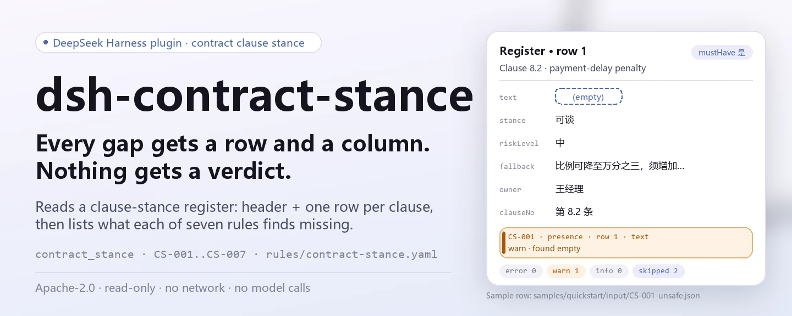
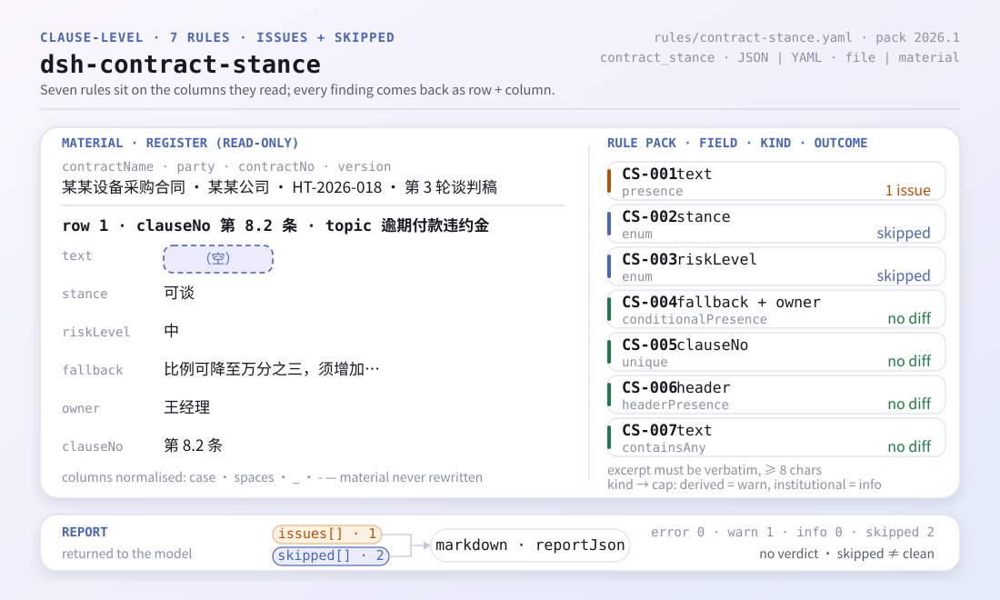
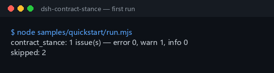

<div align="center">

<picture>
  <source media="(prefers-color-scheme: dark)" srcset="docs/assets/dsh-contract-stance-hero-en-dark.webp">
  
</picture>

# dsh-contract-stance

**Turn the gaps and contradictions in a contract clause-stance register into a line-by-line fix list before negotiation.**

A host-side checker for in-house counsel and contract managers: it reads a stance register (contract header plus one row per clause) and lists what is missing and where, guided by a rule pack whose citations are quoted verbatim — it never edits the material and never pronounces on compliance.

[Install](#three-step-setup) · [Configuration](#configuration) · [FAQ](#faq) · [简体中文](README.md) · [English](README.en.md) · [Español](README.es.md) · [Português](README.pt.md) · [हिन्दी](README.hi.md)

[](LICENSE)
[](#compatibility)
[](https://www.npmjs.com/package/dsh-contract-stance)
[](https://github.com/PerryLink/dsh-contract-stance/actions/workflows/ci.yml)
[](#compatibility)

[](https://github.com/PerryLink/dsh-contract-stance/stargazers)
[](https://www.npmjs.com/package/dsh-contract-stance)
[](https://dshfind.com/en/plugins/PerryLink/dsh-contract-stance?ref=badge)
[](https://securityscorecards.dev/viewer/?uri=github.com/PerryLink/dsh-contract-stance)
[](https://dsh.market/)
[](https://gitee.com/perrylink/dsh-contract-stance)

```sh
dsh plugin --profile <name> add dsh-contract-stance
```

</div>

<sub>Community plugin, not affiliated with DeepSeek. Canonical repository: <https://github.com/PerryLink/dsh-contract-stance> (Gitee is a mirror).</sub>

## What it is

`dsh-contract-stance` reads one **contract clause-stance register** — the contract header plus one row per clause — and checks that register's own completeness and self-consistency: that each clause's text is recorded, that your stance comes from your own vocabulary, that the risk grade does too, that a must-have clause records both a fallback position and an owner, that clause numbers are unique, that the register names the contract and your side, and that no unreplaced placeholder survives in the clause text. It returns a line-by-line difference list; the material is read-only and stays as given.

The plugin registers a single tool, `contract_stance`. Material is JSON or YAML, passed as either `file` or `material`.

<picture>
  <source media="(prefers-color-scheme: dark)" srcset="docs/assets/dsh-contract-stance-flow-v5-dark.svg">
  
</picture>

## Three-step setup

1. **Install** (npm `0.2.11` is published):

   ```sh
   dsh plugin --profile <name> add dsh-contract-stance
   dsh --profile <name> --dump-config | grep 'dsh-contract-stance'
   ```

2. **Run the bundled sample inside this repository** (build the host artifacts first):

   ```sh
   pnpm install && pnpm run build
   node samples/quickstart/run.mjs
   ```

   ```text
   $ node samples/quickstart/run.mjs
   contract_stance: 1 issue(s) — error 0, warn 1, info 0
   skipped: 2
   ```

   The sample input is `samples/quickstart/input/CS-001-unsafe.json`, the expected summary is `samples/quickstart/expected/result.json`, and the same output is captured in `docs/assets/quickstart.log`.

3. **Call the tool in a session**:

   ```text
   Use contract_stance on samples/quickstart/input/CS-001-unsafe.json
   ```

   Inline material also works: `{"material": "contractName: …\nrows:\n  - …"}`. The result carries `summary`, `issueCount`, `skippedCount`, `markdown`, and `reportJson`.



**Uninstall**: `dsh plugin --profile <name> remove dsh-contract-stance` (or remove the row from the profile patch).

## Core capabilities

- **One tool, two material inputs** — `contract_stance` accepts `file` (absolute path to JSON/YAML) or `material` (inline text); when both are empty it fails loudly instead of guessing.
- **Seven rules, all declared as data** — `CS-001` through `CS-007` cover clause text, stance vocabulary, risk-grade vocabulary, the fallback and owner of a must-have clause, clause-number uniqueness, header declarations, and leftover placeholders. Replacing `rules/contract-stance.yaml` switches the rule set without touching code.
- **An empty list never passes silently** — the stance list (`CS-002`) and the risk-grade list (`CS-003`) ship empty; while unconfigured, each rule reports itself in `skipped` with a reason instead of being read as "no differences".
- **Differences only, no verdicts** — the shared rendering layer carries a wording guard (`src/shared/wording.ts`, `src/shared/render.ts`) and every report ends with a fixed disclaimer; the test suite applies the same check to the model-visible text. It does not decide compliance, liability, or whether to sign.
- **Read-only** — it does not modify the input file, write any file, make network requests, or call a model.
- **Registration is an effect** — `ctx.tools.register` returns the disposer that removes the tool when the plugin stops or hot-reloads.

| Rule | What it checks | Severity | Basis kind |
|---|---|---|---|
| `CS-001` | every clause's text is recorded | warn | derived from principle |
| `CS-002` | the stance comes from your configured vocabulary (off by default) | info | derived from principle |
| `CS-003` | the risk grade comes from your configured vocabulary (off by default) | info | direct |
| `CS-004` | a must-have clause records both a fallback and an owner | warn | direct |
| `CS-005` | clause numbers are unique within the register (whitespace ignored) | warn | derived from principle |
| `CS-006` | the header names the contract and your side | warn | direct |
| `CS-007` | the clause text holds no unreplaced placeholder | warn | derived from principle |

### Output shape

The tool returns `summary` (counts for `error`/`warn`/`info`), `issueCount`, `skippedCount`, `markdown` (the rendering the model reads), and `reportJson` (the canonical JSON of the full report). Each issue in `reportJson` carries a stable `id` (`<plugin>.<rule>.<locator hash>`), a `locator` (row/column), `found`, `expected`, `basis`, and an optional `fix`.

### Examples

This is the real issue structure from the fixture (`reportJson.issues[0]`, excerpt). Input:

~~~json
{"rows":[{"条款号":"第 8.2 条","条款主题":"逾期付款违约金","条款原文":"", ...}]}
~~~

Output:

~~~json
{
  "id": "dsh-contract-stance.CS-001.de09b5a6",
  "ruleId": "CS-001",
  "severity": "warn",
  "locator": {
    "row": 1,
    "field": "text"
  },
  "found": "第 1 行「text」为空",
  "expected": "「text」应填写",
  "fix": "补填条款原文；本条只核对是否摘录，不判断条款是否可接受"
}
~~~

*Observed from `tests/fixtures/CS-001/CS-001-unsafe.json`, `tests/fixtures/CS-001/cases.json`, `rules/contract-stance.yaml`, `tests/index.test.ts`.*

## Rules & basis

| Document | Number | Cited by rules |
|---|---|---|
| Civil Code of the People's Republic of China | current version and article numbers not verified in this pass | CS-001, CS-002, CS-003, CS-004, CS-005, CS-006, CS-007 |

**Boundary:** this plugin checks a **contract clause-stance register** for what a register can be held to — that each clause's text is recorded, that your stance comes from your vocabulary, that the risk grade does too, that a must-have clause records both a fallback position and an owner, that clause numbers are unique, that the register names the contract and your side, and that no placeholder survives. It does **not** decide whether a clause should be accepted, whether a risk is bearable, whether to sign, or whether a negotiating strategy is sound. **Those depend on the deal, the counterparty's leverage and your own risk appetite.**

> ### ⚠️ What the citation rests on — and one thing this plugin must never be given
>
> **The Civil Code of the People's Republic of China was obtained and read verbatim**, and `rules/evidence/clause-verification.md` records what was quoted: article 465 (a contract lawfully formed is protected by law and binds only the parties), article 470 (contract content **generally includes** the parties, subject matter, quantity, quality, price, performance terms, liability for breach and dispute resolution), article 496 (the duty to highlight and explain standard terms), article 497 (when standard terms are void), article 506 (when exemption clauses are void), article 509, article 577 (the consequences of breach) and article 584 (damages include expected profits but are capped by **foreseeability**). The pack's `excerpt` fields are verbatim quotations, while `basis.number` still says "current version and article numbers not verified in this pass" — the supplementary provisions and effective date were not obtained, so no claim is made about the version or the effective date.
>
> **The contract part does not regulate a negotiation register.** It governs formation, validity, performance and liability; the register's columns come from your enterprise's own contract management rules. Every rule therefore stays capped at `warn` or `info`: **"this column is blank" must not be read as "this breaches the Civil Code".** Note also that article 470 says **generally includes**, not shall include — one more reason `CS-001` does not claim a direct obligation.
>
> ⚠️ **Do not add a limitation-period rule to this plugin.** The Code *does* fix numbers — article 188 sets a three-year limitation (twenty years at the outside) and article 203 rolls a period forward off a public holiday — which makes "just compare the dates" look tempting. It is not workable here: the period runs from **when the creditor knew or ought to have known** of the harm and the debtor, a finding of fact the register does not record; the period is also subject to suspension (article 194) and interruption (article 195), and article 196 lists claims the limitation does not apply to at all. A date-arithmetic rule would dress a factual finding up as a calculation, which is precisely the over-claim this family avoids.
>
> **No judgement about the substance of a clause is made anywhere in this plugin.** It reads your own columns and checks only that they are filled and drawn from your vocabulary. Two vocabularies ship **empty** — the stance list (`CS-002`) and the risk grades (`CS-003`) — so with nothing configured those rules report themselves in `skipped` rather than passing quietly.

### Rule sources

Rule data is separate from code: every rule carries a document, a number, a clause number in the source's own numbering, a verbatim excerpt and a source URL. The loader enforces that an excerpt is a real quotation of at least eight characters, and that a check based only on a principle (`kind: derived-from-principle`, capped at `warn`) or on local configuration (`kind: institutional-configuration`, capped at `info`) is never labelled `error`. A rule pack that overstates its basis fails at load time instead of producing a confident-looking report.

The boundaries confirmed during verification and the conclusions deliberately **not** drawn are recorded under `rules/evidence/`; `pnpm run check:citations` re-checks that discipline in CI.

## Configuration

All tunables live in the Schemastery schema in `src/config.ts`, so they can be changed from `cordis.yml` without touching code; per-rule thresholds and vocabularies live in `rules/contract-stance.yaml`.

| Key | Type | Default | Meaning |
|---|---|---|---|
| `rulesFile` | string | `rules/contract-stance.yaml` | Rule-pack path, relative to the package root |
| `disabledRules` | string[] | `[]` | Rule ids to stop running; each appears in `skipped` |
| `onlyRules` | string[] | `[]` | Run only these rule ids; empty runs every rule |
| `skipNotes` | string | `""` | Note appended to every `skipped` reason |
| `timeoutMs` | number | `120000` | Cooperative tool timeout budget |

Rule-level parameters (declared in the rule pack, not in Config):

- `CS-002` `values` — your stance vocabulary, e.g. `[hold, negotiable, accept, delete]`; empty means no check.
- `CS-003` `values` — your risk grades, e.g. `[high, medium, low]`; empty means no check.
- `CS-004` `conditionValues` — the values in your must-have column that mark a clause must-have.
- `CS-007` `terms` — the placeholder terms to look for.

The shipped defaults for those two lists are data in the rule pack:

```text
CS-004 conditionValues: 是 | Y | yes | true | 必保 | √
CS-007 terms: 【 | 】 | {{ | }} | XXX | xxx | 待填 | 待补充 | TBD | todo | 示例
```

Example override in your profile patch:

```yaml
- insert:
    - id: dsh-contract-stance
      name: dsh-contract-stance
      config:
        onlyRules: [CS-001, CS-004, CS-006]
        skipNotes: Local contract-management rules, 2026 edition
```

## Material format

JSON and YAML are both accepted. The minimal shape is a header plus one row per clause:

```yaml
contractNo: HT-2026-018
contractName: Example equipment purchase contract
party: Example buyer Ltd.
version: Negotiation round 3
rows:
  - { 条款号: 第 8.2 条, 条款主题: 逾期付款违约金,
      条款原文: 买方逾期付款的，每逾期一日按未付金额的万分之五向卖方支付违约金。,
      本方立场: 可谈, 风险等级: 中, 风险说明: 违约金比例高于本方惯例且未设上限,
      退让底线: 比例可降至万分之三，须增加总额不超过合同额 5% 的上限,
      是否必保: 是, 谈判责任人: 王经理 }
```

Column names are matched case-insensitively and ignore spaces, underscores and hyphens; the register's own column names are kept in the `locator`, so a finding can be traced back to the original material. The header fields `contractName` and `party` are what `CS-006` checks; `version` is available to distinguish negotiation rounds. The material is read-only — the plugin never rewrites the input file.

## FAQ

<details>
<summary>A row carries a topic, but the clause-text column is blank. Is that reported?</summary>

Yes. `CS-001` requires the `text` column on every row: without the wording, a stance cannot be checked against what it is a stance on. The rule checks only that the wording is recorded — it does not judge whether the clause should be accepted or whether it carries legal risk.

</details>

<details>
<summary>The stance and the risk grade are both filled in, yet every row comes back as `skipped`. Why?</summary>

Both value lists ship empty. `CS-002` accepts a stance only from the list configured for it, and `CS-003` does the same for the risk grade; with no list configured neither rule can run, so each reports itself in `skipped` rather than passing quietly. `CS-002` checks only that the value is on your list, not that the stance is appropriate; `CS-003` checks only that the grade is on your list, not how high the actual risk of that clause is.

</details>

<details>
<summary>A clause is marked must-have, but nobody wrote how far we can concede or who decides.</summary>

`CS-004` reads the register's own must-have column: for a row marked must-have (the values set by `conditionValues`) it requires both the `fallback` and `owner` columns to be filled. It checks only that those two are filled, not whether the fallback is reasonable; which clauses count as must-have depends entirely on the project, and the rule never decides that.

</details>

<details>
<summary>The same clause number appears on two rows, one per negotiating draft. Is that a finding?</summary>

`CS-005` reports a repeated clause number, comparing with whitespace ignored. A repeated number makes it impossible to point at one clause precisely. One clause appearing once per draft is a normal shape: distinguish it in the version column instead of reusing the number. No clause requires clause numbers to be unique — uniqueness is what makes the register referable.

</details>

<details>
<summary>The header does not say which contract this is, nor which side we are.</summary>

`CS-006` requires the material's header to state `contractName` and `party`: without those two, a stance cannot be traced to a specific transaction and party. If your form carries a version column for negotiating drafts, add it to that rule's `fields`. The rule only checks that the header declares those two; it does not judge the contract itself.

</details>

## Security boundaries

- **Read-only, no writes.** The tool reads the material behind `file` or the inline `material` text; it does not modify the original, create files, or cache material. `package.json`'s `dsh.demo` declares `network: false` and `writes: []`, and the implementation contains no network or model call.
- **No verdicts.** The report lists only literal differences between the material and the cited basis; every report ends with a fixed disclaimer, the shared renderer runs a wording guard before emitting output (`src/shared/render.ts`), and the test suite applies the same check to the model-visible `markdown`. The professional judgement stays with the reviewer.
- **Citation discipline is a hard gate.** At load time the rule pack verifies that `excerpt` is a real quotation of at least eight characters, and that `kind` caps severity (`derived-from-principle` at `warn`, `institutional-configuration` at `info`); a pack that overstates its basis fails to load.
- **An empty result is not proof of correctness.** Any check that could not run — because its vocabulary is unset, it is disabled, or only some rules were selected — is listed in `skipped` with its reason. "No differences" holds only when every declared rule actually ran.
- **Registration is an effect.** Tool registration returns a disposer; stopping or hot-reloading the plugin removes it. The plugin registers no command, client slot, HTTP route, or shared event listener.
- **Permissions and data.** The manifest declares only `tools:register`; it reads the user-supplied material file and writes nothing, sends nothing over the network, and stores no credentials. Material reaches only the report of that tool call — nothing is persisted plugin-side.

## Known limitations

- **The register, not the contract.** A clause copied wrongly, omitted, or inconsistent with the contract text cannot be detected: the working object is the register itself, not the contract file.
- **The stance and risk-grade lists ship empty.** `CS-002` and `CS-003` use your institution's vocabulary by design; the plugin refuses to guess, and reports `skipped` until configured.
- **The Civil Code does not regulate register format.** The contract part governs formation, validity, performance and liability; "a column is blank" and "this breaches the Civil Code" are different statements, which is why every rule is capped at `warn` or `info`.
- **No limitation-period check, and none should be added.** The period starts from a finding of fact ("knew or ought to have known") that the register does not record, and suspension, interruption and excluded claims cannot be judged from a register (see "Rules & basis").
- **Uniqueness exists for referability.** One clause per negotiation draft is normal and should be distinguished in the version column; `CS-005` only reports duplicates, not whether a duplicate is justified.
- **Header and enums are matched literally.** Column names are normalised for case and for spaces/underscores/hyphens; the must-have marker values are configured through `conditionValues`, so a different form layout needs matching configuration.
- **Tool mode**: works in `native` and `ptc`; for a whole-directory batch, `ptc` pays the schema cost once.

<details>
<summary>Troubleshooting</summary>

- **The plugin installs but the tool never appears**: check that `main` resolves to `lib/index.mjs` and that `pnpm run build` produced it; a wrong `main` makes the loader skip the entry silently.
- **`dsh plugin add` refuses the package as incompatible**: the peer range covers `0.1.x` and `0.2.x`, and `engines.dsh` is `>=0.2.1-0 <0.3.0`; outside it, grant an explicit exemption: `dsh plugin --profile <name> allow-version <pkg@version> --dsh-version <runtime> --accept-risk`.
- **A rule did not run**: read the `skipped` array — it names the rule id and the reason.
- **`check` reports `manifest-peers` as failed**: the static checker compares against a hard-coded peer range that predates the 0.2 line; install-time peer compatibility is decided by the runtime. This is a known upstream issue in `dsh-plugin-dev`.
- **Timestamps look shifted**: all arithmetic is wall-clock arithmetic on the input strings; no time-zone conversion is performed.

</details>

## Interoperability with other DSH plugins

- **One tool only.** `contract_stance` is the plugin's only model-facing surface; it provides no service key, registers no `/` command, no client slot, no `webServer` prefix, and listens to no shared session event.
- **It depends on the host `tools` service.** `inject: ['tools']` means the tool is registered only when that service is available; the plugin never runs half-initialised.
- **The bundle patch only `insert`s its own row.** `cordis.patch.yml` never overrides a built-in row's `config`.
- **No global mutation.** It patches no prototypes, rewrites no `process.env`, replaces no global fetch dispatcher, and does not touch the host's directory layout.
- **No contestable resources.** Because it holds no service key, slot, HTTP route, or shared event listener, other plugins in the same profile cannot collide with it on those four surfaces.

## Compatibility

| Surface | Status |
|---|---|
| Harness | Peer range `>=0.1.2-rc.1 <0.2.0 \|\| >=0.2.0-0 <0.3.0` — verified to accept both `0.2.0-rc.2` and `0.2.1-rc.2`. `engines.dsh` is declared as `>=0.2.1-0 <0.3.0` and is enforced by the host since 0.2.1 |
| Node | `^22.19.0 \|\| >=24.0.0` |
| Platforms | All (plain ESM; no native code, no network, no model call) |
| Tool mode | Works in `native` and `ptc`; for a full directory use `ptc` |

## Ecosystem & quality

- [dshfind plugin page](https://dshfind.com/en/plugins/PerryLink/dsh-contract-stance) (installs and ranking)
- [OpenSSF Scorecard report](https://securityscorecards.dev/viewer/?uri=github.com/PerryLink/dsh-contract-stance) (driven by [.github/workflows/scorecard.yml](.github/workflows/scorecard.yml))
- [DSH Market](https://dsh.market/) (listed)
- [Gitee mirror](https://gitee.com/perrylink/dsh-contract-stance) (sync mirror; GitHub is canonical)
- [Citation verification record](rules/evidence/clause-verification.md) (sources checked, conclusions deliberately not drawn)
- [Choose a checker by material](https://perrylink.github.io/zh/checkers/choose/) · [All PerryLink plugins](https://github.com/PerryLink)

## Development

```sh
pnpm install
pnpm run typecheck
pnpm test
pnpm run build
node samples/quickstart/run.mjs
pnpm run verify:self-contained
pnpm run check:lockfile
pnpm run check:readmes
pnpm run check:citations
pnpm pack
```

`node ../scripts/sync-shared.mjs dsh-contract-stance` copies the shared kit from `../_shared` into `src/shared/`; re-run it after every shared change. The plugin is **data-driven**: `src/model.ts` declares the table shape and column aliases, the shared kit supplies the reader and the check engine, and the rule pack declares every check.

The README images are generated programmatically by [`scripts/gen-readme-assets.py`](scripts/gen-readme-assets.py) (Pillow for the hero, hand-written SVG for the structure) into `docs/assets/dsh-contract-stance-hero-{zh,en}-{light,dark}.webp` and `docs/assets/dsh-contract-stance-flow-v5-{light,dark}.svg`; the script is safe to re-run and the structure diagram contains command/config-key tokens only, shared by all five languages.

Topics: `deepseek-harness`, `dsh`, `dsh-plugin`, `cordis`, `contract`, `stance`

## Family & thanks

This project is part of the DeepSeek Harness plugin family from [PerryLink](https://github.com/PerryLink) (all Apache-2.0). If it is useful, **a star helps the next person find it** — nothing is gated behind it.

- [@PerryLink](https://github.com/PerryLink) — creator and maintainer: the rule pack (CS-001..CS-007), the shared check-engine integration, the citation verification record, and the five-language docs.

<details>
<summary>Expand all plugins</summary>

| Plugin | Status |
|---|---|
| **[dsh-aqua-input-check](https://github.com/PerryLink/dsh-aqua-input-check)** |  |
| **[dsh-archive-check](https://github.com/PerryLink/dsh-archive-check)** |  |
| **[dsh-auto-review](https://github.com/PerryLink/dsh-auto-review)** |  |
| **[dsh-autotier](https://github.com/PerryLink/dsh-autotier)** | 🧊 FROZEN — see the repo README |
| **[dsh-bid-ca-precheck](https://github.com/PerryLink/dsh-bid-ca-precheck)** |  |
| **[dsh-bid-qual-check](https://github.com/PerryLink/dsh-bid-qual-check)** |  |
| **[dsh-cert-mcp](https://github.com/PerryLink/dsh-cert-mcp)** | 🧊 FROZEN — see the repo README |
| **[dsh-checkpoint-rewind](https://github.com/PerryLink/dsh-checkpoint-rewind)** |  |
| **[dsh-click](https://github.com/PerryLink/dsh-click)** |  |
| **[dsh-composer-history](https://github.com/PerryLink/dsh-composer-history)** |  |
| **[dsh-contract-stance](https://github.com/PerryLink/dsh-contract-stance)** |  |
| **[dsh-customs-doc-check](https://github.com/PerryLink/dsh-customs-doc-check)** |  |
| **[dsh-data-quality](https://github.com/PerryLink/dsh-data-quality)** | 🧊 FROZEN — see the repo README |
| **[dsh-demurrage-ledger](https://github.com/PerryLink/dsh-demurrage-ledger)** |  |
| **[dsh-doublecheck](https://github.com/PerryLink/dsh-doublecheck)** |  |
| **[dsh-drill-script-check](https://github.com/PerryLink/dsh-drill-script-check)** |  |
| **[dsh-eia-guide-check](https://github.com/PerryLink/dsh-eia-guide-check)** |  |
| **[dsh-emergency-plan](https://github.com/PerryLink/dsh-emergency-plan)** |  |
| **[dsh-essay-rubric-check](https://github.com/PerryLink/dsh-essay-rubric-check)** |  |
| **[dsh-evidence-check](https://github.com/PerryLink/dsh-evidence-check)** |  |
| **[dsh-export-ctl-check](https://github.com/PerryLink/dsh-export-ctl-check)** |  |
| **[dsh-fast](https://github.com/PerryLink/dsh-fast)** |  |
| **[dsh-fmea-table-check](https://github.com/PerryLink/dsh-fmea-table-check)** |  |
| **[dsh-forecast-penalty](https://github.com/PerryLink/dsh-forecast-penalty)** |  |
| **[dsh-fund-research](https://github.com/PerryLink/dsh-fund-research)** |  |
| **[dsh-github](https://github.com/PerryLink/dsh-github)** |  |
| **[dsh-gongwen-flow-check](https://github.com/PerryLink/dsh-gongwen-flow-check)** |  |
| **[dsh-gongwen-word-check](https://github.com/PerryLink/dsh-gongwen-word-check)** |  |
| **[dsh-guard-plan-qc](https://github.com/PerryLink/dsh-guard-plan-qc)** |  |
| **[dsh-hazchem-check](https://github.com/PerryLink/dsh-hazchem-check)** |  |
| **[dsh-hazplan-check](https://github.com/PerryLink/dsh-hazplan-check)** |  |
| **[dsh-hidden-risk-map](https://github.com/PerryLink/dsh-hidden-risk-map)** |  |
| **[dsh-hs-classify](https://github.com/PerryLink/dsh-hs-classify)** |  |
| **[dsh-icd-rule-check](https://github.com/PerryLink/dsh-icd-rule-check)** |  |
| **[dsh-industry-research](https://github.com/PerryLink/dsh-industry-research)** |  |
| **[dsh-lawcite-adapter](https://github.com/PerryLink/dsh-lawcite-adapter)** |  |
| **[dsh-laya](https://github.com/PerryLink/dsh-laya)** |  |
| **[dsh-lc-doc-check](https://github.com/PerryLink/dsh-lc-doc-check)** |  |
| **[dsh-learning-gap-check](https://github.com/PerryLink/dsh-learning-gap-check)** |  |
| **[dsh-library](https://github.com/PerryLink/dsh-library)** |  |
| **[dsh-local-ai](https://github.com/PerryLink/dsh-local-ai)** |  |
| **[dsh-lsp-actions](https://github.com/PerryLink/dsh-lsp-actions)** |  |
| **[dsh-mask](https://github.com/PerryLink/dsh-mask)** |  |
| **[dsh-mcp-panel](https://github.com/PerryLink/dsh-mcp-panel)** |  |
| **[dsh-medrec-qc](https://github.com/PerryLink/dsh-medrec-qc)** |  |
| **[dsh-memento](https://github.com/PerryLink/dsh-memento)** | 🧊 FROZEN — see the repo README |
| **[dsh-nsfc-form-check](https://github.com/PerryLink/dsh-nsfc-form-check)** |  |
| **[dsh-nurse-record-check](https://github.com/PerryLink/dsh-nurse-record-check)** |  |
| **[dsh-observe](https://github.com/PerryLink/dsh-observe)** |  |
| **[dsh-origin-rvc-check](https://github.com/PerryLink/dsh-origin-rvc-check)** |  |
| **[dsh-ota-review-check](https://github.com/PerryLink/dsh-ota-review-check)** |  |
| **[dsh-output-styles](https://github.com/PerryLink/dsh-output-styles)** |  |
| **[dsh-paper-doc-adapter](https://github.com/PerryLink/dsh-paper-doc-adapter)** |  |
| **[dsh-permission-rules](https://github.com/PerryLink/dsh-permission-rules)** |  |
| **[dsh-permit-report-check](https://github.com/PerryLink/dsh-permit-report-check)** |  |
| **[dsh-pipeline-check](https://github.com/PerryLink/dsh-pipeline-check)** |  |
| **[dsh-pleading-draft](https://github.com/PerryLink/dsh-pleading-draft)** |  |
| **[dsh-plugin-doctor](https://github.com/PerryLink/dsh-plugin-doctor)** | 🚫 RETIRED (repo archived) |
| **[dsh-plugin-guide](https://github.com/PerryLink/dsh-plugin-guide)** |  |
| **[dsh-plugin-kit](https://github.com/PerryLink/dsh-plugin-kit)** | 🚫 RETIRED (repo archived) |
| **[dsh-plugin-upgrade](https://github.com/PerryLink/dsh-plugin-upgrade)** | 🚫 RETIRED (repo archived) |
| **[dsh-policy-brief-draft](https://github.com/PerryLink/dsh-policy-brief-draft)** |  |
| **[dsh-power-loss-split](https://github.com/PerryLink/dsh-power-loss-split)** |  |
| **[dsh-power-ticket-check](https://github.com/PerryLink/dsh-power-ticket-check)** |  |
| **[dsh-ppap-check](https://github.com/PerryLink/dsh-ppap-check)** |  |
| **[dsh-protest-deadline](https://github.com/PerryLink/dsh-protest-deadline)** |  |
| **[dsh-railway-window](https://github.com/PerryLink/dsh-railway-window)** |  |
| **[dsh-repair-order-qc](https://github.com/PerryLink/dsh-repair-order-qc)** |  |
| **[dsh-research-report](https://github.com/PerryLink/dsh-research-report)** |  |
| **[dsh-review-reply-check](https://github.com/PerryLink/dsh-review-reply-check)** |  |
| **[dsh-rulefile-check](https://github.com/PerryLink/dsh-rulefile-check)** |  |
| **[dsh-safety-brief-check](https://github.com/PerryLink/dsh-safety-brief-check)** |  |
| **[dsh-score](https://github.com/PerryLink/dsh-score)** | 🧊 FROZEN — see the repo README |
| **[dsh-session-sync](https://github.com/PerryLink/dsh-session-sync)** |  |
| **[dsh-site-log-check](https://github.com/PerryLink/dsh-site-log-check)** |  |
| **[dsh-skill-pack-security](https://github.com/PerryLink/dsh-skill-pack-security)** |  |
| **[dsh-soe-decision-check](https://github.com/PerryLink/dsh-soe-decision-check)** |  |
| **[dsh-soilwater-check](https://github.com/PerryLink/dsh-soilwater-check)** |  |
| **[dsh-sop-sync-check](https://github.com/PerryLink/dsh-sop-sync-check)** |  |
| **[dsh-spc-gbt-adapter](https://github.com/PerryLink/dsh-spc-gbt-adapter)** |  |
| **[dsh-talk](https://github.com/PerryLink/dsh-talk)** |  |
| **[dsh-tender-extract](https://github.com/PerryLink/dsh-tender-extract)** |  |
| **[dsh-tender-matrix](https://github.com/PerryLink/dsh-tender-matrix)** |  |
| **[dsh-test-drive](https://github.com/PerryLink/dsh-test-drive)** |  |
| **[dsh-ticktick](https://github.com/PerryLink/dsh-ticktick)** | 🚫 RETIRED (repo archived) |
| **[dsh-translate](https://github.com/PerryLink/dsh-translate)** |  |
| **[dsh-warranty-calc](https://github.com/PerryLink/dsh-warranty-calc)** |  |
| **[dsh-budget](https://github.com/PerryLink/dsh-budget)** |  |
| **[dsh-claude-move](https://github.com/PerryLink/dsh-claude-move)** |  |
| **[dsh-defend](https://github.com/PerryLink/dsh-defend)** |  |
| **[dsh-draw](https://github.com/PerryLink/dsh-draw)** | 🧊 FROZEN — see the repo README |
| **[dsh-reach](https://github.com/PerryLink/dsh-reach)** |  |
| **[dsh-background-agents](https://github.com/PerryLink/dsh-background-agents)** | 🚫 RETIRED (repo archived) |
| **[dsh-session-pin](https://github.com/PerryLink/dsh-session-pin)** | 🚫 RETIRED (repo archived) |
| **[dsh-team-rooms](https://github.com/PerryLink/dsh-team-rooms)** | 🚫 RETIRED (repo archived) |

</details>

## License

[LICENSE](LICENSE) (Apache License 2.0) © 2026 dsh-contract-stance contributors

<p align="center"><sub>Apache-2.0 · Community plugin, not affiliated with DeepSeek.</sub></p>
