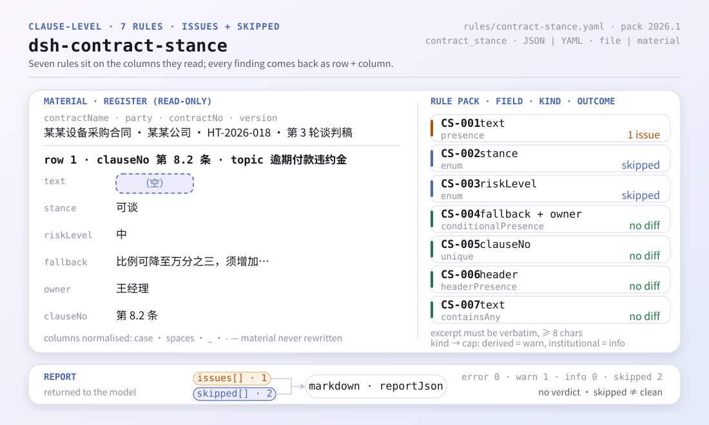
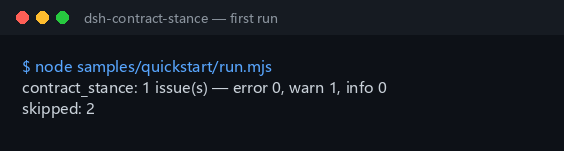

<div align="center">

<picture>
  <source media="(prefers-color-scheme: dark)" srcset="docs/assets/dsh-contract-stance-flow-v5-dark.svg">
  
</picture>

# dsh-contract-stance

**Convierte las lagunas y contradicciones de un registro de posturas sobre cláusulas en una lista de correcciones línea por línea, antes de negociar.**

Un verificador del lado del host para abogados internos y responsables de contratos: lee un registro de posturas (cabecera del contrato más una fila por cláusula) y enumera qué falta y dónde, guiado por un paquete de reglas cuyas citas son literales — nunca modifica el material ni dictamina sobre el cumplimiento.

[Instalación](#instalación-en-tres-pasos) · [Configuración](#configuración) · [FAQ](#faq) · [简体中文](README.md) · [English](README.en.md) · [Español](README.es.md) · [Português](README.pt.md) · [हिन्दी](README.hi.md)

[](LICENSE)
[](#compatibilidad)
[](https://www.npmjs.com/package/dsh-contract-stance)
[](https://github.com/PerryLink/dsh-contract-stance/actions/workflows/ci.yml)
[](#compatibilidad)

[](https://github.com/PerryLink/dsh-contract-stance/stargazers)
[](https://www.npmjs.com/package/dsh-contract-stance)
[](https://dshfind.com/en/plugins/PerryLink/dsh-contract-stance?ref=badge)
[](https://securityscorecards.dev/viewer/?uri=github.com/PerryLink/dsh-contract-stance)
[](https://dsh.market/)
[](https://gitee.com/perrylink/dsh-contract-stance)

```sh
dsh plugin --profile <name> add dsh-contract-stance
```

</div>

<sub>Plugin de la comunidad, no afiliado a DeepSeek. Repositorio canónico: <https://github.com/PerryLink/dsh-contract-stance> (Gitee es un espejo).</sub>

## Qué es

`dsh-contract-stance` lee un **registro de posturas sobre cláusulas contractuales** —la cabecera del contrato más una fila por cláusula— y comprueba la completitud y la coherencia interna de ese registro: que se recoja el texto de cada cláusula, que su postura proceda de su propio vocabulario y que la calificación de riesgo también, que una cláusula irrenunciable registre tanto un límite de concesión como un responsable, que los números de cláusula sean únicos, que el registro declare el contrato y su propia parte y que no quede ningún marcador de plantilla sin sustituir en el texto de la cláusula. Devuelve una lista de diferencias línea por línea; el material es de solo lectura y se conserva tal cual.

El plugin registra una única herramienta, `contract_stance`. El material es JSON o YAML, y se pasa como `file` o como `material`.

## Instalación en tres pasos

1. **Instalar** (npm `0.2.11` está publicado):

   ```sh
   dsh plugin --profile <name> add dsh-contract-stance
   dsh --profile <name> --dump-config | grep 'dsh-contract-stance'
   ```

2. **Ejecutar el ejemplo incluido dentro de este repositorio** (compile primero los artefactos del host):

   ```sh
   pnpm install && pnpm run build
   node samples/quickstart/run.mjs
   ```

   ```text
   $ node samples/quickstart/run.mjs
   contract_stance: 1 issue(s) — error 0, warn 1, info 0
   skipped: 2
   ```

   La entrada del ejemplo está en `samples/quickstart/input/CS-001-unsafe.json`, el resumen esperado en `samples/quickstart/expected/result.json`, y la misma salida se recoge en `docs/assets/quickstart.log`.

3. **Llamar a la herramienta en una sesión**:

   ```text
   Use contract_stance on samples/quickstart/input/CS-001-unsafe.json
   ```

   También se admite material en línea: `{"material": "contractName: …\nrows:\n  - …"}`. El resultado incluye `summary`, `issueCount`, `skippedCount`, `markdown` y `reportJson`.



**Desinstalar**: `dsh plugin --profile <name> remove dsh-contract-stance` (o elimine la fila del patch del perfil).

## Capacidades clave

- **Una herramienta, dos entradas de material** — `contract_stance` acepta `file` (ruta absoluta a JSON/YAML) o `material` (texto en línea); si ambas están vacías falla de forma visible en lugar de adivinar.
- **Siete reglas, todas declaradas como datos** — de `CS-001` a `CS-007` cubren el texto de la cláusula, el vocabulario de posturas, el de calificaciones de riesgo, el límite de concesión y el responsable de una cláusula irrenunciable, la unicidad del número de cláusula, las declaraciones de cabecera y los marcadores residuales. Sustituir `rules/contract-stance.yaml` cambia el conjunto de reglas sin tocar código.
- **Una lista vacía nunca pasa en silencio** — la lista de posturas (`CS-002`) y la de calificaciones de riesgo (`CS-003`) vienen vacías; mientras no se configuren, cada regla se informa en `skipped` con su motivo en lugar de leerse como «sin diferencias».
- **Solo diferencias, sin dictámenes** — la capa de renderizado compartida incorpora un guardián de redacción (`src/shared/wording.ts`, `src/shared/render.ts`) y todo informe termina con un descargo fijo; la suite de pruebas aplica la misma comprobación al texto visible para el modelo. No decide cumplimiento, responsabilidad ni si se debe firmar.
- **Solo lectura** — no modifica el archivo de entrada, no escribe archivos, no hace peticiones de red ni llama a un modelo.
- **El registro es un efecto** — `ctx.tools.register` devuelve el disposer que retira la herramienta al detener o recargar el plugin en caliente.

| Regla | Qué comprueba | Nivel | Tipo de base |
|---|---|---|---|
| `CS-001` | se recoge el texto de cada cláusula | warn | derivada de principio |
| `CS-002` | la postura procede de su vocabulario configurado (desactivada por defecto) | info | derivada de principio |
| `CS-003` | la calificación de riesgo procede de su vocabulario configurado (desactivada por defecto) | info | directa |
| `CS-004` | una cláusula irrenunciable registra límite de concesión y responsable | warn | directa |
| `CS-005` | los números de cláusula son únicos en el registro (se ignoran los espacios) | warn | derivada de principio |
| `CS-006` | la cabecera nombra el contrato y su propia parte | warn | directa |
| `CS-007` | el texto de la cláusula no conserva marcadores sin sustituir | warn | derivada de principio |

### Estructura de salida

La herramienta devuelve `summary` (recuentos de `error`/`warn`/`info`), `issueCount`, `skippedCount`, `markdown` (la representación que lee el modelo) y `reportJson` (el JSON canónico del informe completo). Cada hallazgo de `reportJson` lleva un `id` estable (`<plugin>.<regla>.<hash de ubicación>`), un `locator` (fila/columna), `found`, `expected`, `basis` y un `fix` opcional.

### Ejemplos

Esta es la estructura real de un hallazgo del fixture (`reportJson.issues[0]`, extracto). Entrada:

~~~json
{"rows":[{"条款号":"第 8.2 条","条款主题":"逾期付款违约金","条款原文":"", ...}]}
~~~

Salida:

~~~json
{
  "id": "dsh-contract-stance.CS-001.de09b5a6",
  "ruleId": "CS-001",
  "severity": "warn",
  "locator": {
    "row": 1,
    "field": "text"
  },
  "found": "第 1 行「text」为空",
  "expected": "「text」应填写",
  "fix": "补填条款原文；本条只核对是否摘录，不判断条款是否可接受"
}
~~~

*Observado en `tests/fixtures/CS-001/CS-001-unsafe.json`, `tests/fixtures/CS-001/cases.json`, `rules/contract-stance.yaml`, `tests/index.test.ts`.*

## Reglas y base

| Documento | Número | Reglas que lo citan |
|---|---|---|
| Código Civil de la República Popular China | versión vigente y numeración de artículos no verificadas en esta pasada | CS-001, CS-002, CS-003, CS-004, CS-005, CS-006, CS-007 |

**Límite:** este plugin comprueba un **registro de posturas sobre cláusulas** en lo que un registro puede exigir de sí mismo — que se recoja el texto de cada cláusula, que su postura proceda de su vocabulario y que la calificación de riesgo también, que una cláusula irrenunciable registre tanto un límite de concesión como un responsable, que los números de cláusula sean únicos, que el registro nombre el contrato y su parte y que no quede ningún marcador. **No** decide si una cláusula debe aceptarse, si un riesgo es soportable, si se debe firmar ni si una estrategia de negociación es acertada. **Eso depende del negocio, del poder de negociación de la contraparte y de su propia tolerancia al riesgo.**

> ### ⚠️ En qué se apoya la cita — y algo que nunca debe darse a este plugin
>
> **El Código Civil de la República Popular China se obtuvo y se leyó literalmente**, y `rules/evidence/clause-verification.md` registra lo citado: artículo 465 (el contrato legalmente formado está protegido por la ley y solo vincula a las partes), artículo 470 (el contenido del contrato **generalmente incluye** las partes, el objeto, la cantidad, la calidad, el precio, las condiciones de ejecución, la responsabilidad por incumplimiento y la resolución de controversias), artículo 496 (deber de destacar y explicar las cláusulas estándar), artículo 497 (cuándo son nulas las cláusulas estándar), artículo 506 (cuándo son nulas las cláusulas de exención), artículo 509, artículo 577 (consecuencias del incumplimiento) y artículo 584 (los daños incluyen el beneficio esperado pero se limitan por la **previsibilidad**). Los campos `excerpt` del paquete son citas literales, mientras que `basis.number` sigue diciendo «versión vigente y numeración de artículos no verificadas en esta pasada»: no se obtuvieron las disposiciones complementarias ni la fecha de entrada en vigor, así que no se afirma nada sobre la versión ni sobre esa fecha.
>
> **La parte contractual no regula un registro de negociación.** Regula la formación, la validez, la ejecución y la responsabilidad; las columnas del registro proceden de las normas internas de gestión contractual de su empresa. Por eso todas las reglas quedan limitadas a `warn` o `info`: **«esta columna está vacía» no debe leerse como «esto infringe el Código Civil».** Nótese además que el artículo 470 dice **generalmente incluye**, no debe incluir: una razón más por la que `CS-001` no alega una obligación directa.
>
> ⚠️ **No añada al plugin una regla de plazo de prescripción.** El Código *sí* fija cifras — el artículo 188 establece tres años de prescripción (veinte como máximo) y el artículo 203 traslada el plazo al día siguiente hábil —, lo que hace tentador «comparar fechas». No es viable aquí: el plazo corre desde que **el acreedor conoció o debió conocer** el daño y al deudor, una apreciación de hecho que el registro no recoge; además está sujeto a suspensión (artículo 194) e interrupción (artículo 195), y el artículo 196 enumera pretensiones a las que la prescripción no se aplica. Una regla aritmética de fechas disfrazaría una apreciación de hecho de cálculo, que es precisamente la exageración que esta familia evita.
>
> **En ninguna parte de este plugin se juzga el fondo de una cláusula.** Lee sus propias columnas y solo comprueba que estén rellenas y tomadas de su vocabulario. Dos vocabularios vienen **vacíos** —la lista de posturas (`CS-002`) y las calificaciones de riesgo (`CS-003`)—, así que sin configurar nada esas reglas se informan en `skipped` en lugar de pasar en silencio.

### Origen de las reglas

Los datos de las reglas están separados del código: cada regla lleva documento, número, cláusula en la numeración propia de la fuente, extracto literal y URL de origen. El cargador impone que el extracto sea una cita real de al menos ocho caracteres y que una comprobación basada solo en un principio (`kind: derived-from-principle`, tope `warn`) o en configuración local (`kind: institutional-configuration`, tope `info`) nunca se etiquete como `error`. Un paquete de reglas que exagere su base falla al cargarse en lugar de producir un informe con apariencia de solidez.

Los límites confirmados durante la verificación y las conclusiones deliberadamente **no** extraídas están en `rules/evidence/`; `pnpm run check:citations` vuelve a comprobar esa disciplina en CI.

## Configuración

Todos los parámetros ajustables viven en el esquema Schemastery de `src/config.ts`, por lo que se cambian desde `cordis.yml` sin tocar el código; los umbrales y vocabularios por regla están en `rules/contract-stance.yaml`.

| Clave | Tipo | Predeterminado | Descripción |
|---|---|---|---|
| `rulesFile` | string | `rules/contract-stance.yaml` | Ruta del paquete de reglas, relativa a la raíz del paquete |
| `disabledRules` | string[] | `[]` | Ids de reglas que se dejan de ejecutar; cada una aparece en `skipped` |
| `onlyRules` | string[] | `[]` | Ejecutar solo estas reglas; vacío ejecuta todas |
| `skipNotes` | string | `""` | Nota añadida a cada motivo de `skipped` |
| `timeoutMs` | number | `120000` | Presupuesto de tiempo de espera cooperativo de la herramienta |

Parámetros por regla (declarados en el paquete de reglas, no en Config):

- `CS-002` `values` — su vocabulario de posturas, p. ej. `[mantener, negociable, aceptar, eliminar]`; vacío significa que no se comprueba.
- `CS-003` `values` — sus calificaciones de riesgo, p. ej. `[alto, medio, bajo]`; vacío significa que no se comprueba.
- `CS-004` `conditionValues` — los valores de su columna de irrenunciable que marcan una cláusula como tal.
- `CS-007` `terms` — los términos de plantilla que se buscan.

Los valores predeterminados de esas dos listas son datos del paquete de reglas:

```text
CS-004 conditionValues: 是 | Y | yes | true | 必保 | √
CS-007 terms: 【 | 】 | {{ | }} | XXX | xxx | 待填 | 待补充 | TBD | todo | 示例
```

Ejemplo de sustitución en el patch del perfil:

```yaml
- insert:
    - id: dsh-contract-stance
      name: dsh-contract-stance
      config:
        onlyRules: [CS-001, CS-004, CS-006]
        skipNotes: Normas internas de gestión contractual, edición 2026
```

## Formato del material

Se aceptan JSON y YAML. La forma mínima es una cabecera más una fila por cláusula:

```yaml
contractNo: HT-2026-018
contractName: Contrato de compra de equipos de ejemplo
party: Comprador de ejemplo S.L.
version: Ronda de negociación 3
rows:
  - { 条款号: 第 8.2 条, 条款主题: 逾期付款违约金,
      条款原文: 买方逾期付款的，每逾期一日按未付金额的万分之五向卖方支付违约金。,
      本方立场: 可谈, 风险等级: 中, 风险说明: 违约金比例高于本方惯例且未设上限,
      退让底线: 比例可降至万分之三，须增加总额不超过合同额 5% 的上限,
      是否必保: 是, 谈判责任人: 王经理 }
```

Los nombres de columna se comparan sin distinguir mayúsculas y minúsculas y sin tener en cuenta espacios, guiones bajos ni guiones; los nombres propios del registro se conservan en el `locator`, de modo que un hallazgo puede rastrearse hasta el material original. La cabecera `contractName` y `party` es lo que comprueba `CS-006`; `version` sirve para distinguir rondas de negociación. El material es de solo lectura: el plugin nunca reescribe el archivo de entrada.

## FAQ

<details>
<summary>Una fila tiene tema, pero la columna del texto de la cláusula está vacía. ¿Se informa de eso?</summary>

Sí. `CS-001` exige la columna `text` en todas las filas: sin el texto no se puede comprobar a qué redacción se refiere la postura. La regla solo comprueba que el texto esté recogido; no juzga si la cláusula debe aceptarse ni si entraña riesgo jurídico.

</details>

<details>
<summary>La postura y la calificación de riesgo están rellenas, pero todas las filas vuelven como `skipped`. ¿Por qué?</summary>

Porque las dos listas de valores vienen vacías de fábrica. `CS-002` solo acepta una postura de la lista configurada para él, y `CS-003` hace lo mismo con la calificación de riesgo; sin lista configurada ninguna de las dos reglas puede ejecutarse, así que cada una se informa en `skipped` en lugar de pasar en silencio. `CS-002` solo comprueba que el valor esté en su lista, no que la postura sea adecuada; `CS-003` solo comprueba que esté en la lista, no cuán alto es el riesgo real de esa cláusula.

</details>

<details>
<summary>Una cláusula está marcada como irrenunciable, pero nadie escribió hasta dónde se puede ceder ni quién decide.</summary>

`CS-004` lee la propia columna de irrenunciable del registro: cuando la fila está marcada como irrenunciable (valores fijados por `conditionValues`) exige que se rellenen las columnas `fallback` y `owner`. Solo comprueba que ambas estén rellenas, no si el límite de concesión es razonable; qué cláusulas son irrenunciables depende por completo del proyecto y la regla no lo decide.

</details>

<details>
<summary>El mismo número de cláusula aparece en dos filas, una por borrador de negociación. ¿Es un hallazgo?</summary>

`CS-005` informa de un número de cláusula repetido, comparando sin tener en cuenta los espacios. Un número repetido impide señalar con precisión una sola cláusula. Que una cláusula aparezca una vez por borrador es una forma normal: distíngala en la columna de versión en lugar de reutilizar el número. Ninguna cláusula exige que los números sean únicos: la unicidad es lo que hace referenciable el registro.

</details>

<details>
<summary>La cabecera no dice de qué contrato se trata ni cuál es nuestra parte.</summary>

`CS-006` exige que la cabecera del material declare `contractName` y `party`: sin esos dos datos la postura no puede rastrearse hasta una operación y una parte concretas. Si su formulario tiene una columna de versión para los borradores, añádala a los `fields` de esa regla. La regla solo comprueba que la cabecera declare los dos; no juzga el contrato en sí.

</details>

## Límites de seguridad

- **Solo lectura, sin escrituras.** La herramienta lee el material indicado por `file` o el texto en línea de `material`; no modifica el original, no crea archivos ni almacena material en caché. `dsh.demo` en `package.json` declara `network: false` y `writes: []`, y la implementación no contiene ninguna llamada de red ni de modelo.
- **Sin dictámenes.** El informe solo enumera diferencias literales entre el material y la base citada; todo informe termina con un descargo fijo, el renderizador compartido ejecuta un guardián de redacción antes de emitir (`src/shared/render.ts`), y la suite de pruebas aplica la misma comprobación al `markdown` visible para el modelo. El juicio profesional queda en manos de quien revisa.
- **La disciplina de citas es una puerta dura.** Al cargar, el paquete verifica que `excerpt` sea una cita real de al menos ocho caracteres y que `kind` limite la severidad (`derived-from-principle` a `warn`, `institutional-configuration` a `info`); un paquete que exagere su base no llega a cargarse.
- **Un resultado vacío no es prueba de corrección.** Cualquier comprobación que no haya podido ejecutarse —porque su vocabulario no está configurado, está desactivada o solo se seleccionaron algunas reglas— se lista en `skipped` con su motivo. «Sin diferencias» solo vale cuando todas las reglas declaradas se ejecutaron.
- **El registro es un efecto.** El registro de la herramienta devuelve un disposer; detener o recargar el plugin en caliente lo retira. El plugin no registra comandos, slots de cliente, rutas HTTP ni escuchas de eventos compartidos.
- **Permisos y datos.** El manifiesto solo declara `tools:register`; lee el archivo de material indicado por el usuario y no escribe nada, no envía nada por la red ni guarda credenciales. El material solo llega al informe de esa llamada; nada se persiste del lado del plugin.

## Limitaciones conocidas

- **El registro, no el contrato.** Una cláusula copiada mal, omitida o incoherente con el texto contractual no se detecta: el objeto de trabajo es el registro, no el archivo del contrato.
- **Las listas de posturas y de riesgo vienen vacías.** `CS-002` y `CS-003` usan el vocabulario de su institución por diseño; el plugin se niega a adivinarlo y las informa en `skipped` hasta que se configuren.
- **El Código Civil no regula el formato del registro.** La parte contractual regula formación, validez, ejecución y responsabilidad; «una columna está vacía» y «esto infringe el Código Civil» son afirmaciones distintas, y por eso todas las reglas están limitadas a `warn` o `info`.
- **No se comprueba la prescripción, y no debería añadirse.** El plazo parte de una apreciación de hecho («conoció o debió conocer») que el registro no recoge, y la suspensión, la interrupción y las pretensiones excluidas no pueden juzgarse desde un registro (véase «Reglas y base»).
- **La unicidad existe para poder referenciar.** Una cláusula por borrador de negociación es normal y debe distinguirse en la columna de versión; `CS-005` solo informa duplicados, no si un duplicado está justificado.
- **Cabecera y enumeraciones se comparan literalmente.** Los nombres de columna se normalizan para mayúsculas y para espacios/guiones bajos/guiones; los valores que marcan una cláusula irrenunciable se configuran con `conditionValues`, así que un formulario distinto exige configuración acorde.
- **Modo de herramienta**: funciona en `native` y `ptc`; para un lote de directorios completos, `ptc` paga el coste del esquema una sola vez.

<details>
<summary>Resolución de problemas</summary>

- **El plugin se instala pero la herramienta no aparece**: compruebe que `main` resuelve a `lib/index.mjs` y que `pnpm run build` lo generó; un `main` incorrecto hace que el cargador omita la entrada en silencio.
- **`dsh plugin add` rechaza el paquete por incompatibilidad**: el rango de peers cubre `0.1.x` y `0.2.x`, y `engines.dsh` es `>=0.2.1-0 <0.3.0`; fuera de él, conceda una exención explícita: `dsh plugin --profile <name> allow-version <pkg@version> --dsh-version <runtime> --accept-risk`.
- **Una regla no se ejecutó**: lea el arreglo `skipped`; indica el id de la regla y el motivo.
- **`check` informa `manifest-peers` como fallo**: el verificador estático compara con un rango de peers codificado anterior a la línea 0.2; la compatibilidad de instalación la decide el runtime. Es un problema conocido de `dsh-plugin-dev`.
- **Las horas parecen desplazadas**: toda la aritmética es de hora local sobre las cadenas de entrada; no se convierte la zona horaria.

</details>

## Interoperabilidad con otros plugins DSH

- **Una sola herramienta.** `contract_stance` es la única superficie del plugin expuesta al modelo; no ofrece clave de servicio, no registra comandos `/`, ni slots de cliente, ni prefijo `webServer`, y no escucha eventos de sesión compartidos.
- **Depende del servicio `tools` del host.** `inject: ['tools']` significa que la herramienta solo se registra cuando ese servicio está disponible; el plugin nunca se ejecuta a medio inicializar.
- **El patch del bundle solo `insert`a su propia fila.** `cordis.patch.yml` nunca sobrescribe el `config` de una fila incorporada.
- **Sin mutaciones globales.** No parchea prototipos, no reescribe `process.env`, no sustituye el despachador global de fetch ni modifica la estructura de directorios del host.
- **Sin recursos disputables.** Como no ocupa clave de servicio, slot, ruta HTTP ni escucha de eventos compartidos, otros plugins del mismo perfil no pueden colisionar con él en esas cuatro superficies.

## Compatibilidad

| Superficie | Estado |
|---|---|
| Harness | Rango de peers `>=0.1.2-rc.1 <0.2.0 \|\| >=0.2.0-0 <0.3.0` — verificado para aceptar tanto `0.2.0-rc.2` como `0.2.1-rc.2`. `engines.dsh` se declara como `>=0.2.1-0 <0.3.0` y el host lo aplica desde 0.2.1 |
| Node | `^22.19.0 \|\| >=24.0.0` |
| Plataformas | Todas (ESM puro; sin código nativo, sin red, sin llamada al modelo) |
| Modo de herramienta | Funciona en `native` y `ptc`; para un directorio completo use `ptc` |

## Ecosistema y calidad

- [Página de dshfind](https://dshfind.com/en/plugins/PerryLink/dsh-contract-stance) (instalaciones y ranking)
- [Informe OpenSSF Scorecard](https://securityscorecards.dev/viewer/?uri=github.com/PerryLink/dsh-contract-stance) (impulsado por [.github/workflows/scorecard.yml](.github/workflows/scorecard.yml))
- [DSH Market](https://dsh.market/) (listado)
- [Espejo en Gitee](https://gitee.com/perrylink/dsh-contract-stance) (espejo sincronizado; GitHub es el canónico)
- [Registro de verificación de citas](rules/evidence/clause-verification.md) (fuentes comprobadas y conclusiones deliberadamente no extraídas)
- [Elegir un verificador por material](https://perrylink.github.io/zh/checkers/choose/) · [Todos los plugins de PerryLink](https://github.com/PerryLink)

## Desarrollo

```sh
pnpm install
pnpm run typecheck
pnpm test
pnpm run build
node samples/quickstart/run.mjs
pnpm run verify:self-contained
pnpm run check:lockfile
pnpm run check:readmes
pnpm run check:citations
pnpm pack
```

`node ../scripts/sync-shared.mjs dsh-contract-stance` copia el kit compartido de `../_shared` a `src/shared/`; vuelva a ejecutarlo tras cada cambio compartido. El plugin es **guiado por datos**: `src/model.ts` declara la forma de la tabla y los alias de columna, el kit compartido aporta el lector y el motor de comprobación, y el paquete de reglas declara cada comprobación.

Las imágenes del README se generan mediante [`scripts/gen-readme-assets.py`](scripts/gen-readme-assets.py) (Pillow para la cabecera, SVG escrito a mano para la estructura) en `docs/assets/dsh-contract-stance-hero-{zh,en}-{light,dark}.webp` y `docs/assets/dsh-contract-stance-flow-v5-{light,dark}.svg`; el script puede ejecutarse de nuevo y los diagramas solo contienen tokens de comandos y claves de configuración, compartidos por los cinco idiomas.

Topics: `deepseek-harness`, `dsh`, `dsh-plugin`, `cordis`, `contract`, `stance`

## Familia y agradecimientos

Este proyecto forma parte de la familia de plugins de DeepSeek Harness de [PerryLink](https://github.com/PerryLink) (todos Apache-2.0). Si le resulta útil, **una estrella ayuda a que la siguiente persona lo encuentre**; no desbloquea ninguna función.

- [@PerryLink](https://github.com/PerryLink) — creador y mantenedor: el paquete de reglas (CS-001..CS-007), la integración con el motor compartido, el registro de verificación de citas y la documentación en cinco idiomas.

<details>
<summary>Ver todos los plugins</summary>

| Plugin | Estado |
|---|---|
| **[dsh-aqua-input-check](https://github.com/PerryLink/dsh-aqua-input-check)** |  |
| **[dsh-archive-check](https://github.com/PerryLink/dsh-archive-check)** |  |
| **[dsh-auto-review](https://github.com/PerryLink/dsh-auto-review)** |  |
| **[dsh-autotier](https://github.com/PerryLink/dsh-autotier)** | 🧊 CONGELADO — ver el README del repo |
| **[dsh-bid-ca-precheck](https://github.com/PerryLink/dsh-bid-ca-precheck)** |  |
| **[dsh-bid-qual-check](https://github.com/PerryLink/dsh-bid-qual-check)** |  |
| **[dsh-cert-mcp](https://github.com/PerryLink/dsh-cert-mcp)** | 🧊 CONGELADO — ver el README del repo |
| **[dsh-checkpoint-rewind](https://github.com/PerryLink/dsh-checkpoint-rewind)** |  |
| **[dsh-click](https://github.com/PerryLink/dsh-click)** |  |
| **[dsh-composer-history](https://github.com/PerryLink/dsh-composer-history)** |  |
| **[dsh-contract-stance](https://github.com/PerryLink/dsh-contract-stance)** |  |
| **[dsh-customs-doc-check](https://github.com/PerryLink/dsh-customs-doc-check)** |  |
| **[dsh-data-quality](https://github.com/PerryLink/dsh-data-quality)** | 🧊 CONGELADO — ver el README del repo |
| **[dsh-demurrage-ledger](https://github.com/PerryLink/dsh-demurrage-ledger)** |  |
| **[dsh-doublecheck](https://github.com/PerryLink/dsh-doublecheck)** |  |
| **[dsh-drill-script-check](https://github.com/PerryLink/dsh-drill-script-check)** |  |
| **[dsh-eia-guide-check](https://github.com/PerryLink/dsh-eia-guide-check)** |  |
| **[dsh-emergency-plan](https://github.com/PerryLink/dsh-emergency-plan)** |  |
| **[dsh-essay-rubric-check](https://github.com/PerryLink/dsh-essay-rubric-check)** |  |
| **[dsh-evidence-check](https://github.com/PerryLink/dsh-evidence-check)** |  |
| **[dsh-export-ctl-check](https://github.com/PerryLink/dsh-export-ctl-check)** |  |
| **[dsh-fast](https://github.com/PerryLink/dsh-fast)** |  |
| **[dsh-fmea-table-check](https://github.com/PerryLink/dsh-fmea-table-check)** |  |
| **[dsh-forecast-penalty](https://github.com/PerryLink/dsh-forecast-penalty)** |  |
| **[dsh-fund-research](https://github.com/PerryLink/dsh-fund-research)** |  |
| **[dsh-github](https://github.com/PerryLink/dsh-github)** |  |
| **[dsh-gongwen-flow-check](https://github.com/PerryLink/dsh-gongwen-flow-check)** |  |
| **[dsh-gongwen-word-check](https://github.com/PerryLink/dsh-gongwen-word-check)** |  |
| **[dsh-guard-plan-qc](https://github.com/PerryLink/dsh-guard-plan-qc)** |  |
| **[dsh-hazchem-check](https://github.com/PerryLink/dsh-hazchem-check)** |  |
| **[dsh-hazplan-check](https://github.com/PerryLink/dsh-hazplan-check)** |  |
| **[dsh-hidden-risk-map](https://github.com/PerryLink/dsh-hidden-risk-map)** |  |
| **[dsh-hs-classify](https://github.com/PerryLink/dsh-hs-classify)** |  |
| **[dsh-icd-rule-check](https://github.com/PerryLink/dsh-icd-rule-check)** |  |
| **[dsh-industry-research](https://github.com/PerryLink/dsh-industry-research)** |  |
| **[dsh-lawcite-adapter](https://github.com/PerryLink/dsh-lawcite-adapter)** |  |
| **[dsh-laya](https://github.com/PerryLink/dsh-laya)** |  |
| **[dsh-lc-doc-check](https://github.com/PerryLink/dsh-lc-doc-check)** |  |
| **[dsh-learning-gap-check](https://github.com/PerryLink/dsh-learning-gap-check)** |  |
| **[dsh-library](https://github.com/PerryLink/dsh-library)** |  |
| **[dsh-local-ai](https://github.com/PerryLink/dsh-local-ai)** |  |
| **[dsh-lsp-actions](https://github.com/PerryLink/dsh-lsp-actions)** |  |
| **[dsh-mask](https://github.com/PerryLink/dsh-mask)** |  |
| **[dsh-mcp-panel](https://github.com/PerryLink/dsh-mcp-panel)** |  |
| **[dsh-medrec-qc](https://github.com/PerryLink/dsh-medrec-qc)** |  |
| **[dsh-memento](https://github.com/PerryLink/dsh-memento)** | 🧊 CONGELADO — ver el README del repo |
| **[dsh-nsfc-form-check](https://github.com/PerryLink/dsh-nsfc-form-check)** |  |
| **[dsh-nurse-record-check](https://github.com/PerryLink/dsh-nurse-record-check)** |  |
| **[dsh-observe](https://github.com/PerryLink/dsh-observe)** |  |
| **[dsh-origin-rvc-check](https://github.com/PerryLink/dsh-origin-rvc-check)** |  |
| **[dsh-ota-review-check](https://github.com/PerryLink/dsh-ota-review-check)** |  |
| **[dsh-output-styles](https://github.com/PerryLink/dsh-output-styles)** |  |
| **[dsh-paper-doc-adapter](https://github.com/PerryLink/dsh-paper-doc-adapter)** |  |
| **[dsh-permission-rules](https://github.com/PerryLink/dsh-permission-rules)** |  |
| **[dsh-permit-report-check](https://github.com/PerryLink/dsh-permit-report-check)** |  |
| **[dsh-pipeline-check](https://github.com/PerryLink/dsh-pipeline-check)** |  |
| **[dsh-pleading-draft](https://github.com/PerryLink/dsh-pleading-draft)** |  |
| **[dsh-plugin-doctor](https://github.com/PerryLink/dsh-plugin-doctor)** | 🚫 RETIRADO (repo archivado) |
| **[dsh-plugin-guide](https://github.com/PerryLink/dsh-plugin-guide)** |  |
| **[dsh-plugin-kit](https://github.com/PerryLink/dsh-plugin-kit)** | 🚫 RETIRADO (repo archivado) |
| **[dsh-plugin-upgrade](https://github.com/PerryLink/dsh-plugin-upgrade)** | 🚫 RETIRADO (repo archivado) |
| **[dsh-policy-brief-draft](https://github.com/PerryLink/dsh-policy-brief-draft)** |  |
| **[dsh-power-loss-split](https://github.com/PerryLink/dsh-power-loss-split)** |  |
| **[dsh-power-ticket-check](https://github.com/PerryLink/dsh-power-ticket-check)** |  |
| **[dsh-ppap-check](https://github.com/PerryLink/dsh-ppap-check)** |  |
| **[dsh-protest-deadline](https://github.com/PerryLink/dsh-protest-deadline)** |  |
| **[dsh-railway-window](https://github.com/PerryLink/dsh-railway-window)** |  |
| **[dsh-repair-order-qc](https://github.com/PerryLink/dsh-repair-order-qc)** |  |
| **[dsh-research-report](https://github.com/PerryLink/dsh-research-report)** |  |
| **[dsh-review-reply-check](https://github.com/PerryLink/dsh-review-reply-check)** |  |
| **[dsh-rulefile-check](https://github.com/PerryLink/dsh-rulefile-check)** |  |
| **[dsh-safety-brief-check](https://github.com/PerryLink/dsh-safety-brief-check)** |  |
| **[dsh-score](https://github.com/PerryLink/dsh-score)** | 🧊 CONGELADO — ver el README del repo |
| **[dsh-session-sync](https://github.com/PerryLink/dsh-session-sync)** |  |
| **[dsh-site-log-check](https://github.com/PerryLink/dsh-site-log-check)** |  |
| **[dsh-skill-pack-security](https://github.com/PerryLink/dsh-skill-pack-security)** |  |
| **[dsh-soe-decision-check](https://github.com/PerryLink/dsh-soe-decision-check)** |  |
| **[dsh-soilwater-check](https://github.com/PerryLink/dsh-soilwater-check)** |  |
| **[dsh-sop-sync-check](https://github.com/PerryLink/dsh-sop-sync-check)** |  |
| **[dsh-spc-gbt-adapter](https://github.com/PerryLink/dsh-spc-gbt-adapter)** |  |
| **[dsh-talk](https://github.com/PerryLink/dsh-talk)** |  |
| **[dsh-tender-extract](https://github.com/PerryLink/dsh-tender-extract)** |  |
| **[dsh-tender-matrix](https://github.com/PerryLink/dsh-tender-matrix)** |  |
| **[dsh-test-drive](https://github.com/PerryLink/dsh-test-drive)** |  |
| **[dsh-ticktick](https://github.com/PerryLink/dsh-ticktick)** | 🚫 RETIRADO (repo archivado) |
| **[dsh-translate](https://github.com/PerryLink/dsh-translate)** |  |
| **[dsh-warranty-calc](https://github.com/PerryLink/dsh-warranty-calc)** |  |
| **[dsh-budget](https://github.com/PerryLink/dsh-budget)** |  |
| **[dsh-claude-move](https://github.com/PerryLink/dsh-claude-move)** |  |
| **[dsh-defend](https://github.com/PerryLink/dsh-defend)** |  |
| **[dsh-draw](https://github.com/PerryLink/dsh-draw)** | 🧊 CONGELADO — ver el README del repo |
| **[dsh-reach](https://github.com/PerryLink/dsh-reach)** |  |
| **[dsh-background-agents](https://github.com/PerryLink/dsh-background-agents)** | 🚫 RETIRADO (repo archivado) |
| **[dsh-session-pin](https://github.com/PerryLink/dsh-session-pin)** | 🚫 RETIRADO (repo archivado) |
| **[dsh-team-rooms](https://github.com/PerryLink/dsh-team-rooms)** | 🚫 RETIRADO (repo archivado) |

</details>

## Licencia

[LICENSE](LICENSE) (Apache License 2.0) © 2026 dsh-contract-stance contributors

<p align="center"><sub>Apache-2.0 · Plugin de la comunidad, no afiliado a DeepSeek.</sub></p>
