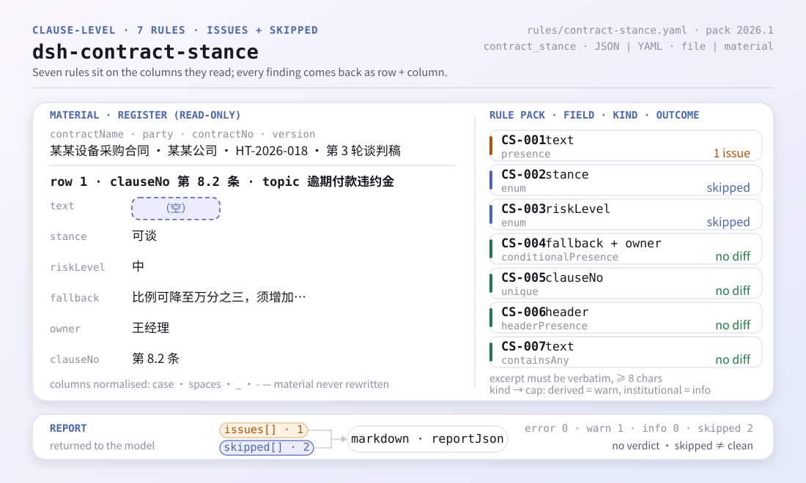
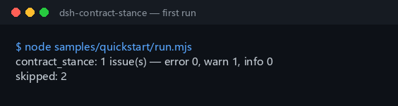

<div align="center">

<picture>
  <source media="(prefers-color-scheme: dark)" srcset="docs/assets/dsh-contract-stance-flow-v5-dark.svg">
  
</picture>

# dsh-contract-stance

**बातचीत से पहले संविदा-खंड पक्ष-रुख रजिस्टर की कमियों और अंतर्विरोधों को पंक्ति-दर-पंक्ति सुधार-सूची में बदलें।**

इन-हाउस कानूनी सलाहकारों और संविदा प्रबंधकों के लिए होस्ट-पक्षीय जाँचकर्ता: यह एक पक्ष-रुख रजिस्टर (संविदा हेडर और प्रत्येक खंड की एक पंक्ति) पढ़ता है और बताता है कि क्या और कहाँ छूटा है — नियम-पैक की उद्धृतियाँ शब्दशः हैं; यह सामग्री बदलता नहीं और अनुपालन पर निर्णय नहीं देता।

[इंस्टॉल](#तीन-चरणों-में-शुरुआत) · [कॉन्फ़िगरेशन](#कॉन्फ़िगरेशन) · [FAQ](#faq) · [简体中文](README.md) · [English](README.en.md) · [Español](README.es.md) · [Português](README.pt.md) · [हिन्दी](README.hi.md)

[](LICENSE)
[](#संगतता)
[](https://www.npmjs.com/package/dsh-contract-stance)
[](https://github.com/PerryLink/dsh-contract-stance/actions/workflows/ci.yml)
[](#संगतता)

[](https://github.com/PerryLink/dsh-contract-stance/stargazers)
[](https://www.npmjs.com/package/dsh-contract-stance)
[](https://dshfind.com/en/plugins/PerryLink/dsh-contract-stance?ref=badge)
[](https://securityscorecards.dev/viewer/?uri=github.com/PerryLink/dsh-contract-stance)
[](https://dsh.market/)
[](https://gitee.com/perrylink/dsh-contract-stance)

```sh
dsh plugin --profile <name> add dsh-contract-stance
```

</div>

<sub>समुदाय प्लगइन, DeepSeek से संबद्ध नहीं। एकमात्र रेपो: <https://github.com/PerryLink/dsh-contract-stance> (Gitee प्रतिबिंब है)।</sub>

## यह क्या है

`dsh-contract-stance` एक **संविदा खंड पक्ष-रुख रजिस्टर** पढ़ता है — संविदा हेडर और प्रत्येक खंड की एक पंक्ति — और उसी रजिस्टर की पूर्णता तथा आंतरिक सुसंगति जाँचता है: क्या प्रत्येक खंड का मूल पाठ दर्ज है, क्या आपका पक्ष-रुख आपकी अपनी शब्दावली से लिया गया है और जोखिम-श्रेणी भी, क्या अनिवार्य खंड में छूट की सीमा और ज़िम्मेदार व्यक्ति दोनों दर्ज हैं, क्या खंड-संख्याएँ अद्वितीय हैं, क्या रजिस्टर संविदा और आपके पक्ष का उल्लेख करता है, और क्या खंड के पाठ में कोई अपरिवर्तित टेम्पलेट प्लेसहोल्डर शेष नहीं है। यह पंक्ति-दर-पंक्ति अंतर-सूची देता है; सामग्री केवल पढ़ी जाती है और जैसी है वैसी रहती है।

प्लगइन एक ही टूल पंजीकृत करता है, `contract_stance`। सामग्री JSON या YAML है और `file` अथवा `material` के रूप में दी जाती है।

## तीन चरणों में शुरुआत

1. **इंस्टॉल करें** (npm `0.2.11` प्रकाशित है):

   ```sh
   dsh plugin --profile <name> add dsh-contract-stance
   dsh --profile <name> --dump-config | grep 'dsh-contract-stance'
   ```

2. **इस रेपो के भीतर साथ आया नमूना चलाएँ** (पहले होस्ट आर्टिफ़ैक्ट बनाएँ):

   ```sh
   pnpm install && pnpm run build
   node samples/quickstart/run.mjs
   ```

   ```text
   $ node samples/quickstart/run.mjs
   contract_stance: 1 issue(s) — error 0, warn 1, info 0
   skipped: 2
   ```

   नमूना इनपुट `samples/quickstart/input/CS-001-unsafe.json` में है, अपेक्षित सारांश `samples/quickstart/expected/result.json` में, और वही आउटपुट `docs/assets/quickstart.log` में दर्ज है।

3. **सत्र में टूल को कॉल करें**:

   ```text
   Use contract_stance on samples/quickstart/input/CS-001-unsafe.json
   ```

   इनलाइन सामग्री भी मान्य है: `{"material": "contractName: …\nrows:\n  - …"}`। परिणाम में `summary`, `issueCount`, `skippedCount`, `markdown` और `reportJson` होते हैं।



**अनइंस्टॉल**: `dsh plugin --profile <name> remove dsh-contract-stance` (या प्रोफ़ाइल पैच से वह पंक्ति हटा दें)।

## मुख्य क्षमताएँ

- **एक टूल, सामग्री के दो प्रवेश** — `contract_stance` `file` (JSON/YAML का पूर्ण पथ) या `material` (इनलाइन पाठ) स्वीकार करता है; दोनों खाली हों तो अनुमान लगाने के बजाय स्पष्ट त्रुटि देता है।
- **सात नियम, सभी डेटा के रूप में घोषित** — `CS-001` से `CS-007` तक खंड-पाठ, पक्ष-रुख शब्दावली, जोखिम-श्रेणी शब्दावली, अनिवार्य खंड की छूट-सीमा और ज़िम्मेदार व्यक्ति, खंड-संख्या की अद्वितीयता, हेडर घोषणाएँ और शेष प्लेसहोल्डर cover करते हैं। `rules/contract-stance.yaml` बदलने से कोड छुए बिना नियम-समुच्चय बदल जाता है।
- **खाली सूची कभी चुपचाप पास नहीं होती** — पक्ष-रुख सूची (`CS-002`) और जोखिम-श्रेणी सूची (`CS-003`) खाली आती हैं; कॉन्फ़िगर न होने तक प्रत्येक नियम कारण सहित स्वयं को `skipped` में दर्ज करता है, «कोई अंतर नहीं» के रूप में नहीं पढ़ा जाता।
- **केवल अंतर, कोई निर्णय नहीं** — साझा रेंडरिंग परत में शब्द-संरक्षक है (`src/shared/wording.ts`, `src/shared/render.ts`) और हर रिपोर्ट के अंत में निश्चित अस्वीकरण रहता है; परीक्षण-सूट मॉडल को दिखने वाले पाठ पर वही जाँच लागू करता है। यह अनुपालन, दायित्व या हस्ताक्षर पर निर्णय नहीं देती।
- **केवल पठन** — इनपुट फ़ाइल नहीं बदलता, कोई फ़ाइल नहीं लिखता, नेटवर्क अनुरोध नहीं करता और किसी मॉडल को नहीं बुलाता।
- **पंजीकरण एक effect है** — `ctx.tools.register` वह disposer लौटाता है जो प्लगइन रोकने या हॉट-रीलोड करने पर टूल हटा देता है।

| नियम | क्या जाँचता है | स्तर | आधार प्रकार |
|---|---|---|---|
| `CS-001` | प्रत्येक खंड का पाठ दर्ज है | warn | सिद्धांत-व्युत्पन्न |
| `CS-002` | पक्ष-रुख आपकी कॉन्फ़िगर की गई शब्दावली से है (डिफ़ॉल्ट रूप से बंद) | info | सिद्धांत-व्युत्पन्न |
| `CS-003` | जोखिम-श्रेणी आपकी कॉन्फ़िगर की गई शब्दावली से है (डिफ़ॉल्ट रूप से बंद) | info | प्रत्यक्ष |
| `CS-004` | अनिवार्य खंड छूट-सीमा और ज़िम्मेदार व्यक्ति दोनों दर्ज करता है | warn | प्रत्यक्ष |
| `CS-005` | रजिस्टर में खंड-संख्याएँ अद्वितीय हैं (रिक्त स्थान अनदेखा) | warn | सिद्धांत-व्युत्पन्न |
| `CS-006` | हेडर संविदा और आपके पक्ष का उल्लेख करता है | warn | प्रत्यक्ष |
| `CS-007` | खंड-पाठ में कोई अपरिवर्तित प्लेसहोल्डर नहीं | warn | सिद्धांत-व्युत्पन्न |

### आउटपुट संरचना

टूल `summary` (`error`/`warn`/`info` गणनाएँ), `issueCount`, `skippedCount`, `markdown` (मॉडल जो पढ़ता है) और `reportJson` (पूर्ण रिपोर्ट का विहित JSON) लौटाता है। `reportJson` में प्रत्येक अंतर के साथ स्थिर `id` (`<plugin>.<rule>.<locator hash>`), `locator` (पंक्ति/स्तंभ), `found`, `expected`, `basis` और वैकल्पिक `fix` होता है।

### उदाहरण

यह फ़िक्स्चर से वास्तविक अंतर-संरचना है (`reportJson.issues[0]`, अंश)। इनपुट:

~~~json
{"rows":[{"条款号":"第 8.2 条","条款主题":"逾期付款违约金","条款原文":"", ...}]}
~~~

आउटपुट:

~~~json
{
  "id": "dsh-contract-stance.CS-001.de09b5a6",
  "ruleId": "CS-001",
  "severity": "warn",
  "locator": {
    "row": 1,
    "field": "text"
  },
  "found": "第 1 行「text」为空",
  "expected": "「text」应填写",
  "fix": "补填条款原文；本条只核对是否摘录，不判断条款是否可接受"
}
~~~

*स्रोत: `tests/fixtures/CS-001/CS-001-unsafe.json`, `tests/fixtures/CS-001/cases.json`, `rules/contract-stance.yaml`, `tests/index.test.ts`.*

## नियम और आधार

| दस्तावेज़ | संख्यांक | इन्हें उद्धृत करने वाले नियम |
|---|---|---|
| चीनी जनवादी गणराज्य की सिविल संहिता | वर्तमान संस्करण और अनुच्छेद संख्याएँ इस बार सत्यापित नहीं | CS-001, CS-002, CS-003, CS-004, CS-005, CS-006, CS-007 |

**सीमा:** यह प्लगइन एक **संविदा खंड पक्ष-रुख रजिस्टर** की उन बातों की जाँच करता है जिनके लिए रजिस्टर स्वयं उत्तरदायी ठहराया जा सकता है — प्रत्येक खंड का पाठ दर्ज है, आपका पक्ष-रुख आपकी शब्दावली से है और जोखिम-श्रेणी भी, अनिवार्य खंड में छूट-सीमा और ज़िम्मेदार व्यक्ति दोनों हैं, खंड-संख्याएँ अद्वितीय हैं, रजिस्टर संविदा और आपके पक्ष का उल्लेख करता है, और कोई प्लेसहोल्डर शेष नहीं है। यह **निर्णय नहीं** देता कि कोई खंड स्वीकार्य है, कोई जोखिम सह्य है, हस्ताक्षर करना चाहिए, या बातचीत की रणनीति उचित है। **ये सौदे, प्रतिपक्ष की सौदेबाज़ी शक्ति और आपकी जोखिम-सहनशीलता पर निर्भर हैं।**

> ### ⚠️ उद्धरण किस पर टिका है — और जो चीज़ इस प्लगइन को कभी नहीं देनी चाहिए
>
> **चीनी जनवादी गणराज्य की सिविल संहिता प्राप्त की गई और शब्दशः पढ़ी गई**, और `rules/evidence/clause-verification.md` दर्ज करता है कि क्या उद्धृत किया गया: अनुच्छेद 465 (विधिपूर्वक बनी संविदा कानून द्वारा संरक्षित है और केवल पक्षकारों को बाध्य करती है), अनुच्छेद 470 (संविदा की विषयवस्तु में **सामान्यतः सम्मिलित** होते हैं पक्षकार, विषय, मात्रा, गुणवत्ता, मूल्य, निष्पादन शर्तें, उल्लंघन का दायित्व और विवाद-समाधान), अनुच्छेद 496 (मानक शर्तों को उजागर करने और समझाने का कर्तव्य), अनुच्छेद 497 (मानक शर्तें कब शून्य हैं), अनुच्छेद 506 (छूट-शर्तें कब शून्य हैं), अनुच्छेद 509, अनुच्छेद 577 (उल्लंघन के परिणाम) और अनुच्छेद 584 (हानि में अपेक्षित लाभ सम्मिलित है, पर **पूर्वानुमेयता** से सीमित)। पैक के `excerpt` शब्दशः उद्धरण हैं, जबकि `basis.number` अभी भी कहता है «वर्तमान संस्करण और अनुच्छेद संख्याएँ इस बार सत्यापित नहीं» — अनुपूरक प्रावधान और प्रभावी तिथि प्राप्त नहीं हुई, इसलिए संस्करण या उस तिथि पर कोई दावा नहीं किया जाता।
>
> **संविदा भाग बातचीत के रजिस्टर को विनियमित नहीं करता।** वह संविदा के निर्माण, वैधता, निष्पादन और दायित्व को विनियमित करता है; रजिस्टर के स्तंभ आपके उद्यम के अपने संविदा-प्रबंधन नियमों से आते हैं। इसलिए हर नियम `warn` या `info` तक सीमित है: **«यह स्तंभ खाली है» को «यह सिविल संहिता का उल्लंघन है» नहीं पढ़ा जाना चाहिए।** यह भी ध्यान दें कि अनुच्छेद 470 **सामान्यतः सम्मिलित** कहता है, «अवश्य सम्मिलित» नहीं — यह एक और कारण है कि `CS-001` प्रत्यक्ष बाध्यता का दावा नहीं करता।
>
> ⚠️ **इस प्लगइन में परिसीमा-अवधि का नियम न जोड़ें।** संहिता *वास्तव में* संख्याएँ तय करती है — अनुच्छेद 188 तीन वर्ष की परिसीमा (अधिकतम बीस वर्ष) और अनुच्छेद 203 सार्वजनिक अवकाश पड़ने पर अवधि को आगे बढ़ाना — जिससे «तारीख़ों की तुलना» आकर्षक लगती है। यह यहाँ व्यवहार्य नहीं: अवधि उस क्षण से चलती है जब **लेनदार को हानि और देनदार का ज्ञान हुआ या होना चाहिए था**, जो तथ्य-निर्धारण है और रजिस्टर उसे दर्ज नहीं करता; अवधि पर निलंबन (अनुच्छेद 194) और व्यवधान (अनुच्छेद 195) भी लागू होते हैं, और अनुच्छेद 196 उन दावों की सूची देता है जिन पर परिसीमा लागू ही नहीं होती। तारीख़-अंकगणित का नियम तथ्य-निर्धारण को गणना का रूप दे देगा, जो ठीक वही अति-दावा है जिससे यह परिवार बचता है।
>
> **इस प्लगइन में कहीं भी किसी खंड के सार पर निर्णय नहीं दिया जाता।** यह आपके अपने स्तंभ पढ़ता है और केवल यह जाँचता है कि वे भरे हैं और आपकी शब्दावली से लिए गए हैं। दो शब्दावलियाँ **खाली** आती हैं — पक्ष-रुख सूची (`CS-002`) और जोखिम-श्रेणियाँ (`CS-003`) — इसलिए कुछ भी कॉन्फ़िगर न होने पर वे नियम चुपचाप पास होने के बजाय स्वयं को `skipped` में दर्ज करते हैं।

### नियमों का स्रोत

नियम-डेटा कोड से अलग है: प्रत्येक नियम में दस्तावेज़, संख्या, स्रोत की अपनी क्रमांकन-प्रणाली के अनुसार धारा, शब्दशः उद्धरण और स्रोत URL होता है। लोडर लागू करता है कि उद्धरण कम से कम आठ अक्षरों का वास्तविक उद्धरण हो, और जिस जाँच का आधार केवल सिद्धांत (`kind: derived-from-principle`, अधिकतम `warn`) या स्थानीय कॉन्फ़िगरेशन (`kind: institutional-configuration`, अधिकतम `info`) हो, उसे कभी `error` न घोषित किया जाए। अपने आधार को बढ़ा-चढ़ाकर बताने वाला नियम-पैक लोड होने में ही विफल होता है, भरोसेमंद दिखने वाली रिपोर्ट नहीं बनाता।

सत्यापन के दौरान पुष्ट सीमाएँ और जान-बूझकर **न** निकाले गए निष्कर्ष `rules/evidence/` में दर्ज हैं; `pnpm run check:citations` CI में इस अनुशासन की पुनः जाँच करता है।

## कॉन्फ़िगरेशन

सभी समायोज्य पैरामीटर `src/config.ts` की Schemastery स्कीमा में हैं, इसलिए कोड बदले बिना `cordis.yml` से बदले जा सकते हैं; प्रति-नियम सीमाएँ और शब्दावलियाँ `rules/contract-stance.yaml` में हैं।

| कुंजी | प्रकार | डिफ़ॉल्ट | विवरण |
|---|---|---|---|
| `rulesFile` | string | `rules/contract-stance.yaml` | नियम-पैक का पथ, पैकेज रूट के सापेक्ष |
| `disabledRules` | string[] | `[]` | बंद करने वाले नियम id; प्रत्येक `skipped` में दिखता है |
| `onlyRules` | string[] | `[]` | केवल ये नियम चलाएँ; खाली होने पर सभी नियम चलते हैं |
| `skipNotes` | string | `""` | हर `skipped` कारण के आगे जोड़ी जाने वाली टिप्पणी |
| `timeoutMs` | number | `120000` | उपकरण का सहकारी समय-सीमा बजट |

नियम-स्तरीय पैरामीटर (नियम-पैक में घोषित, Config में नहीं):

- `CS-002` `values` — आपकी पक्ष-रुख शब्दावली, जैसे `[hold, negotiable, accept, delete]`; खाली का अर्थ है कोई जाँच नहीं।
- `CS-003` `values` — आपकी जोखिम-श्रेणियाँ, जैसे `[high, medium, low]`; खाली का अर्थ है कोई जाँच नहीं।
- `CS-004` `conditionValues` — आपके अनिवार्य-स्तंभ के वे मान जो खंड को अनिवार्य चिह्नित करते हैं।
- `CS-007` `terms` — खोजे जाने वाले प्लेसहोल्डर शब्द।

इन दो सूचियों के साथ आए डिफ़ॉल्ट नियम-पैक में डेटा हैं:

```text
CS-004 conditionValues: 是 | Y | yes | true | 必保 | √
CS-007 terms: 【 | 】 | {{ | }} | XXX | xxx | 待填 | 待补充 | TBD | todo | 示例
```

प्रोफ़ाइल पैच में ओवरराइड का उदाहरण:

```yaml
- insert:
    - id: dsh-contract-stance
      name: dsh-contract-stance
      config:
        onlyRules: [CS-001, CS-004, CS-006]
        skipNotes: आंतरिक संविदा-प्रबंधन नियम, 2026 संस्करण
```

## सामग्री प्रारूप

JSON और YAML दोनों स्वीकार्य हैं। न्यूनतम रूप है हेडर और प्रत्येक खंड की एक पंक्ति:

```yaml
contractNo: HT-2026-018
contractName: उदाहरण उपकरण खरीद संविदा
party: उदाहरण क्रेता लि.
version: बातचीत दौर 3
rows:
  - { 条款号: 第 8.2 条, 条款主题: 逾期付款违约金,
      条款原文: 买方逾期付款的，每逾期一日按未付金额的万分之五向卖方支付违约金。,
      本方立场: 可谈, 风险等级: 中, 风险说明: 违约金比例高于本方惯例且未设上限,
      退让底线: 比例可降至万分之三，须增加总额不超过合同额 5% 的上限,
      是否必保: 是, 谈判责任人: 王经理 }
```

स्तंभ नाम बड़े/छोटे अक्षरों में भेद किए बिना और रिक्त स्थान, अंडरस्कोर तथा हाइफ़न अनदेखा करके मिलाए जाते हैं; रजिस्टर के अपने स्तंभ नाम `locator` में सुरक्षित रहते हैं, ताकि कोई अंतर मूल सामग्री तक वापस खोजा जा सके। हेडर के `contractName` और `party` वही हैं जो `CS-006` जाँचता है; `version` बातचीत के दौर अलग दिखाने के लिए है। सामग्री केवल पठन है: प्लगइन इनपुट फ़ाइल को कभी नहीं लिखता।

## FAQ

<details>
<summary>किसी पंक्ति में विषय भरा है, पर खंड-पाठ का कॉलम खाली है। क्या यह दर्ज होता है?</summary>

हाँ। `CS-001` हर पंक्ति में `text` कॉलम की अपेक्षा करता है: पाठ के बिना यह जाँचा ही नहीं जा सकता कि पक्ष-रुख किस शब्दावली पर है। नियम केवल यह देखता है कि पाठ दर्ज है; यह नहीं आँकता कि खंड स्वीकार्य है या उसमें विधिक जोखिम है।

</details>

<details>
<summary>पक्ष-रुख और जोखिम-श्रेणी दोनों भरे हैं, फिर भी हर पंक्ति `skipped` आती है। क्यों?</summary>

क्योंकि दोनों मान-सूचियाँ फ़ैक्टरी से खाली आती हैं। `CS-002` पक्ष-रुख केवल उसके लिए कॉन्फ़िगर की गई सूची से स्वीकार करता है, और `CS-003` जोखिम-श्रेणी के साथ वही करता है; सूची कॉन्फ़िगर न हो तो कोई भी नियम चल नहीं सकता, इसलिए दोनों चुपचाप पास होने के बजाय स्वयं को `skipped` में दर्ज करते हैं। `CS-002` केवल यह देखता है कि मान आपकी सूची में है, यह नहीं कि पक्ष-रुख उपयुक्त है; `CS-003` केवल यह देखता है कि मान सूची में है, यह नहीं कि उस खंड का वास्तविक जोखिम कितना ऊँचा है।

</details>

<details>
<summary>एक खंड अनिवार्य चिह्नित है, पर कहीं नहीं लिखा कि कहाँ तक छूट दी जा सकती है और निर्णय कौन लेगा।</summary>

`CS-004` रजिस्टर के अपने अनिवार्य-स्तंभ को पढ़ता है: जब पंक्ति अनिवार्य चिह्नित हो (मान `conditionValues` से तय होते हैं), तो `fallback` और `owner` दोनों स्तंभ भरे होने चाहिए। यह केवल यह देखता है कि ये दोनों भरे हैं, यह नहीं कि छूट की सीमा उचित है; कौन-से खंड अनिवार्य हैं, यह पूरी तरह परियोजना पर निर्भर है और नियम इसका निर्णय नहीं करता।

</details>

<details>
<summary>एक ही खंड-संख्या दो पंक्तियों में है, हर मसौदे के लिए एक। क्या यह दोष है?</summary>

`CS-005` दोहराई गई खंड-संख्या दर्ज करता है और तुलना में रिक्त स्थान छोड़ देता है। दोहरी संख्या से किसी एक खंड की सटीक पहचान नहीं हो पाती। एक खंड का प्रति-मसौदा एक बार आना सामान्य है: संख्या दोहराने के बजाय संस्करण स्तंभ में उसे अलग दिखाएँ। कोई उपधारा यह नहीं कहती कि संख्याएँ अद्वितीय हों — अद्वितीयता रजिस्टर की संदर्भ-योग्यता के लिए है।

</details>

<details>
<summary>हेडर में नहीं लिखा कि यह कौन-सी संविदा है और हमारा पक्ष कौन है।</summary>

`CS-006` अपेक्षा करता है कि सामग्री का हेडर `contractName` और `party` दर्ज करे: इन दोनों के बिना पक्ष-रुख किसी विशेष सौदे और पक्ष तक नहीं जोड़ा जा सकता। यदि आपके फ़ॉर्म में मसौदों के लिए संस्करण स्तंभ है, तो उसे उस नियम के `fields` में जोड़ दें। नियम केवल यह देखता है कि हेडर ये दोनों घोषित करता है; संविदा पर स्वयं निर्णय नहीं देता।

</details>

## सुरक्षा सीमाएँ

- **केवल पठन, कोई लेखन नहीं।** टूल `file` के पीछे की सामग्री या इनलाइन `material` पाठ पढ़ता है; मूल नहीं बदलता, फ़ाइल नहीं बनाता, सामग्री कैश नहीं करता। `package.json` का `dsh.demo` `network: false` और `writes: []` घोषित करता है, और कार्यान्वयन में कोई नेटवर्क या मॉडल कॉल नहीं है।
- **कोई निर्णय नहीं।** रिपोर्ट केवल सामग्री और उद्धृत आधार के बीच शाब्दिक अंतर सूचीबद्ध करती है; हर रिपोर्ट के अंत में निश्चित अस्वीकरण रहता है, साझा रेंडरर आउटपुट देने से पहले शब्द-संरक्षक चलाता है (`src/shared/render.ts`), और परीक्षण-सूट मॉडल को दिखने वाले `markdown` पर वही जाँच लागू करता है। पेशेवर निर्णय समीक्षक के पास रहता है।
- **उद्धरण-अनुशासन कठोर द्वार है।** लोड के समय नियम-पैक जाँचता है कि `excerpt` कम से कम आठ अक्षरों का वास्तविक उद्धरण है और `kind` गंभीरता सीमित करता है (`derived-from-principle` अधिकतम `warn`, `institutional-configuration` अधिकतम `info`); अपने आधार को बढ़ा-चढ़ाकर बताने वाला पैक लोड ही नहीं होता।
- **खाली परिणाम शुद्धता का प्रमाण नहीं।** जो भी जाँच नहीं चल सकी — शब्दावली अनसेट होने, नियम बंद होने या केवल कुछ नियम चुनने के कारण — वह कारण सहित `skipped` में सूचीबद्ध होती है। «कोई अंतर नहीं» तभी मान्य है जब सभी घोषित नियम वास्तव में चले हों।
- **पंजीकरण एक effect है।** टूल पंजीकरण disposer लौटाता है; प्लगइन रोकने या हॉट-रीलोड करने पर वह हट जाता है। प्लगइन कोई कमांड, क्लाइंट slot, HTTP रूट या साझा इवेंट श्रोता पंजीकृत नहीं करता।
- **अनुमतियाँ और डेटा।** मैनिफ़ेस्ट केवल `tools:register` घोषित करता है; यह उपयोगकर्ता की दी सामग्री-फ़ाइल पढ़ता है और कुछ नहीं लिखता, नेटवर्क पर कुछ नहीं भेजता और कोई क्रेडेंशियल संग्रहीत नहीं करता। सामग्री केवल उस टूल कॉल की रिपोर्ट तक पहुँचती है; प्लगइन-पक्ष पर कुछ भी सहेजा नहीं जाता।

## ज्ञात सीमाएँ

- **रजिस्टर, संविदा नहीं।** गलत कॉपी किया गया, छूटा हुआ या संविदा-पाठ से असंगत खंड पकड़ा नहीं जा सकता: कार्य-वस्तु रजिस्टर स्वयं है, संविदा फ़ाइल नहीं।
- **पक्ष-रुख और जोखिम-श्रेणी सूचियाँ खाली आती हैं।** `CS-002` और `CS-003` डिज़ाइन से आपकी संस्था की शब्दावली उपयोग करते हैं; प्लगइन अनुमान नहीं लगाता और कॉन्फ़िगर होने तक `skipped` दर्ज करता है।
- **सिविल संहिता रजिस्टर का प्रारूप विनियमित नहीं करती।** संविदा भाग निर्माण, वैधता, निष्पादन और दायित्व विनियमित करता है; «कोई स्तंभ खाली है» और «यह सिविल संहिता का उल्लंघन है» अलग-अलग कथन हैं, इसीलिए हर नियम `warn` या `info` तक सीमित है।
- **परिसीमा की जाँच नहीं, और जोड़नी भी नहीं चाहिए।** अवधि उस तथ्य-निर्धारण से शुरू होती है («ज्ञान हुआ या होना चाहिए था») जो रजिस्टर दर्ज नहीं करता, और निलंबन, व्यवधान तथा बहिष्कृत दावे रजिस्टर से तय नहीं हो सकते (देखें «नियम और आधार»)।
- **अद्वितीयता संदर्भ-योग्यता के लिए है।** प्रति बातचीत-मसौदा एक खंड सामान्य है और उसे संस्करण स्तंभ में अलग दिखाना चाहिए; `CS-005` केवल दोहराव दर्ज करता है, यह नहीं कि दोहराव उचित है।
- **हेडर और enum शाब्दिक रूप से मिलाए जाते हैं।** स्तंभ नाम बड़े/छोटे अक्षर तथा रिक्त स्थान/अंडरस्कोर/हाइफ़न के लिए सामान्यीकृत होते हैं; अनिवार्य-चिह्न मान `conditionValues` से कॉन्फ़िगर होते हैं, इसलिए भिन्न फ़ॉर्म के लिए मेल खाता कॉन्फ़िगरेशन चाहिए।
- **टूल मोड**: `native` और `ptc` में काम करता है; पूरे फ़ोल्डर के बैच के लिए `ptc` स्कीमा लागत एक बार चुकाता है।

<details>
<summary>समस्या-समाधान</summary>

- **प्लगइन इंस्टॉल हो गया पर टूल दिखता नहीं**: जाँचें कि `main` `lib/index.mjs` पर जाता है और `pnpm run build` ने उसे बनाया है; गलत `main` पर लोडर प्रविष्टि चुपचाप छोड़ देता है।
- **`dsh plugin add` असंगत बताकर मना करता है**: peer रेंज `0.1.x` और `0.2.x` दोनों को कवर करती है, और `engines.dsh` `>=0.2.1-0 <0.3.0` है; बाहर होने पर स्पष्ट छूट दें: `dsh plugin --profile <name> allow-version <pkg@version> --dsh-version <runtime> --accept-risk`।
- **कोई नियम नहीं चला**: `skipped` सरणी देखें; वह नियम id और कारण बताती है।
- **`check` में `manifest-peers` विफल दिखता है**: स्थिर जाँचकर्ता 0.2 पंक्ति से पहले की हार्डकोडेड peer रेंज से तुलना करता है; इंस्टॉल-कालीन peer अनुकूलता रनटाइम तय करता है। यह `dsh-plugin-dev` की ज्ञात अपस्ट्रीम समस्या है।
- **समय खिसका हुआ लगता है**: सारी गणना इनपुट स्ट्रिंग पर वॉल-क्लॉक है; कोई समय-क्षेत्र रूपांतरण नहीं होता।

</details>

## अन्य DSH प्लगइनों के साथ इंटरऑपरेबिलिटी

- **केवल एक टूल।** `contract_stance` प्लगइन की मॉडल के सामने एकमात्र सतह है; यह कोई service key नहीं देता, कोई `/` कमांड, क्लाइंट slot, `webServer` उपसर्ग या साझा सत्र इवेंट श्रोता पंजीकृत नहीं करता।
- **यह होस्ट की `tools` सेवा पर निर्भर है।** `inject: ['tools']` का अर्थ है कि टूल केवल तब पंजीकृत होता है जब वह सेवा उपलब्ध हो; प्लगइन आधा-आरंभित अवस्था में कभी नहीं चलता।
- **बंडल पैच केवल अपनी पंक्ति `insert` करता है।** `cordis.patch.yml` किसी अंतर्निहित पंक्ति का `config` कभी नहीं बदलता।
- **कोई वैश्विक परिवर्तन नहीं।** यह prototypes नहीं बदलता, `process.env` नहीं लिखता, वैश्विक fetch dispatcher नहीं बदलता और होस्ट की निर्देशिका-संरचना नहीं छेड़ता।
- **कोई विवादित संसाधन नहीं।** चूँकि यह service key, slot, HTTP रूट या साझा इवेंट श्रोता नहीं रखता, उसी प्रोफ़ाइल के अन्य प्लगइन इन चार सतहों पर इससे टकरा नहीं सकते।

## संगतता

| सतह | स्थिति |
|---|---|
| Harness | peer रेंज `>=0.1.2-rc.1 <0.2.0 \|\| >=0.2.0-0 <0.3.0` — `0.2.0-rc.2` और `0.2.1-rc.2` दोनों को स्वीकार करने के लिए सत्यापित। `engines.dsh` `>=0.2.1-0 <0.3.0` के रूप में घोषित है और 0.2.1 से होस्ट इसे लागू करता है |
| Node | `^22.19.0 \|\| >=24.0.0` |
| प्लेटफ़ॉर्म | सभी (शुद्ध ESM; कोई नेटिव कोड नहीं, कोई नेटवर्क नहीं, कोई मॉडल कॉल नहीं) |
| टूल मोड | `native` और `ptc` में काम करता है; पूरे फ़ोल्डर के लिए `ptc` चुनें |

## इकोसिस्टम और गुणवत्ता

- [dshfind प्लगइन पेज](https://dshfind.com/en/plugins/PerryLink/dsh-contract-stance) (इंस्टॉल और रैंकिंग)
- [OpenSSF Scorecard रिपोर्ट](https://securityscorecards.dev/viewer/?uri=github.com/PerryLink/dsh-contract-stance) ([.github/workflows/scorecard.yml](.github/workflows/scorecard.yml) से संचालित)
- [DSH Market](https://dsh.market/) (सूचीबद्ध)
- [Gitee प्रतिबिंब](https://gitee.com/perrylink/dsh-contract-stance) (समन्वित प्रतिबिंब; GitHub प्रामाणिक है)
- [उद्धरण सत्यापन रिकॉर्ड](rules/evidence/clause-verification.md) (जाँचे गए स्रोत और जान-बूझकर न निकाले गए निष्कर्ष)
- [सामग्री के अनुसार जाँचकर्ता चुनें](https://perrylink.github.io/zh/checkers/choose/) · [सभी PerryLink प्लगइन](https://github.com/PerryLink)

## डेवलपमेंट

```sh
pnpm install
pnpm run typecheck
pnpm test
pnpm run build
node samples/quickstart/run.mjs
pnpm run verify:self-contained
pnpm run check:lockfile
pnpm run check:readmes
pnpm run check:citations
pnpm pack
```

`node ../scripts/sync-shared.mjs dsh-contract-stance` साझा किट `../_shared` से `src/shared/` में कॉपी करता है; हर साझा बदलाव के बाद इसे दोबारा चलाएँ। प्लगइन **डेटा-संचालित** है: `src/model.ts` तालिका का आकार और स्तंभ alias घोषित करता है, साझा किट पाठक और जाँच-इंजन देता है, और नियम-पैक हर जाँच घोषित करता है।

README की छवियाँ [`scripts/gen-readme-assets.py`](scripts/gen-readme-assets.py) (हेडर के लिए Pillow, संरचना के लिए हाथ से लिखा SVG) से `docs/assets/dsh-contract-stance-hero-{zh,en}-{light,dark}.webp` और `docs/assets/dsh-contract-stance-flow-v5-{light,dark}.svg` में बनती हैं; स्क्रिप्ट दोबारा चलाई जा सकती है और आरेखों में केवल कमांड और कॉन्फ़िगरेशन-कुंजी tokens हैं, जो पाँचों भाषाओं में साझा हैं।

Topics: `deepseek-harness`, `dsh`, `dsh-plugin`, `cordis`, `contract`, `stance`

## परिवार और आभार

यह परियोजना [PerryLink](https://github.com/PerryLink) की DeepSeek Harness प्लगइन परिवार का हिस्सा है (सभी Apache-2.0)। अगर यह उपयोगी लगे, तो **एक star अगले व्यक्ति को इसे खोजने में मदद करता है**; इससे कोई सुविधा अनलॉक नहीं होती।

- [@PerryLink](https://github.com/PerryLink) — निर्माता और अनुरक्षक: नियम-पैक (CS-001..CS-007), साझा जाँच-इंजन एकीकरण, उद्धरण सत्यापन रिकॉर्ड और पाँच-भाषी दस्तावेज़।

<details>
<summary>सभी प्लगइन देखें</summary>

| प्लगइन | स्थिति |
|---|---|
| **[dsh-aqua-input-check](https://github.com/PerryLink/dsh-aqua-input-check)** |  |
| **[dsh-archive-check](https://github.com/PerryLink/dsh-archive-check)** |  |
| **[dsh-auto-review](https://github.com/PerryLink/dsh-auto-review)** |  |
| **[dsh-autotier](https://github.com/PerryLink/dsh-autotier)** | 🧊 फ़्रोज़न — रेपो README देखें |
| **[dsh-bid-ca-precheck](https://github.com/PerryLink/dsh-bid-ca-precheck)** |  |
| **[dsh-bid-qual-check](https://github.com/PerryLink/dsh-bid-qual-check)** |  |
| **[dsh-cert-mcp](https://github.com/PerryLink/dsh-cert-mcp)** | 🧊 फ़्रोज़न — रेपो README देखें |
| **[dsh-checkpoint-rewind](https://github.com/PerryLink/dsh-checkpoint-rewind)** |  |
| **[dsh-click](https://github.com/PerryLink/dsh-click)** |  |
| **[dsh-composer-history](https://github.com/PerryLink/dsh-composer-history)** |  |
| **[dsh-contract-stance](https://github.com/PerryLink/dsh-contract-stance)** |  |
| **[dsh-customs-doc-check](https://github.com/PerryLink/dsh-customs-doc-check)** |  |
| **[dsh-data-quality](https://github.com/PerryLink/dsh-data-quality)** | 🧊 फ़्रोज़न — रेपो README देखें |
| **[dsh-demurrage-ledger](https://github.com/PerryLink/dsh-demurrage-ledger)** |  |
| **[dsh-doublecheck](https://github.com/PerryLink/dsh-doublecheck)** |  |
| **[dsh-drill-script-check](https://github.com/PerryLink/dsh-drill-script-check)** |  |
| **[dsh-eia-guide-check](https://github.com/PerryLink/dsh-eia-guide-check)** |  |
| **[dsh-emergency-plan](https://github.com/PerryLink/dsh-emergency-plan)** |  |
| **[dsh-essay-rubric-check](https://github.com/PerryLink/dsh-essay-rubric-check)** |  |
| **[dsh-evidence-check](https://github.com/PerryLink/dsh-evidence-check)** |  |
| **[dsh-export-ctl-check](https://github.com/PerryLink/dsh-export-ctl-check)** |  |
| **[dsh-fast](https://github.com/PerryLink/dsh-fast)** |  |
| **[dsh-fmea-table-check](https://github.com/PerryLink/dsh-fmea-table-check)** |  |
| **[dsh-forecast-penalty](https://github.com/PerryLink/dsh-forecast-penalty)** |  |
| **[dsh-fund-research](https://github.com/PerryLink/dsh-fund-research)** |  |
| **[dsh-github](https://github.com/PerryLink/dsh-github)** |  |
| **[dsh-gongwen-flow-check](https://github.com/PerryLink/dsh-gongwen-flow-check)** |  |
| **[dsh-gongwen-word-check](https://github.com/PerryLink/dsh-gongwen-word-check)** |  |
| **[dsh-guard-plan-qc](https://github.com/PerryLink/dsh-guard-plan-qc)** |  |
| **[dsh-hazchem-check](https://github.com/PerryLink/dsh-hazchem-check)** |  |
| **[dsh-hazplan-check](https://github.com/PerryLink/dsh-hazplan-check)** |  |
| **[dsh-hidden-risk-map](https://github.com/PerryLink/dsh-hidden-risk-map)** |  |
| **[dsh-hs-classify](https://github.com/PerryLink/dsh-hs-classify)** |  |
| **[dsh-icd-rule-check](https://github.com/PerryLink/dsh-icd-rule-check)** |  |
| **[dsh-industry-research](https://github.com/PerryLink/dsh-industry-research)** |  |
| **[dsh-lawcite-adapter](https://github.com/PerryLink/dsh-lawcite-adapter)** |  |
| **[dsh-laya](https://github.com/PerryLink/dsh-laya)** |  |
| **[dsh-lc-doc-check](https://github.com/PerryLink/dsh-lc-doc-check)** |  |
| **[dsh-learning-gap-check](https://github.com/PerryLink/dsh-learning-gap-check)** |  |
| **[dsh-library](https://github.com/PerryLink/dsh-library)** |  |
| **[dsh-local-ai](https://github.com/PerryLink/dsh-local-ai)** |  |
| **[dsh-lsp-actions](https://github.com/PerryLink/dsh-lsp-actions)** |  |
| **[dsh-mask](https://github.com/PerryLink/dsh-mask)** |  |
| **[dsh-mcp-panel](https://github.com/PerryLink/dsh-mcp-panel)** |  |
| **[dsh-medrec-qc](https://github.com/PerryLink/dsh-medrec-qc)** |  |
| **[dsh-memento](https://github.com/PerryLink/dsh-memento)** | 🧊 फ़्रोज़न — रेपो README देखें |
| **[dsh-nsfc-form-check](https://github.com/PerryLink/dsh-nsfc-form-check)** |  |
| **[dsh-nurse-record-check](https://github.com/PerryLink/dsh-nurse-record-check)** |  |
| **[dsh-observe](https://github.com/PerryLink/dsh-observe)** |  |
| **[dsh-origin-rvc-check](https://github.com/PerryLink/dsh-origin-rvc-check)** |  |
| **[dsh-ota-review-check](https://github.com/PerryLink/dsh-ota-review-check)** |  |
| **[dsh-output-styles](https://github.com/PerryLink/dsh-output-styles)** |  |
| **[dsh-paper-doc-adapter](https://github.com/PerryLink/dsh-paper-doc-adapter)** |  |
| **[dsh-permission-rules](https://github.com/PerryLink/dsh-permission-rules)** |  |
| **[dsh-permit-report-check](https://github.com/PerryLink/dsh-permit-report-check)** |  |
| **[dsh-pipeline-check](https://github.com/PerryLink/dsh-pipeline-check)** |  |
| **[dsh-pleading-draft](https://github.com/PerryLink/dsh-pleading-draft)** |  |
| **[dsh-plugin-doctor](https://github.com/PerryLink/dsh-plugin-doctor)** | 🚫 रिटायर्ड (रेपो संग्रहीत) |
| **[dsh-plugin-guide](https://github.com/PerryLink/dsh-plugin-guide)** |  |
| **[dsh-plugin-kit](https://github.com/PerryLink/dsh-plugin-kit)** | 🚫 रिटायर्ड (रेपो संग्रहीत) |
| **[dsh-plugin-upgrade](https://github.com/PerryLink/dsh-plugin-upgrade)** | 🚫 रिटायर्ड (रेपो संग्रहीत) |
| **[dsh-policy-brief-draft](https://github.com/PerryLink/dsh-policy-brief-draft)** |  |
| **[dsh-power-loss-split](https://github.com/PerryLink/dsh-power-loss-split)** |  |
| **[dsh-power-ticket-check](https://github.com/PerryLink/dsh-power-ticket-check)** |  |
| **[dsh-ppap-check](https://github.com/PerryLink/dsh-ppap-check)** |  |
| **[dsh-protest-deadline](https://github.com/PerryLink/dsh-protest-deadline)** |  |
| **[dsh-railway-window](https://github.com/PerryLink/dsh-railway-window)** |  |
| **[dsh-repair-order-qc](https://github.com/PerryLink/dsh-repair-order-qc)** |  |
| **[dsh-research-report](https://github.com/PerryLink/dsh-research-report)** |  |
| **[dsh-review-reply-check](https://github.com/PerryLink/dsh-review-reply-check)** |  |
| **[dsh-rulefile-check](https://github.com/PerryLink/dsh-rulefile-check)** |  |
| **[dsh-safety-brief-check](https://github.com/PerryLink/dsh-safety-brief-check)** |  |
| **[dsh-score](https://github.com/PerryLink/dsh-score)** | 🧊 फ़्रोज़न — रेपो README देखें |
| **[dsh-session-sync](https://github.com/PerryLink/dsh-session-sync)** |  |
| **[dsh-site-log-check](https://github.com/PerryLink/dsh-site-log-check)** |  |
| **[dsh-skill-pack-security](https://github.com/PerryLink/dsh-skill-pack-security)** |  |
| **[dsh-soe-decision-check](https://github.com/PerryLink/dsh-soe-decision-check)** |  |
| **[dsh-soilwater-check](https://github.com/PerryLink/dsh-soilwater-check)** |  |
| **[dsh-sop-sync-check](https://github.com/PerryLink/dsh-sop-sync-check)** |  |
| **[dsh-spc-gbt-adapter](https://github.com/PerryLink/dsh-spc-gbt-adapter)** |  |
| **[dsh-talk](https://github.com/PerryLink/dsh-talk)** |  |
| **[dsh-tender-extract](https://github.com/PerryLink/dsh-tender-extract)** |  |
| **[dsh-tender-matrix](https://github.com/PerryLink/dsh-tender-matrix)** |  |
| **[dsh-test-drive](https://github.com/PerryLink/dsh-test-drive)** |  |
| **[dsh-ticktick](https://github.com/PerryLink/dsh-ticktick)** | 🚫 रिटायर्ड (रेपो संग्रहीत) |
| **[dsh-translate](https://github.com/PerryLink/dsh-translate)** |  |
| **[dsh-warranty-calc](https://github.com/PerryLink/dsh-warranty-calc)** |  |
| **[dsh-budget](https://github.com/PerryLink/dsh-budget)** |  |
| **[dsh-claude-move](https://github.com/PerryLink/dsh-claude-move)** |  |
| **[dsh-defend](https://github.com/PerryLink/dsh-defend)** |  |
| **[dsh-draw](https://github.com/PerryLink/dsh-draw)** | 🧊 फ़्रोज़न — रेपो README देखें |
| **[dsh-reach](https://github.com/PerryLink/dsh-reach)** |  |
| **[dsh-background-agents](https://github.com/PerryLink/dsh-background-agents)** | 🚫 रिटायर्ड (रेपो संग्रहीत) |
| **[dsh-session-pin](https://github.com/PerryLink/dsh-session-pin)** | 🚫 रिटायर्ड (रेपो संग्रहीत) |
| **[dsh-team-rooms](https://github.com/PerryLink/dsh-team-rooms)** | 🚫 रिटायर्ड (रेपो संग्रहीत) |

</details>

## लाइसेंस

[LICENSE](LICENSE) (Apache License 2.0) © 2026 dsh-contract-stance contributors

<p align="center"><sub>Apache-2.0 · समुदाय प्लगइन, DeepSeek से संबद्ध नहीं।</sub></p>
