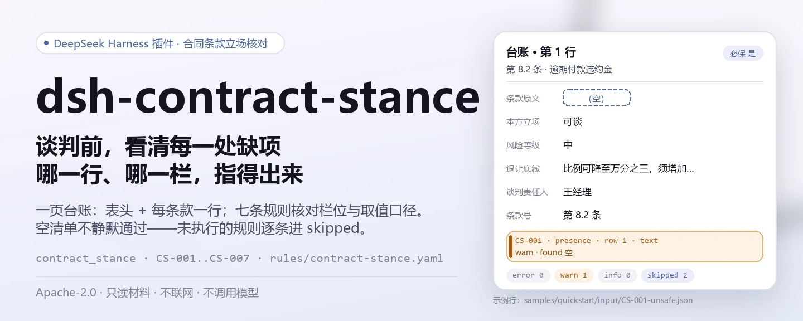
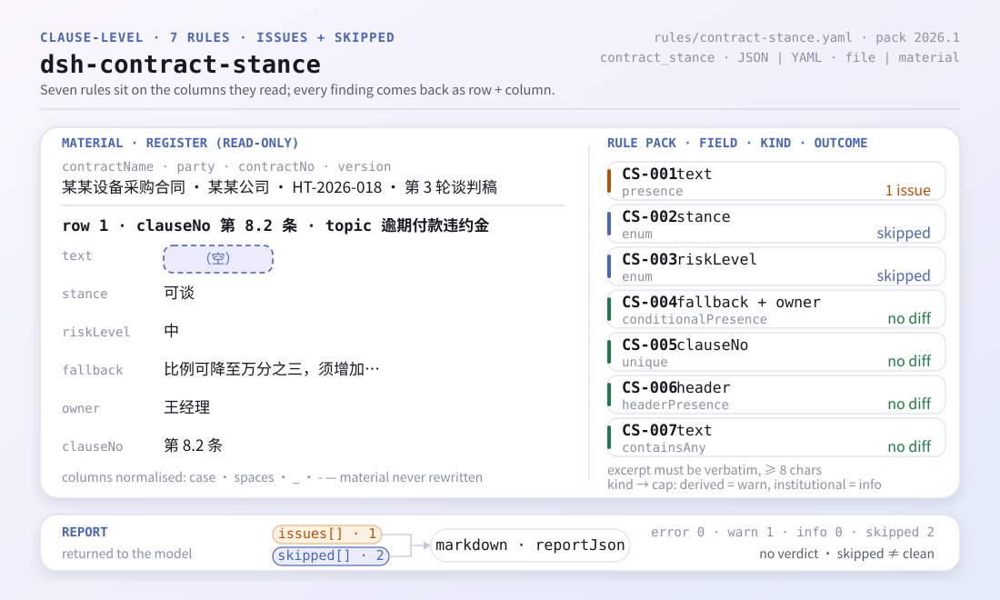
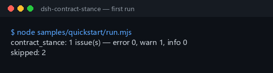

<div align="center">

<picture>
  <source media="(prefers-color-scheme: dark)" srcset="docs/assets/dsh-contract-stance-hero-zh-dark.webp">
  
</picture>

# dsh-contract-stance

**把合同条款立场台账的缺项与自相矛盾，在谈判前变成一份可逐条指认的清单。**

面向法务与合同管理员的主机端核对插件：读取一份「合同表头 + 每条款一行」的立场台账，按逐字引用的规则库列出「哪一行、哪一栏、差什么」，不改原件、不判定合规。

[安装](#三步上手) · [配置](#配置) · [FAQ](#faq) · [简体中文](README.md) · [English](README.en.md)

[](LICENSE)
[](#兼容性)
[](https://www.npmjs.com/package/dsh-contract-stance)
[](https://github.com/PerryLink/dsh-contract-stance/actions/workflows/ci.yml)
[](#兼容性)

[](https://github.com/PerryLink/dsh-contract-stance/stargazers)
[](https://www.npmjs.com/package/dsh-contract-stance)
[](https://dshfind.com/en/plugins/PerryLink/dsh-contract-stance?ref=badge)
[](https://securityscorecards.dev/viewer/?uri=github.com/PerryLink/dsh-contract-stance)
[](https://dsh.market/)
[](https://gitee.com/perrylink/dsh-contract-stance)

```sh
dsh plugin --profile <name> add dsh-contract-stance
```

</div>

<sub>社区插件，与 DeepSeek 官方无关。唯一仓库：<https://github.com/PerryLink/dsh-contract-stance>（Gitee 为镜像）。</sub>

## 它是什么

`dsh-contract-stance` 读取一份**合同条款立场台账**——合同表头加每条条款一行——只核对这份台账自身的齐备与自洽：条款原文是否摘录、本方立场是否取自本机构口径、风险等级是否同样在册、必保条款是否写明退让底线与责任人、条款号是否唯一、表头是否声明合同与本方、条款原文是否残留未替换的占位符。它输出的是「哪一行、哪一栏、差什么」的差异清单；材料只读，原样保留。

插件注册单一工具 `contract_stance`，材料用 JSON 或 YAML，`file` 与 `material` 二选一。

<picture>
  <source media="(prefers-color-scheme: dark)" srcset="docs/assets/dsh-contract-stance-flow-v5-dark.svg">
  
</picture>

## 三步上手

1. **安装**（npm 已发布 `0.2.11`）：

   ```sh
   dsh plugin --profile <name> add dsh-contract-stance
   dsh --profile <name> --dump-config | grep 'dsh-contract-stance'
   ```

2. **在本仓库内跑一次自带样例**（先构建宿主产物）：

   ```sh
   pnpm install && pnpm run build
   node samples/quickstart/run.mjs
   ```

   ```text
   $ node samples/quickstart/run.mjs
   contract_stance: 1 issue(s) — error 0, warn 1, info 0
   skipped: 2
   ```

   样例输入在 `samples/quickstart/input/CS-001-unsafe.json`，期望摘要见 `samples/quickstart/expected/result.json`，同一输出收录在 `docs/assets/quickstart.log`。

3. **在会话里调用工具**：

   ```text
   用 contract_stance 核对 samples/quickstart/input/CS-001-unsafe.json
   ```

   工具也接受内联材料：`{"material": "contractName: …\nrows:\n  - …"}`。输出含 `summary`、`issueCount`、`skippedCount`、`markdown` 与 `reportJson`。



**卸载**：`dsh plugin --profile <name> remove dsh-contract-stance`（或从 profile patch 删掉该行）。

## 核心能力

- **单一工具、两种材料入口** —— `contract_stance` 接受 `file`（JSON/YAML 绝对路径）或 `material`（内联文本）；两者都为空时明确报错，不回退到猜测。
- **七条规则，全部由规则库声明** —— `CS-001` 至 `CS-007` 覆盖条款原文、立场口径、风险等级口径、必保条款的底线与责任人、条款号唯一性、表头声明与占位符；替换 `rules/contract-stance.yaml` 即可切换规则集，无需改代码。
- **空清单不静默通过** —— 立场清单（`CS-002`）与风险等级清单（`CS-003`）出厂为空，未配置时两条规则把自己列入 `skipped` 并写明原因，绝不当作「无差异」。
- **只列差异，不作定性** —— 共享渲染层内置措辞守卫（`src/shared/wording.ts`、`src/shared/render.ts`），每份报告固定附加免责声明；测试套件对模型可见的 `markdown` 做同一检查。不判合规、不认定责任、不建议是否签署。
- **只读材料** —— 不修改输入文件、不写入任何文件、不发起网络请求、不调用模型。
- **注册即 effect** —— `ctx.tools.register` 返回 disposer，插件停用或热重载时工具随之撤销。

| 规则 | 核对什么 | 级别 | 依据类型 |
|---|---|---|---|
| `CS-001` | 每条条款都摘录原文 | warn | 原则性（derived-from-principle） |
| `CS-002` | 本方立场取自本机构配置的取值清单（默认关闭） | info | 原则性（derived-from-principle） |
| `CS-003` | 风险等级取自本机构配置的取值清单（默认关闭） | info | 直接（direct） |
| `CS-004` | 必保条款同时写明退让底线与谈判责任人 | warn | 直接（direct） |
| `CS-005` | 条款号在台账内唯一（比较时忽略空白） | warn | 原则性（derived-from-principle） |
| `CS-006` | 表头写明合同名称与本方主体 | warn | 直接（direct） |
| `CS-007` | 条款原文不残留未替换的占位符 | warn | 原则性（derived-from-principle） |

### 输出结构

工具返回 `summary`（`error`/`warn`/`info` 计数）、`issueCount`、`skippedCount`、`markdown`（模型读的渲染文本）与 `reportJson`（完整报告的规范化 JSON）。`reportJson` 中每条差异带稳定的 `id`（`<插件>.<规则>.<位置哈希>`）、`locator`（行/栏）、`found`、`expected`、`basis` 与可选 `fix`。

### 示例

以下为真实夹具的差异结构（`reportJson.issues[0]`，节选）。输入：

~~~json
{"rows":[{"条款号":"第 8.2 条","条款主题":"逾期付款违约金","条款原文":"", ...}]}
~~~

输出：

~~~json
{
  "id": "dsh-contract-stance.CS-001.de09b5a6",
  "ruleId": "CS-001",
  "severity": "warn",
  "locator": {
    "row": 1,
    "field": "text"
  },
  "found": "第 1 行「text」为空",
  "expected": "「text」应填写",
  "fix": "补填条款原文；本条只核对是否摘录，不判断条款是否可接受"
}
~~~

*出处：`tests/fixtures/CS-001/CS-001-unsafe.json`、`tests/fixtures/CS-001/cases.json`、`rules/contract-stance.yaml`、`tests/index.test.ts`。*

## 规则与依据

| 文件 | 文号 | 引用它的规则 |
|---|---|---|
| 《中华人民共和国民法典》 | 现行版本与条号本次未核实 | CS-001, CS-002, CS-003, CS-004, CS-005, CS-006, CS-007 |

**边界：** 本插件核对一份**合同条款立场台账**，范围限于台账自身可以据以要求的事项——每一条款的原文是否记录、你的立场是否取自你配置的取值口径、风险等级是否同样取自该口径、必保条款是否同时记录可以让步到的底线与责任人、条款号是否唯一、台账是否写明合同与本方、是否残留占位符。它**不**判定某条款是否应当接受、某项风险是否可承受、是否应当签署，也不判定谈判策略是否妥当。**这些取决于交易本身、对方的议价能力与你自己的风险偏好。**

> ### ⚠️ 引文依据什么——以及一件绝不能交给本插件的东西
>
> **《中华人民共和国民法典》已取得并逐字阅读**，`rules/evidence/clause-verification.md` 记录了所引内容：第四百六十五条（依法成立的合同受法律保护、仅对当事人具有法律约束力）、第四百七十条（合同内容**一般包括**当事人、标的、数量、质量、价款、履行期限、违约责任与争议解决方法）、第四百九十六条（格式条款的提示与说明义务）、第四百九十七条（格式条款无效的情形）、第五百零六条（免责条款无效的情形）、第五百零九条、第五百七十七条（违约的后果）与第五百八十四条（损害赔偿包括可得利益，但以**可预见性**为限）。规则库的 `excerpt` 是逐字引文，`basis.number` 仍保留「现行版本与条号本次未核实」——本次未取到附则与施行日期，故不对版本与施行日期作断言。
>
> **合同编并不规范谈判台账。** 它规范合同的订立、效力、履行与违约责任；台账的栏位来自你自己的企业合同管理制度。因此每条规则仍封顶为 `warn` 或 `info`：**「这一栏是空的」不得被读作「这违反了《民法典》」。** 另请注意，第四百七十条写的是**一般包括**，不是应当包括——这也是 `CS-001` 不主张直接义务的又一理由。
>
> ⚠️ **不要向本插件添加诉讼时效规则。** 《民法典》*确实*规定了具体数字——第一百八十八条规定三年诉讼时效（最长二十年），第二百零三条规定期间最后一日为法定休假日时顺延——这让「直接比较日期」看起来很有吸引力。但在这里行不通：该期间从**债权人知道或者应当知道**损害与债务人之日起算，而这是台账并不记录的事实认定；该期间还适用中止（第一百九十四条）与中断（第一百九十五条），第一百九十六条则列出根本不适用诉讼时效的请求权。日期算术规则会把事实认定包装成计算，而这恰恰是本插件族要避免的过度主张。
>
> **本插件任何地方都不对条款的实质作出判断。** 它读取你自己的列，只核对这些列是否填写、是否取自你的词汇表。有两份词汇表出厂为**空**——立场清单（`CS-002`）与风险等级（`CS-003`）——因此在未配置任何内容时，这些规则会在 `skipped` 中自行报告，而不是静默通过。

### 规则来源

规则数据与代码分离：每条规则都带文件名、文号、按原文自身编号体系的条款号、逐字摘录与来源地址。加载期强制：摘录必须是真实引文且不少于八个字符；依据仅为原则性条款（`kind: derived-from-principle`，严重级上限 `warn`）或本机构配置（`kind: institutional-configuration`，上限 `info`）的检查不得标为 `error`。夸大依据的规则库会在加载期失败，而不会产出一份看起来很有底气的报告。

核验中确认的边界与「刻意没有作出的结论」见 `rules/evidence/` 目录；`pnpm run check:citations` 在 CI 中复核这条纪律。

## 配置

全部可调参数都在 `src/config.ts` 的 Schemastery schema 中，只改 `cordis.yml` 即可生效，无需改代码；逐条规则的阈值与取值清单在 `rules/contract-stance.yaml` 里。

| 键 | 类型 | 默认值 | 说明 |
|---|---|---|---|
| `rulesFile` | string | `rules/contract-stance.yaml` | 规则库文件路径，相对插件包根目录 |
| `disabledRules` | string[] | `[]` | 要停用的规则 id 列表；每条都会出现在 `skipped` 中 |
| `onlyRules` | string[] | `[]` | 只执行这些规则 id；留空表示执行全部规则 |
| `skipNotes` | string | `""` | 附加到每条 `skipped` 说明后的备注 |
| `timeoutMs` | number | `120000` | 工具协作式超时预算（毫秒） |

规则级参数（写在规则库文件里，不在 Config 中）：

- `CS-002` 的 `values` —— 你的立场词汇表，例如 `[坚持, 可谈, 接受, 须删除]`；留空表示不检查。
- `CS-003` 的 `values` —— 你的风险等级，例如 `[高, 中, 低]`；留空表示不检查。
- `CS-004` 的 `conditionValues` —— 「是否必保」栏中表示必保的取值，默认 `[是, Y, yes, true, 必保, √]`。
- `CS-007` 的 `terms` —— 要查找的占位符术语清单。

profile patch 覆盖示例：

```yaml
- insert:
    - id: dsh-contract-stance
      name: dsh-contract-stance
      config:
        onlyRules: [CS-001, CS-004, CS-006]
        skipNotes: 本机构合同管理办法（2026 版）
```

## 材料格式

接受 JSON 与 YAML。最小形态是「表头 + 每条款一行」：

```yaml
contractNo: HT-2026-018
contractName: 某某设备采购合同
party: 某某公司
version: 第 3 轮谈判稿
rows:
  - { 条款号: 第 8.2 条, 条款主题: 逾期付款违约金,
      条款原文: 买方逾期付款的，每逾期一日按未付金额的万分之五向卖方支付违约金。,
      本方立场: 可谈, 风险等级: 中, 风险说明: 违约金比例高于本方惯例且未设上限,
      退让底线: 比例可降至万分之三，须增加总额不超过合同额 5% 的上限,
      是否必保: 是, 谈判责任人: 王经理 }
```

列名大小写不敏感，并忽略空格、下划线与连字符；台账自己的列名会保留在 `locator` 中，方便按原件回查。表头字段 `contractName` 与 `party` 是 `CS-006` 的核对对象；`version` 可用于区分多轮谈判稿。材料只读，插件不会改写输入文件。

## FAQ

<details>
<summary>某行只填了条款主题，条款原文栏是空的，会被报出吗？</summary>

会。`CS-001` 要求每行都填写 `text` 栏：没有原文，就无法核对立场是针对什么措辞作出的。本条只核对原文栏是否填写，不判断该条款是否应当接受、是否存在法律风险。

</details>

<details>
<summary>立场栏与风险等级栏都填了，为什么每行都报 `skipped`？</summary>

因为两份取值清单出厂都是空的。`CS-002` 只接受为本机构配置的清单里的 `stance` 取值，`CS-003` 对 `riskLevel` 同理；未配置清单时两条规则都无法执行，于是各自报告 `skipped`，而不是静默通过。`CS-002` 只核对所填值是否在册，不判断该立场是否恰当；`CS-003` 只核对是否在册，不判断该条款的实际风险有多高。

</details>

<details>
<summary>某条标了「必保」，但没有写可以让到哪里、由谁决策。</summary>

`CS-004` 读取台账自己的「是否必保」栏：该栏取值为 `是`、`Y`、`yes`、`true`、`必保` 或 `√`（由 `conditionValues` 配置）时，要求 `fallback` 与 `owner` 两栏都填写。它只核对这两栏是否填写，不判断该退让底线是否合理；哪些条款属于必保条款完全取决于本项目，本条不作判定。

</details>

<details>
<summary>同一个条款号在两行各出现一次，一行对应一个谈判稿版本，算问题吗？</summary>

`CS-005` 会报出重复的条款号，比较时忽略空白字符。条款号重复会让人无法准确指认是哪一条；同一条款在多个谈判稿版本中各有一行是正常情形，请在版本栏加以区分，而不是重复使用条款号。没有任何条文规定条款号不得重复，唯一性只是台账可指认性的需要。

</details>

<details>
<summary>表头没有写明这是哪份合同、本方是哪个主体，会怎样？</summary>

`CS-006` 要求材料顶层写明 `contractName`（合同名称）与 `party`（本方名称）：不写明这两项，立场就无法追溯到具体的交易与主体。若本机构表式另有版本栏，把该栏加进本条的 `fields` 即可。本条只核对表头是否声明了这两项，不判断合同本身。

</details>

## 安全边界

- **只读，不写盘。** 工具只读取 `file` 指向的材料或 `material` 内联文本；不修改原件、不生成文件、不缓存材料。`package.json` 的 `dsh.demo` 声明 `network: false`、`writes: []`，实现中也没有任何网络或模型调用。
- **不作出定性结论。** 报告只列「材料与所引条款之间的字面差异」；每份报告固定附加免责声明，共享渲染层在输出前用措辞守卫拒绝「合规／违规／无效合同」这类定性词（`src/shared/render.ts`），测试套件对模型可见的 `markdown` 做同一检查。专业判断留给复核人。
- **引用纪律是硬门禁。** 规则库加载期校验 `excerpt` 必须是不少于八个字符的真实引文，`kind` 决定严重级上限（`derived-from-principle` 封顶 `warn`，`institutional-configuration` 封顶 `info`）；依据夸大的规则库直接加载失败。
- **空结果不等于没有问题。** 任何因缺少取值清单、停用或只跑部分规则而无法执行的检查，都会逐条列入 `skipped` 并写明原因；「没有差异」只在全部声明规则都已执行时成立。
- **注册即 effect。** 工具注册返回 disposer，停止或热重载插件即可撤销注册；插件不注册命令、客户端 slot、HTTP 路由或共享事件监听。
- **权限与数据。** manifest 只声明 `tools:register`；读取用户指定的材料文件，不写文件、不联网、不存凭据。材料内容只进入本次工具调用的报告，插件侧不落盘。

## 已知限制

- **只核对台账，不核对合同正文。** 台账抄错、漏抄或与合同正文不一致，本插件发现不了——它的工作对象是台账本身，不是合同文件。
- **立场与风险等级清单出厂为空。** `CS-002`、`CS-003` 的口径由本机构定义，插件不猜；未配置即如实进 `skipped`。
- **民法典不规定台账形式。** 合同编规范的是订立、效力、履行与责任；「栏位没填」与「违反民法典」是两件事，所有规则封顶 `warn`／`info`。
- **不核对诉讼时效，且不应添加此类规则。** 时效起算点是「知道或者应当知道」这一事实认定，台账不记录；中止、中断与不适用时效的请求权也无法从台账判断（详见「规则与依据」）。
- **条款号唯一性只是可指认性的需要。** 同一条款按谈判稿分多行是正常形态，应在版本栏区分；`CS-005` 只报重复，不判断重复是否合理。
- **表头与枚举按字面取值匹配。** 列名做大小写与空格／下划线／连字符归一；「是否必保」的判定取值由 `conditionValues` 决定，换表式时需同步配置。
- **工具模式**：`native` 与 `ptc` 均可；整目录批量核对建议 `ptc`，schema 成本只付一次。

<details>
<summary>故障排查</summary>

- **插件装上了但工具不出现**：确认 `main` 指向 `lib/index.mjs` 且 `pnpm run build` 已生成该文件；`main` 写错会让加载器静默跳过该条目。
- **`dsh plugin add` 报版本不兼容**：peer 范围覆盖 `0.1.x` 与 `0.2.x`，`engines.dsh` 为 `>=0.2.1-0 <0.3.0`；若运行时在其之外，可显式豁免：`dsh plugin --profile <name> allow-version <包名@版本> --dsh-version <runtime> --accept-risk`。
- **某条规则没有执行**：查看 `skipped` 数组，其中写明了规则 id 与原因。
- **`check` 报 `manifest-peers` 失败**：静态检查器比对的是一份早于 0.2 世代的硬编码 peer 范围；安装期的 peer 校验以运行时为准。这是 `dsh-plugin-dev` 的已知上游问题。
- **时间看起来偏移**：全部计算都是对输入字符串做墙上时钟运算，不做时区换算。

</details>

## 与其他插件的互操作性

- **只注册一个工具。** `contract_stance` 是插件唯一暴露给模型的表面；它不提供 service key、不注册 `/` 命令、不注册客户端 slot、不注册 `webServer` 前缀、不监听共享会话事件。
- **依赖宿主 `tools` 服务。** `inject: ['tools']` 表示工具只在 `tools` 服务可用时注册；宿主没有该服务时插件不会以半初始化状态运行。
- **bundle patch 只 `insert` 自己一行。** `cordis.patch.yml` 不覆盖任何内置行的 `config`。
- **无全局改写。** 不改原型、不改写 `process.env`、不替换全局 fetch dispatcher、不改动宿主目录结构。
- **没有可争抢的资源。** 由于不占用服务键、slot、HTTP 路由与共享事件，同一 profile 中的其他插件不会因本插件产生这四类冲突。

## 兼容性

| 维度 | 状态 |
|---|---|
| Harness | 对等版本范围 `>=0.1.2-rc.1 <0.2.0 \|\| >=0.2.0-0 <0.3.0`——已实测同时接受 `0.2.0-rc.2` 与 `0.2.1-rc.2`。`engines.dsh` 声明为 `>=0.2.1-0 <0.3.0`，0.2.1 起由宿主单独裁决 |
| Node | `^22.19.0 \|\| >=24.0.0` |
| 平台 | 全平台（纯 ESM；无原生代码、无联网、不调用模型） |
| 工具模式 | `native` / `ptc` 均可；批量校验整个目录时建议 `ptc` |

## 生态与质量

- [dshfind 插件页](https://dshfind.com/en/plugins/PerryLink/dsh-contract-stance)（安装量与排名）
- [OpenSSF Scorecard 报告](https://securityscorecards.dev/viewer/?uri=github.com/PerryLink/dsh-contract-stance)（由 [.github/workflows/scorecard.yml](.github/workflows/scorecard.yml) 驱动）
- [DSH Market](https://dsh.market/)（已上架）
- [Gitee 镜像](https://gitee.com/perrylink/dsh-contract-stance)（同步镜像，以 GitHub 为准）
- [规则核查记录](rules/evidence/clause-verification.md)（逐条记录引文来源与刻意未作的结论）
- [按材料选核查器](https://perrylink.github.io/zh/checkers/choose/) · [PerryLink 插件全景](https://github.com/PerryLink)

## 开发

```sh
pnpm install
pnpm run typecheck
pnpm test
pnpm run build
node samples/quickstart/run.mjs
pnpm run verify:self-contained
pnpm run check:lockfile
pnpm run check:readmes
pnpm run check:citations
pnpm pack
```

`node ../scripts/sync-shared.mjs dsh-contract-stance` 把 `../_shared` 的共享件同步进 `src/shared/`；每次改动共享件后都要重跑。插件是**数据驱动**的：`src/model.ts` 声明表结构与列别名，共享包提供读取与检查引擎，规则库声明每一条检查。

README 配图由 [`scripts/gen-readme-assets.py`](scripts/gen-readme-assets.py) 程序化生成（Python + Pillow 出 hero，手写 SVG 出结构图），输出 `docs/assets/dsh-contract-stance-hero-{zh,en}-{light,dark}.webp` 与 `docs/assets/dsh-contract-stance-flow-v5-{light,dark}.svg`；可重复执行，结构图内只含命令与配置键 token，五语共用。

Topics：`deepseek-harness`, `dsh`, `dsh-plugin`, `cordis`, `contract`, `stance`

## 家族与致谢

本项目是 [PerryLink](https://github.com/PerryLink) 维护的 DeepSeek Harness 插件家族成员（全部 Apache-2.0）。如果这个插件帮到了你，**给个 star**——它不解锁任何功能，但会让下一个人更容易找到它。

- [@PerryLink](https://github.com/PerryLink) —— 创建者与维护者：规则库（CS-001..CS-007）、共享核对引擎接入、条款核查记录与五语文档。

<details>
<summary>展开全部插件</summary>

| 插件 | 状态 |
|---|---|
| **[dsh-aqua-input-check](https://github.com/PerryLink/dsh-aqua-input-check)** |  |
| **[dsh-archive-check](https://github.com/PerryLink/dsh-archive-check)** |  |
| **[dsh-auto-review](https://github.com/PerryLink/dsh-auto-review)** |  |
| **[dsh-autotier](https://github.com/PerryLink/dsh-autotier)** | 🧊 已冻结 — 见仓库 README |
| **[dsh-bid-ca-precheck](https://github.com/PerryLink/dsh-bid-ca-precheck)** |  |
| **[dsh-bid-qual-check](https://github.com/PerryLink/dsh-bid-qual-check)** |  |
| **[dsh-cert-mcp](https://github.com/PerryLink/dsh-cert-mcp)** | 🧊 已冻结 — 见仓库 README |
| **[dsh-checkpoint-rewind](https://github.com/PerryLink/dsh-checkpoint-rewind)** |  |
| **[dsh-click](https://github.com/PerryLink/dsh-click)** |  |
| **[dsh-composer-history](https://github.com/PerryLink/dsh-composer-history)** |  |
| **[dsh-contract-stance](https://github.com/PerryLink/dsh-contract-stance)** |  |
| **[dsh-customs-doc-check](https://github.com/PerryLink/dsh-customs-doc-check)** |  |
| **[dsh-data-quality](https://github.com/PerryLink/dsh-data-quality)** | 🧊 已冻结 — 见仓库 README |
| **[dsh-demurrage-ledger](https://github.com/PerryLink/dsh-demurrage-ledger)** |  |
| **[dsh-doublecheck](https://github.com/PerryLink/dsh-doublecheck)** |  |
| **[dsh-drill-script-check](https://github.com/PerryLink/dsh-drill-script-check)** |  |
| **[dsh-eia-guide-check](https://github.com/PerryLink/dsh-eia-guide-check)** |  |
| **[dsh-emergency-plan](https://github.com/PerryLink/dsh-emergency-plan)** |  |
| **[dsh-essay-rubric-check](https://github.com/PerryLink/dsh-essay-rubric-check)** |  |
| **[dsh-evidence-check](https://github.com/PerryLink/dsh-evidence-check)** |  |
| **[dsh-export-ctl-check](https://github.com/PerryLink/dsh-export-ctl-check)** |  |
| **[dsh-fast](https://github.com/PerryLink/dsh-fast)** |  |
| **[dsh-fmea-table-check](https://github.com/PerryLink/dsh-fmea-table-check)** |  |
| **[dsh-forecast-penalty](https://github.com/PerryLink/dsh-forecast-penalty)** |  |
| **[dsh-fund-research](https://github.com/PerryLink/dsh-fund-research)** |  |
| **[dsh-github](https://github.com/PerryLink/dsh-github)** |  |
| **[dsh-gongwen-flow-check](https://github.com/PerryLink/dsh-gongwen-flow-check)** |  |
| **[dsh-gongwen-word-check](https://github.com/PerryLink/dsh-gongwen-word-check)** |  |
| **[dsh-guard-plan-qc](https://github.com/PerryLink/dsh-guard-plan-qc)** |  |
| **[dsh-hazchem-check](https://github.com/PerryLink/dsh-hazchem-check)** |  |
| **[dsh-hazplan-check](https://github.com/PerryLink/dsh-hazplan-check)** |  |
| **[dsh-hidden-risk-map](https://github.com/PerryLink/dsh-hidden-risk-map)** |  |
| **[dsh-hs-classify](https://github.com/PerryLink/dsh-hs-classify)** |  |
| **[dsh-icd-rule-check](https://github.com/PerryLink/dsh-icd-rule-check)** |  |
| **[dsh-industry-research](https://github.com/PerryLink/dsh-industry-research)** |  |
| **[dsh-lawcite-adapter](https://github.com/PerryLink/dsh-lawcite-adapter)** |  |
| **[dsh-laya](https://github.com/PerryLink/dsh-laya)** |  |
| **[dsh-lc-doc-check](https://github.com/PerryLink/dsh-lc-doc-check)** |  |
| **[dsh-learning-gap-check](https://github.com/PerryLink/dsh-learning-gap-check)** |  |
| **[dsh-library](https://github.com/PerryLink/dsh-library)** |  |
| **[dsh-local-ai](https://github.com/PerryLink/dsh-local-ai)** |  |
| **[dsh-lsp-actions](https://github.com/PerryLink/dsh-lsp-actions)** |  |
| **[dsh-mask](https://github.com/PerryLink/dsh-mask)** |  |
| **[dsh-mcp-panel](https://github.com/PerryLink/dsh-mcp-panel)** |  |
| **[dsh-medrec-qc](https://github.com/PerryLink/dsh-medrec-qc)** |  |
| **[dsh-memento](https://github.com/PerryLink/dsh-memento)** | 🧊 已冻结 — 见仓库 README |
| **[dsh-nsfc-form-check](https://github.com/PerryLink/dsh-nsfc-form-check)** |  |
| **[dsh-nurse-record-check](https://github.com/PerryLink/dsh-nurse-record-check)** |  |
| **[dsh-observe](https://github.com/PerryLink/dsh-observe)** |  |
| **[dsh-origin-rvc-check](https://github.com/PerryLink/dsh-origin-rvc-check)** |  |
| **[dsh-ota-review-check](https://github.com/PerryLink/dsh-ota-review-check)** |  |
| **[dsh-output-styles](https://github.com/PerryLink/dsh-output-styles)** |  |
| **[dsh-paper-doc-adapter](https://github.com/PerryLink/dsh-paper-doc-adapter)** |  |
| **[dsh-permission-rules](https://github.com/PerryLink/dsh-permission-rules)** |  |
| **[dsh-permit-report-check](https://github.com/PerryLink/dsh-permit-report-check)** |  |
| **[dsh-pipeline-check](https://github.com/PerryLink/dsh-pipeline-check)** |  |
| **[dsh-pleading-draft](https://github.com/PerryLink/dsh-pleading-draft)** |  |
| **[dsh-plugin-doctor](https://github.com/PerryLink/dsh-plugin-doctor)** | 🚫 已退役（仓库已归档） |
| **[dsh-plugin-guide](https://github.com/PerryLink/dsh-plugin-guide)** |  |
| **[dsh-plugin-kit](https://github.com/PerryLink/dsh-plugin-kit)** | 🚫 已退役（仓库已归档） |
| **[dsh-plugin-upgrade](https://github.com/PerryLink/dsh-plugin-upgrade)** | 🚫 已退役（仓库已归档） |
| **[dsh-policy-brief-draft](https://github.com/PerryLink/dsh-policy-brief-draft)** |  |
| **[dsh-power-loss-split](https://github.com/PerryLink/dsh-power-loss-split)** |  |
| **[dsh-power-ticket-check](https://github.com/PerryLink/dsh-power-ticket-check)** |  |
| **[dsh-ppap-check](https://github.com/PerryLink/dsh-ppap-check)** |  |
| **[dsh-protest-deadline](https://github.com/PerryLink/dsh-protest-deadline)** |  |
| **[dsh-railway-window](https://github.com/PerryLink/dsh-railway-window)** |  |
| **[dsh-repair-order-qc](https://github.com/PerryLink/dsh-repair-order-qc)** |  |
| **[dsh-research-report](https://github.com/PerryLink/dsh-research-report)** |  |
| **[dsh-review-reply-check](https://github.com/PerryLink/dsh-review-reply-check)** |  |
| **[dsh-rulefile-check](https://github.com/PerryLink/dsh-rulefile-check)** |  |
| **[dsh-safety-brief-check](https://github.com/PerryLink/dsh-safety-brief-check)** |  |
| **[dsh-score](https://github.com/PerryLink/dsh-score)** | 🧊 已冻结 — 见仓库 README |
| **[dsh-session-sync](https://github.com/PerryLink/dsh-session-sync)** |  |
| **[dsh-site-log-check](https://github.com/PerryLink/dsh-site-log-check)** |  |
| **[dsh-skill-pack-security](https://github.com/PerryLink/dsh-skill-pack-security)** |  |
| **[dsh-soe-decision-check](https://github.com/PerryLink/dsh-soe-decision-check)** |  |
| **[dsh-soilwater-check](https://github.com/PerryLink/dsh-soilwater-check)** |  |
| **[dsh-sop-sync-check](https://github.com/PerryLink/dsh-sop-sync-check)** |  |
| **[dsh-spc-gbt-adapter](https://github.com/PerryLink/dsh-spc-gbt-adapter)** |  |
| **[dsh-talk](https://github.com/PerryLink/dsh-talk)** |  |
| **[dsh-tender-extract](https://github.com/PerryLink/dsh-tender-extract)** |  |
| **[dsh-tender-matrix](https://github.com/PerryLink/dsh-tender-matrix)** |  |
| **[dsh-test-drive](https://github.com/PerryLink/dsh-test-drive)** |  |
| **[dsh-ticktick](https://github.com/PerryLink/dsh-ticktick)** | 🚫 已退役（仓库已归档） |
| **[dsh-translate](https://github.com/PerryLink/dsh-translate)** |  |
| **[dsh-warranty-calc](https://github.com/PerryLink/dsh-warranty-calc)** |  |
| **[dsh-budget](https://github.com/PerryLink/dsh-budget)** |  |
| **[dsh-claude-move](https://github.com/PerryLink/dsh-claude-move)** |  |
| **[dsh-defend](https://github.com/PerryLink/dsh-defend)** |  |
| **[dsh-draw](https://github.com/PerryLink/dsh-draw)** | 🧊 已冻结 — 见仓库 README |
| **[dsh-reach](https://github.com/PerryLink/dsh-reach)** |  |
| **[dsh-background-agents](https://github.com/PerryLink/dsh-background-agents)** | 🚫 已退役（仓库已归档） |
| **[dsh-session-pin](https://github.com/PerryLink/dsh-session-pin)** | 🚫 已退役（仓库已归档） |
| **[dsh-team-rooms](https://github.com/PerryLink/dsh-team-rooms)** | 🚫 已退役（仓库已归档） |

</details>

## License

[LICENSE](LICENSE)（Apache License 2.0）© 2026 dsh-contract-stance contributors

<p align="center"><sub>Apache-2.0 · 社区插件，与 DeepSeek 无关。</sub></p>
