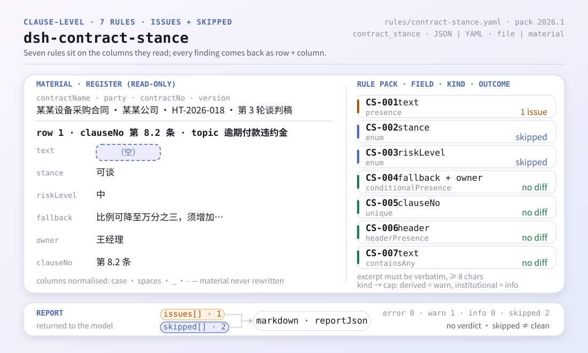
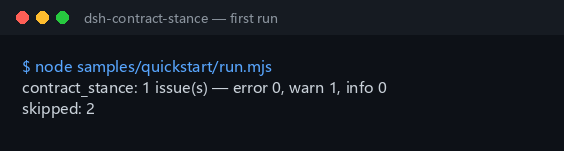

<div align="center">

<picture>
  <source media="(prefers-color-scheme: dark)" srcset="docs/assets/dsh-contract-stance-flow-v5-dark.svg">
  
</picture>

# dsh-contract-stance

**Transforme as lacunas e contradições de um registo de posições sobre cláusulas numa lista de correções linha a linha, antes de negociar.**

Um verificador do lado do host para juristas internos e gestores de contratos: lê um registo de posições (cabeçalho do contrato mais uma linha por cláusula) e enumera o que falta e onde, guiado por um pacote de regras cujas citações são literais — nunca altera o material nem emite juízos sobre conformidade.

[Instalação](#instalação-em-três-passos) · [Configuração](#configuração) · [FAQ](#faq) · [简体中文](README.md) · [English](README.en.md) · [Español](README.es.md) · [Português](README.pt.md) · [हिन्दी](README.hi.md)

[](LICENSE)
[](#compatibilidade)
[](https://www.npmjs.com/package/dsh-contract-stance)
[](https://github.com/PerryLink/dsh-contract-stance/actions/workflows/ci.yml)
[](#compatibilidade)

[](https://github.com/PerryLink/dsh-contract-stance/stargazers)
[](https://www.npmjs.com/package/dsh-contract-stance)
[](https://dshfind.com/en/plugins/PerryLink/dsh-contract-stance?ref=badge)
[](https://securityscorecards.dev/viewer/?uri=github.com/PerryLink/dsh-contract-stance)
[](https://dsh.market/)
[](https://gitee.com/perrylink/dsh-contract-stance)

```sh
dsh plugin --profile <name> add dsh-contract-stance
```

</div>

<sub>Plugin da comunidade, não afiliado à DeepSeek. Repositório canónico: <https://github.com/PerryLink/dsh-contract-stance> (o Gitee é um espelho).</sub>

## O que é

`dsh-contract-stance` lê um **registo de posições sobre cláusulas contratuais** —o cabeçalho do contrato mais uma linha por cláusula— e verifica a completude e a coerência interna desse registo: se o texto de cada cláusula está registado, se a sua posição vem do seu próprio vocabulário e se a classificação de risco também, se uma cláusula irrenunciável regista tanto um limite de cedência como um responsável, se os números de cláusula são únicos, se o registo declara o contrato e a sua própria parte e se não resta nenhum marcador de modelo por substituir no texto da cláusula. Devolve uma lista de diferenças linha a linha; o material é apenas de leitura e fica como está.

O plugin regista uma única ferramenta, `contract_stance`. O material é JSON ou YAML e é passado como `file` ou como `material`.

## Instalação em três passos

1. **Instalar** (o npm `0.2.11` está publicado):

   ```sh
   dsh plugin --profile <name> add dsh-contract-stance
   dsh --profile <name> --dump-config | grep 'dsh-contract-stance'
   ```

2. **Executar o exemplo incluído neste repositório** (compile primeiro os artefactos do host):

   ```sh
   pnpm install && pnpm run build
   node samples/quickstart/run.mjs
   ```

   ```text
   $ node samples/quickstart/run.mjs
   contract_stance: 1 issue(s) — error 0, warn 1, info 0
   skipped: 2
   ```

   A entrada do exemplo está em `samples/quickstart/input/CS-001-unsafe.json`, o resumo esperado em `samples/quickstart/expected/result.json`, e a mesma saída está registada em `docs/assets/quickstart.log`.

3. **Chamar a ferramenta numa sessão**:

   ```text
   Use contract_stance on samples/quickstart/input/CS-001-unsafe.json
   ```

   Material em linha também é aceite: `{"material": "contractName: …\nrows:\n  - …"}`. O resultado inclui `summary`, `issueCount`, `skippedCount`, `markdown` e `reportJson`.



**Desinstalar**: `dsh plugin --profile <name> remove dsh-contract-stance` (ou remova a linha do patch do perfil).

## Capacidades principais

- **Uma ferramenta, duas entradas de material** — `contract_stance` aceita `file` (caminho absoluto para JSON/YAML) ou `material` (texto em linha); se ambos estiverem vazios falha de forma visível em vez de adivinhar.
- **Sete regras, todas declaradas como dados** — de `CS-001` a `CS-007` cobrem o texto da cláusula, o vocabulário de posições, o de classificações de risco, o limite de cedência e o responsável de uma cláusula irrenunciável, a unicidade do número de cláusula, as declarações do cabeçalho e os marcadores residuais. Substituir `rules/contract-stance.yaml` muda o conjunto de regras sem tocar em código.
- **Uma lista vazia nunca passa em silêncio** — a lista de posições (`CS-002`) e a de classificações de risco (`CS-003`) vêm vazias; enquanto não forem configuradas, cada regra reporta-se em `skipped` com o motivo, em vez de ser lida como «sem diferenças».
- **Apenas diferenças, sem juízos** — a camada de renderização partilhada inclui um guardião de redação (`src/shared/wording.ts`, `src/shared/render.ts`) e todo o relatório termina com um aviso fixo; a suite de testes aplica a mesma verificação ao texto visível para o modelo. Não decide conformidade, responsabilidade nem se se deve assinar.
- **Apenas leitura** — não altera o ficheiro de entrada, não escreve ficheiros, não faz pedidos de rede nem chama um modelo.
- **O registo é um efeito** — `ctx.tools.register` devolve o disposer que remove a ferramenta ao parar ou recarregar o plugin a quente.

| Regra | O que verifica | Nível | Tipo de base |
|---|---|---|---|
| `CS-001` | o texto de cada cláusula está registado | warn | derivada de princípio |
| `CS-002` | a posição vem do seu vocabulário configurado (desativada por omissão) | info | derivada de princípio |
| `CS-003` | a classificação de risco vem do seu vocabulário configurado (desativada por omissão) | info | direta |
| `CS-004` | uma cláusula irrenunciável regista limite de cedência e responsável | warn | direta |
| `CS-005` | os números de cláusula são únicos no registo (espaços ignorados) | warn | derivada de princípio |
| `CS-006` | o cabeçalho nomeia o contrato e a sua própria parte | warn | direta |
| `CS-007` | o texto da cláusula não conserva marcadores por substituir | warn | derivada de princípio |

### Estrutura da saída

A ferramenta devolve `summary` (contagens de `error`/`warn`/`info`), `issueCount`, `skippedCount`, `markdown` (a representação que o modelo lê) e `reportJson` (o JSON canónico do relatório completo). Cada achado em `reportJson` leva um `id` estável (`<plugin>.<regra>.<hash de localização>`), um `locator` (linha/coluna), `found`, `expected`, `basis` e um `fix` opcional.

### Exemplos

Esta é a estrutura real de um achado do fixture (`reportJson.issues[0]`, extrato). Entrada:

~~~json
{"rows":[{"条款号":"第 8.2 条","条款主题":"逾期付款违约金","条款原文":"", ...}]}
~~~

Saída:

~~~json
{
  "id": "dsh-contract-stance.CS-001.de09b5a6",
  "ruleId": "CS-001",
  "severity": "warn",
  "locator": {
    "row": 1,
    "field": "text"
  },
  "found": "第 1 行「text」为空",
  "expected": "「text」应填写",
  "fix": "补填条款原文；本条只核对是否摘录，不判断条款是否可接受"
}
~~~

*Observado em `tests/fixtures/CS-001/CS-001-unsafe.json`, `tests/fixtures/CS-001/cases.json`, `rules/contract-stance.yaml`, `tests/index.test.ts`.*

## Regras e base

| Documento | Número | Regras que o citam |
|---|---|---|
| Código Civil da República Popular da China | versão em vigor e numeração dos artigos não verificadas nesta passagem | CS-001, CS-002, CS-003, CS-004, CS-005, CS-006, CS-007 |

**Limite:** este plugin verifica um **registo de posições sobre cláusulas** quanto ao que um registo pode exigir de si mesmo — que o texto de cada cláusula seja registado, que a sua posição venha do seu vocabulário e que a classificação de risco também, que uma cláusula irrenunciável registe tanto um limite de cedência como um responsável, que os números de cláusula sejam únicos, que o registo nomeie o contrato e a sua parte e que não reste nenhum marcador. **Não** decide se uma cláusula deve ser aceite, se um risco é suportável, se se deve assinar nem se uma estratégia de negociação é acertada. **Isso depende do negócio, do poder negocial da contraparte e da sua própria tolerância ao risco.**

> ### ⚠️ Em que se apoia a citação — e algo que nunca deve ser dado a este plugin
>
> **O Código Civil da República Popular da China foi obtido e lido literalmente**, e `rules/evidence/clause-verification.md` registra o que foi citado: artigo 465 (o contrato legalmente formado é protegido por lei e vincula apenas as partes), artigo 470 (o conteúdo do contrato **geralmente inclui** as partes, o objeto, a quantidade, a qualidade, o preço, as condições de execução, a responsabilidade por incumprimento e a resolução de litígios), artigo 496 (dever de destacar e explicar as cláusulas-padrão), artigo 497 (quando são nulas as cláusulas-padrão), artigo 506 (quando são nulas as cláusulas de exclusão), artigo 509, artigo 577 (consequências do incumprimento) e artigo 584 (os danos incluem o benefício esperado mas são limitados pela **previsibilidade**). Os campos `excerpt` do pacote são citações literais, enquanto `basis.number` ainda diz «versão em vigor e numeração dos artigos não verificadas nesta passagem»: as disposições complementares e a data de entrada em vigor não foram obtidas, pelo que nada se afirma sobre a versão ou essa data.
>
> **A parte contratual não regula um registo de negociação.** Regula a formação, a validade, a execução e a responsabilidade; as colunas do registo vêm das normas internas de gestão contratual da sua empresa. Por isso todas as regras ficam limitadas a `warn` ou `info`: **«esta coluna está vazia» não deve ser lido como «isto infringe o Código Civil».** Note também que o artigo 470 diz **geralmente inclui**, não deve incluir — mais uma razão pela qual `CS-001` não alega uma obrigação direta.
>
> ⚠️ **Não acrescente ao plugin uma regra de prazo de prescrição.** O Código *sim* fixa números — o artigo 188 estabelece três anos de prescrição (vinte no máximo) e o artigo 203 transfere o prazo para o dia útil seguinte —, o que torna tentador «comparar datas». Não é viável aqui: o prazo corre desde que **o credor soube ou devia saber** do dano e do devedor, uma apreciação de facto que o registo não regista; além disso está sujeito a suspensão (artigo 194) e interrupção (artigo 195), e o artigo 196 enumera pretensões a que a prescrição não se aplica. Uma regra aritmética de datas disfarçaria uma apreciação de facto de cálculo, que é precisamente o exagero que esta família evita.
>
> **Em nenhum ponto deste plugin se julga o mérito de uma cláusula.** Lê as suas próprias colunas e verifica apenas que estão preenchidas e tiradas do seu vocabulário. Dois vocabulários vêm **vazios** —a lista de posições (`CS-002`) e as classificações de risco (`CS-003`)—, pelo que sem nada configurado essas regras se reportam em `skipped` em vez de passarem em silêncio.

### Origem das regras

Os dados das regras estão separados do código: cada regra leva documento, número, cláusula na numeração própria da fonte, extrato literal e URL de origem. O carregador impõe que o extrato seja uma citação real de pelo menos oito caracteres e que uma verificação baseada apenas num princípio (`kind: derived-from-principle`, teto `warn`) ou em configuração local (`kind: institutional-configuration`, teto `info`) nunca seja rotulada como `error`. Um pacote de regras que exagere a sua base falha ao carregar em vez de produzir um relatório com aparência de solidez.

Os limites confirmados na verificação e as conclusões deliberadamente **não** tiradas estão em `rules/evidence/`; `pnpm run check:citations` volta a verificar essa disciplina em CI.

## Configuração

Todos os parâmetros ajustáveis vivem no esquema Schemastery de `src/config.ts`, pelo que se alteram a partir de `cordis.yml` sem tocar no código; os limites e vocabulários por regra estão em `rules/contract-stance.yaml`.

| Chave | Tipo | Padrão | Descrição |
|---|---|---|---|
| `rulesFile` | string | `rules/contract-stance.yaml` | Caminho do pacote de regras, relativo à raiz do pacote |
| `disabledRules` | string[] | `[]` | Ids de regras a desativar; cada uma aparece em `skipped` |
| `onlyRules` | string[] | `[]` | Executar apenas estas regras; vazio executa todas |
| `skipNotes` | string | `""` | Nota acrescentada a cada motivo de `skipped` |
| `timeoutMs` | number | `120000` | Orçamento de tempo limite cooperativo da ferramenta |

Parâmetros por regra (declarados no pacote de regras, não em Config):

- `CS-002` `values` — o seu vocabulário de posições, p. ex. `[manter, negociável, aceitar, eliminar]`; vazio significa que não se verifica.
- `CS-003` `values` — as suas classificações de risco, p. ex. `[alto, médio, baixo]`; vazio significa que não se verifica.
- `CS-004` `conditionValues` — os valores da sua coluna de irrenunciável que marcam uma cláusula como tal.
- `CS-007` `terms` — os termos de modelo que se procuram.

Os valores predefinidos dessas duas listas são dados do pacote de regras:

```text
CS-004 conditionValues: 是 | Y | yes | true | 必保 | √
CS-007 terms: 【 | 】 | {{ | }} | XXX | xxx | 待填 | 待补充 | TBD | todo | 示例
```

Exemplo de substituição no patch do perfil:

```yaml
- insert:
    - id: dsh-contract-stance
      name: dsh-contract-stance
      config:
        onlyRules: [CS-001, CS-004, CS-006]
        skipNotes: Normas internas de gestão contratual, edição 2026
```

## Formato do material

Aceita JSON e YAML. A forma mínima é um cabeçalho mais uma linha por cláusula:

```yaml
contractNo: HT-2026-018
contractName: Contrato de compra de equipamentos de exemplo
party: Comprador de exemplo, Lda.
version: Ronda de negociação 3
rows:
  - { 条款号: 第 8.2 条, 条款主题: 逾期付款违约金,
      条款原文: 买方逾期付款的，每逾期一日按未付金额的万分之五向卖方支付违约金。,
      本方立场: 可谈, 风险等级: 中, 风险说明: 违约金比例高于本方惯例且未设上限,
      退让底线: 比例可降至万分之三，须增加总额不超过合同额 5% 的上限,
      是否必保: 是, 谈判责任人: 王经理 }
```

Os nomes das colunas são comparados sem distinguir maiúsculas de minúsculas e ignorando espaços, sublinhados e hífenes; os nomes próprios do registo são mantidos no `locator`, para que um achado possa ser rastreado até ao material original. O cabeçalho `contractName` e `party` é o que `CS-006` verifica; `version` serve para distinguir rondas de negociação. O material é apenas de leitura: o plugin nunca reescreve o ficheiro de entrada.

## FAQ

<details>
<summary>Uma linha tem tema, mas a coluna do texto da cláusula está vazia. Isso é reportado?</summary>

Sim. `CS-001` exige a coluna `text` em todas as linhas: sem o texto não é possível verificar a que redação se refere a posição. A regra verifica apenas que o texto está registado; não julga se a cláusula deve ser aceite nem se envolve risco jurídico.

</details>

<details>
<summary>A posição e a classificação de risco estão preenchidas, mas todas as linhas voltam como `skipped`. Porquê?</summary>

Porque as duas listas de valores vêm vazias de fábrica. `CS-002` só aceita uma posição da lista configurada para ele, e `CS-003` faz o mesmo com a classificação de risco; sem lista configurada nenhuma das regras consegue correr, por isso cada uma se reporta em `skipped` em vez de passar em silêncio. `CS-002` verifica apenas se o valor consta da sua lista, não se a posição é adequada; `CS-003` verifica apenas se consta da lista, não quão alto é o risco real dessa cláusula.

</details>

<details>
<summary>Uma cláusula está marcada como irrenunciável, mas ninguém escreveu até onde se pode ceder nem quem decide.</summary>

`CS-004` lê a própria coluna de irrenunciável do registo: quando a linha está marcada como irrenunciável (valores definidos por `conditionValues`) exige que as colunas `fallback` e `owner` estejam preenchidas. Verifica apenas que ambas estão preenchidas, não se o limite de cedência é razoável; que cláusulas são irrenunciáveis depende inteiramente do projeto e a regra não o decide.

</details>

<details>
<summary>O mesmo número de cláusula aparece em duas linhas, uma por minuta de negociação. É um achado?</summary>

`CS-005` reporta um número de cláusula repetido, comparando sem considerar os espaços. Um número repetido impede apontar com precisão uma única cláusula. Uma cláusula surgir uma vez por minuta é uma forma normal: distinga-a na coluna de versão em vez de reutilizar o número. Nenhuma cláusula exige que os números sejam únicos: a unicidade é o que torna o registo referenciável.

</details>

<details>
<summary>O cabeçalho não diz de que contrato se trata nem qual é a nossa parte.</summary>

`CS-006` exige que o cabeçalho do material declare `contractName` e `party`: sem esses dois dados a posição não pode ser rastreada até uma operação e uma parte concretas. Se o seu formulário tiver uma coluna de versão para as minutas, acrescente-a aos `fields` dessa regra. A regra verifica apenas que o cabeçalho declara os dois; não julga o contrato em si.

</details>

## Limites de segurança

- **Apenas leitura, sem escritas.** A ferramenta lê o material indicado por `file` ou o texto em linha de `material`; não altera o original, não cria ficheiros nem guarda material em cache. `dsh.demo` em `package.json` declara `network: false` e `writes: []`, e a implementação não contém qualquer chamada de rede ou de modelo.
- **Sem juízos.** O relatório enumera apenas diferenças literais entre o material e a base citada; todo o relatório termina com um aviso fixo, o renderizador partilhado executa um guardião de redação antes de emitir (`src/shared/render.ts`), e a suite de testes aplica a mesma verificação ao `markdown` visível para o modelo. O juízo profissional fica com quem revê.
- **A disciplina de citações é uma porta dura.** Ao carregar, o pacote verifica que `excerpt` é uma citação real de pelo menos oito caracteres e que `kind` limita a severidade (`derived-from-principle` a `warn`, `institutional-configuration` a `info`); um pacote que exagere a sua base nem chega a carregar.
- **Um resultado vazio não é prova de correção.** Qualquer verificação que não tenha podido correr —porque o vocabulário não está configurado, porque está desativada ou porque só se selecionaram algumas regras— é listada em `skipped` com o motivo. «Sem diferenças» só vale quando todas as regras declaradas correram.
- **O registo é um efeito.** O registo da ferramenta devolve um disposer; parar ou recarregar o plugin a quente remove-o. O plugin não regista comandos, slots de cliente, rotas HTTP nem escutas de eventos partilhados.
- **Permissões e dados.** O manifesto declara apenas `tools:register`; lê o ficheiro de material indicado pelo utilizador e não escreve nada, não envia nada pela rede nem guarda credenciais. O material chega apenas ao relatório dessa chamada; nada é persistido do lado do plugin.

## Limitações conhecidas

- **O registo, não o contrato.** Uma cláusula copiada mal, omitida ou incoerente com o texto contratual não é detetada: o objeto de trabalho é o registo, não o ficheiro do contrato.
- **As listas de posições e de risco vêm vazias.** `CS-002` e `CS-003` usam o vocabulário da sua instituição por conceção; o plugin recusa adivinhá-lo e reporta-as em `skipped` até serem configuradas.
- **O Código Civil não regula o formato do registo.** A parte contratual regula formação, validade, execução e responsabilidade; «uma coluna está vazia» e «isto infringe o Código Civil» são afirmações distintas, e por isso todas as regras estão limitadas a `warn` ou `info`.
- **Não se verifica a prescrição, e não se deve acrescentar.** O prazo parte de uma apreciação de facto («soube ou devia saber») que o registo não regista, e a suspensão, a interrupção e as pretensões excluídas não podem ser julgadas a partir de um registo (ver «Regras e base»).
- **A unicidade existe para poder referenciar.** Uma cláusula por minuta de negociação é normal e deve ser distinguida na coluna de versão; `CS-005` apenas reporta duplicados, não se um duplicado se justifica.
- **Cabeçalho e enumerações são comparados literalmente.** Os nomes das colunas são normalizados quanto a maiúsculas e a espaços/sublinhados/hífenes; os valores que marcam uma cláusula irrenunciável configuram-se com `conditionValues`, pelo que um formulário diferente exige configuração correspondente.
- **Modo de ferramenta**: funciona em `native` e `ptc`; para um lote de diretórios completos, `ptc` paga o custo do esquema uma só vez.

<details>
<summary>Resolução de problemas</summary>

- **O plugin instala mas a ferramenta não aparece**: confirme que `main` resolve para `lib/index.mjs` e que `pnpm run build` o gerou; um `main` errado faz o carregador omitir a entrada em silêncio.
- **`dsh plugin add` recusa o pacote por incompatibilidade**: a faixa de peers cobre `0.1.x` e `0.2.x`, e `engines.dsh` é `>=0.2.1-0 <0.3.0`; fora dela, conceda uma isenção explícita: `dsh plugin --profile <name> allow-version <pkg@version> --dsh-version <runtime> --accept-risk`.
- **Uma regra não correu**: leia o arranjo `skipped`; indica o id da regra e o motivo.
- **`check` informa `manifest-peers` como falha**: o verificador estático compara com uma faixa de peers codificada anterior à linha 0.2; a compatibilidade de instalação é decidida pelo runtime. É um problema conhecido do `dsh-plugin-dev`.
- **As horas parecem deslocadas**: toda a aritmética é de hora local sobre as cadeias de entrada; não há conversão de fuso horário.

</details>

## Interoperabilidade com outros plugins DSH

- **Uma só ferramenta.** `contract_stance` é a única superfície do plugin exposta ao modelo; não fornece chave de serviço, não regista comandos `/`, nem slots de cliente, nem prefixo `webServer`, e não escuta eventos de sessão partilhados.
- **Depende do serviço `tools` do host.** `inject: ['tools']` significa que a ferramenta só é registada quando esse serviço está disponível; o plugin nunca corre meio inicializado.
- **O patch do bundle apenas `insert`a a sua própria linha.** `cordis.patch.yml` nunca substitui o `config` de uma linha incorporada.
- **Sem mutações globais.** Não altera protótipos, não reescreve `process.env`, não substitui o despachante global de fetch nem mexe na estrutura de diretórios do host.
- **Sem recursos disputáveis.** Como não ocupa chave de serviço, slot, rota HTTP nem escuta de eventos partilhados, outros plugins do mesmo perfil não podem colidir com ele nessas quatro superfícies.

## Compatibilidade

| Superfície | Estado |
|---|---|
| Harness | Faixa de peers `>=0.1.2-rc.1 <0.2.0 \|\| >=0.2.0-0 <0.3.0` — verificada para aceitar tanto `0.2.0-rc.2` quanto `0.2.1-rc.2`. `engines.dsh` é declarado como `>=0.2.1-0 <0.3.0` e o host aplica-o desde 0.2.1 |
| Node | `^22.19.0 \|\| >=24.0.0` |
| Plataformas | Todas (ESM puro; sem código nativo, sem rede, sem chamada ao modelo) |
| Modo de ferramenta | Funciona em `native` e `ptc`; para um diretório inteiro use `ptc` |

## Ecossistema e qualidade

- [Página do dshfind](https://dshfind.com/en/plugins/PerryLink/dsh-contract-stance) (instalações e ranking)
- [Relatório OpenSSF Scorecard](https://securityscorecards.dev/viewer/?uri=github.com/PerryLink/dsh-contract-stance) (impulsionado por [.github/workflows/scorecard.yml](.github/workflows/scorecard.yml))
- [DSH Market](https://dsh.market/) (listado)
- [Espelho no Gitee](https://gitee.com/perrylink/dsh-contract-stance) (espelho sincronizado; o GitHub é o canónico)
- [Registo de verificação de citações](rules/evidence/clause-verification.md) (fontes verificadas e conclusões deliberadamente não tiradas)
- [Escolher um verificador por material](https://perrylink.github.io/zh/checkers/choose/) · [Todos os plugins da PerryLink](https://github.com/PerryLink)

## Desenvolvimento

```sh
pnpm install
pnpm run typecheck
pnpm test
pnpm run build
node samples/quickstart/run.mjs
pnpm run verify:self-contained
pnpm run check:lockfile
pnpm run check:readmes
pnpm run check:citations
pnpm pack
```

`node ../scripts/sync-shared.mjs dsh-contract-stance` copia o kit partilhado de `../_shared` para `src/shared/`; volte a executá-lo após cada alteração partilhada. O plugin é **guiado por dados**: `src/model.ts` declara a forma da tabela e os alias de coluna, o kit partilhado fornece o leitor e o motor de verificação, e o pacote de regras declara cada verificação.

As imagens do README são geradas por [`scripts/gen-readme-assets.py`](scripts/gen-readme-assets.py) (Pillow para o cabeçalho, SVG escrito à mão para a estrutura) em `docs/assets/dsh-contract-stance-hero-{zh,en}-{light,dark}.webp` e `docs/assets/dsh-contract-stance-flow-v5-{light,dark}.svg`; o script pode ser executado novamente e os diagramas contêm apenas tokens de comandos e chaves de configuração, partilhados pelos cinco idiomas.

Topics: `deepseek-harness`, `dsh`, `dsh-plugin`, `cordis`, `contract`, `stance`

## Família e agradecimentos

Este projeto faz parte da família de plugins de DeepSeek Harness da [PerryLink](https://github.com/PerryLink) (todos Apache-2.0). Se lhe for útil, **uma estrela ajuda a próxima pessoa a encontrá-lo**; não desbloqueia nenhuma funcionalidade.

- [@PerryLink](https://github.com/PerryLink) — criador e mantenedor: o pacote de regras (CS-001..CS-007), a integração com o motor partilhado, o registo de verificação de citações e a documentação em cinco idiomas.

<details>
<summary>Ver todos os plugins</summary>

| Plugin | Estado |
|---|---|
| **[dsh-aqua-input-check](https://github.com/PerryLink/dsh-aqua-input-check)** |  |
| **[dsh-archive-check](https://github.com/PerryLink/dsh-archive-check)** |  |
| **[dsh-auto-review](https://github.com/PerryLink/dsh-auto-review)** |  |
| **[dsh-autotier](https://github.com/PerryLink/dsh-autotier)** | 🧊 CONGELADO — ver o README do repo |
| **[dsh-bid-ca-precheck](https://github.com/PerryLink/dsh-bid-ca-precheck)** |  |
| **[dsh-bid-qual-check](https://github.com/PerryLink/dsh-bid-qual-check)** |  |
| **[dsh-cert-mcp](https://github.com/PerryLink/dsh-cert-mcp)** | 🧊 CONGELADO — ver o README do repo |
| **[dsh-checkpoint-rewind](https://github.com/PerryLink/dsh-checkpoint-rewind)** |  |
| **[dsh-click](https://github.com/PerryLink/dsh-click)** |  |
| **[dsh-composer-history](https://github.com/PerryLink/dsh-composer-history)** |  |
| **[dsh-contract-stance](https://github.com/PerryLink/dsh-contract-stance)** |  |
| **[dsh-customs-doc-check](https://github.com/PerryLink/dsh-customs-doc-check)** |  |
| **[dsh-data-quality](https://github.com/PerryLink/dsh-data-quality)** | 🧊 CONGELADO — ver o README do repo |
| **[dsh-demurrage-ledger](https://github.com/PerryLink/dsh-demurrage-ledger)** |  |
| **[dsh-doublecheck](https://github.com/PerryLink/dsh-doublecheck)** |  |
| **[dsh-drill-script-check](https://github.com/PerryLink/dsh-drill-script-check)** |  |
| **[dsh-eia-guide-check](https://github.com/PerryLink/dsh-eia-guide-check)** |  |
| **[dsh-emergency-plan](https://github.com/PerryLink/dsh-emergency-plan)** |  |
| **[dsh-essay-rubric-check](https://github.com/PerryLink/dsh-essay-rubric-check)** |  |
| **[dsh-evidence-check](https://github.com/PerryLink/dsh-evidence-check)** |  |
| **[dsh-export-ctl-check](https://github.com/PerryLink/dsh-export-ctl-check)** |  |
| **[dsh-fast](https://github.com/PerryLink/dsh-fast)** |  |
| **[dsh-fmea-table-check](https://github.com/PerryLink/dsh-fmea-table-check)** |  |
| **[dsh-forecast-penalty](https://github.com/PerryLink/dsh-forecast-penalty)** |  |
| **[dsh-fund-research](https://github.com/PerryLink/dsh-fund-research)** |  |
| **[dsh-github](https://github.com/PerryLink/dsh-github)** |  |
| **[dsh-gongwen-flow-check](https://github.com/PerryLink/dsh-gongwen-flow-check)** |  |
| **[dsh-gongwen-word-check](https://github.com/PerryLink/dsh-gongwen-word-check)** |  |
| **[dsh-guard-plan-qc](https://github.com/PerryLink/dsh-guard-plan-qc)** |  |
| **[dsh-hazchem-check](https://github.com/PerryLink/dsh-hazchem-check)** |  |
| **[dsh-hazplan-check](https://github.com/PerryLink/dsh-hazplan-check)** |  |
| **[dsh-hidden-risk-map](https://github.com/PerryLink/dsh-hidden-risk-map)** |  |
| **[dsh-hs-classify](https://github.com/PerryLink/dsh-hs-classify)** |  |
| **[dsh-icd-rule-check](https://github.com/PerryLink/dsh-icd-rule-check)** |  |
| **[dsh-industry-research](https://github.com/PerryLink/dsh-industry-research)** |  |
| **[dsh-lawcite-adapter](https://github.com/PerryLink/dsh-lawcite-adapter)** |  |
| **[dsh-laya](https://github.com/PerryLink/dsh-laya)** |  |
| **[dsh-lc-doc-check](https://github.com/PerryLink/dsh-lc-doc-check)** |  |
| **[dsh-learning-gap-check](https://github.com/PerryLink/dsh-learning-gap-check)** |  |
| **[dsh-library](https://github.com/PerryLink/dsh-library)** |  |
| **[dsh-local-ai](https://github.com/PerryLink/dsh-local-ai)** |  |
| **[dsh-lsp-actions](https://github.com/PerryLink/dsh-lsp-actions)** |  |
| **[dsh-mask](https://github.com/PerryLink/dsh-mask)** |  |
| **[dsh-mcp-panel](https://github.com/PerryLink/dsh-mcp-panel)** |  |
| **[dsh-medrec-qc](https://github.com/PerryLink/dsh-medrec-qc)** |  |
| **[dsh-memento](https://github.com/PerryLink/dsh-memento)** | 🧊 CONGELADO — ver o README do repo |
| **[dsh-nsfc-form-check](https://github.com/PerryLink/dsh-nsfc-form-check)** |  |
| **[dsh-nurse-record-check](https://github.com/PerryLink/dsh-nurse-record-check)** |  |
| **[dsh-observe](https://github.com/PerryLink/dsh-observe)** |  |
| **[dsh-origin-rvc-check](https://github.com/PerryLink/dsh-origin-rvc-check)** |  |
| **[dsh-ota-review-check](https://github.com/PerryLink/dsh-ota-review-check)** |  |
| **[dsh-output-styles](https://github.com/PerryLink/dsh-output-styles)** |  |
| **[dsh-paper-doc-adapter](https://github.com/PerryLink/dsh-paper-doc-adapter)** |  |
| **[dsh-permission-rules](https://github.com/PerryLink/dsh-permission-rules)** |  |
| **[dsh-permit-report-check](https://github.com/PerryLink/dsh-permit-report-check)** |  |
| **[dsh-pipeline-check](https://github.com/PerryLink/dsh-pipeline-check)** |  |
| **[dsh-pleading-draft](https://github.com/PerryLink/dsh-pleading-draft)** |  |
| **[dsh-plugin-doctor](https://github.com/PerryLink/dsh-plugin-doctor)** | 🚫 APOSENTADO (repo arquivado) |
| **[dsh-plugin-guide](https://github.com/PerryLink/dsh-plugin-guide)** |  |
| **[dsh-plugin-kit](https://github.com/PerryLink/dsh-plugin-kit)** | 🚫 APOSENTADO (repo arquivado) |
| **[dsh-plugin-upgrade](https://github.com/PerryLink/dsh-plugin-upgrade)** | 🚫 APOSENTADO (repo arquivado) |
| **[dsh-policy-brief-draft](https://github.com/PerryLink/dsh-policy-brief-draft)** |  |
| **[dsh-power-loss-split](https://github.com/PerryLink/dsh-power-loss-split)** |  |
| **[dsh-power-ticket-check](https://github.com/PerryLink/dsh-power-ticket-check)** |  |
| **[dsh-ppap-check](https://github.com/PerryLink/dsh-ppap-check)** |  |
| **[dsh-protest-deadline](https://github.com/PerryLink/dsh-protest-deadline)** |  |
| **[dsh-railway-window](https://github.com/PerryLink/dsh-railway-window)** |  |
| **[dsh-repair-order-qc](https://github.com/PerryLink/dsh-repair-order-qc)** |  |
| **[dsh-research-report](https://github.com/PerryLink/dsh-research-report)** |  |
| **[dsh-review-reply-check](https://github.com/PerryLink/dsh-review-reply-check)** |  |
| **[dsh-rulefile-check](https://github.com/PerryLink/dsh-rulefile-check)** |  |
| **[dsh-safety-brief-check](https://github.com/PerryLink/dsh-safety-brief-check)** |  |
| **[dsh-score](https://github.com/PerryLink/dsh-score)** | 🧊 CONGELADO — ver o README do repo |
| **[dsh-session-sync](https://github.com/PerryLink/dsh-session-sync)** |  |
| **[dsh-site-log-check](https://github.com/PerryLink/dsh-site-log-check)** |  |
| **[dsh-skill-pack-security](https://github.com/PerryLink/dsh-skill-pack-security)** |  |
| **[dsh-soe-decision-check](https://github.com/PerryLink/dsh-soe-decision-check)** |  |
| **[dsh-soilwater-check](https://github.com/PerryLink/dsh-soilwater-check)** |  |
| **[dsh-sop-sync-check](https://github.com/PerryLink/dsh-sop-sync-check)** |  |
| **[dsh-spc-gbt-adapter](https://github.com/PerryLink/dsh-spc-gbt-adapter)** |  |
| **[dsh-talk](https://github.com/PerryLink/dsh-talk)** |  |
| **[dsh-tender-extract](https://github.com/PerryLink/dsh-tender-extract)** |  |
| **[dsh-tender-matrix](https://github.com/PerryLink/dsh-tender-matrix)** |  |
| **[dsh-test-drive](https://github.com/PerryLink/dsh-test-drive)** |  |
| **[dsh-ticktick](https://github.com/PerryLink/dsh-ticktick)** | 🚫 APOSENTADO (repo arquivado) |
| **[dsh-translate](https://github.com/PerryLink/dsh-translate)** |  |
| **[dsh-warranty-calc](https://github.com/PerryLink/dsh-warranty-calc)** |  |
| **[dsh-budget](https://github.com/PerryLink/dsh-budget)** |  |
| **[dsh-claude-move](https://github.com/PerryLink/dsh-claude-move)** |  |
| **[dsh-defend](https://github.com/PerryLink/dsh-defend)** |  |
| **[dsh-draw](https://github.com/PerryLink/dsh-draw)** | 🧊 CONGELADO — ver o README do repo |
| **[dsh-reach](https://github.com/PerryLink/dsh-reach)** |  |
| **[dsh-background-agents](https://github.com/PerryLink/dsh-background-agents)** | 🚫 APOSENTADO (repo arquivado) |
| **[dsh-session-pin](https://github.com/PerryLink/dsh-session-pin)** | 🚫 APOSENTADO (repo arquivado) |
| **[dsh-team-rooms](https://github.com/PerryLink/dsh-team-rooms)** | 🚫 APOSENTADO (repo arquivado) |

</details>

## Licença

[LICENSE](LICENSE) (Apache License 2.0) © 2026 dsh-contract-stance contributors

<p align="center"><sub>Apache-2.0 · Plugin da comunidade, não afiliado à DeepSeek.</sub></p>
